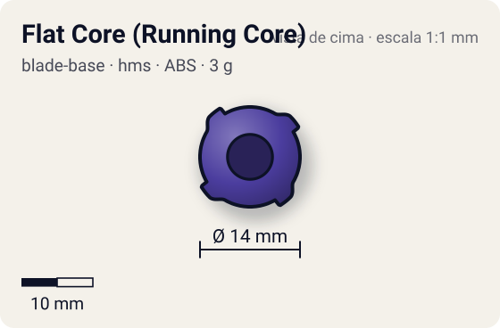
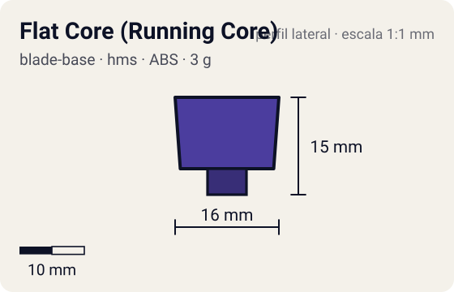

# Flat Core (Running Core)

<!-- auto:inicio (gerado por npm run build:research; não edite este bloco) -->
 

| Medidas e material | |
|---|---|
| Diâmetro | 14 estimado mm |
| Altura / espessura | 15 estimado mm |
| Peso | 3 estimado g |
| Material | ABS (opaco) |
| Estrelas Takara (A / D / S) | 3 / 1 / 1 |
<!-- auto:fim -->

Blade Base · sistema **hms**

## Formato
Running Core do HMS (substitui Spin Gear + Blade Base): cilindro roxo com quatro abas laterais de encaixe e ponta escalonada terminando num flat largo.

## Função em batalha
Primeiro Running Core lançado; ponta flat de ataque com movimento decente, depois superada por Grip Flat Core e Metal Flat Core.

## Gimmick: como funciona
1. Sem gimmick: o core encaixa por baixo do Attack Ring/Weight Disk do HMS pelas abas laterais e a ponta flat toca o piso.

## Padrão de movimento no estádio
Flat: percorre o estádio em órbita/flower rápido, buscando contato. (`padrao_movimento`: agressivo; ponta flat, atrito de referência 0,5.)

## Beys que usam
- `daichi-sumeragi/gaia-dragoon-ms` ([ficha](../../../personagens/daichi-sumeragi/beyblades/gaia-dragoon-ms/README.md))

## Medidas, material e stats
| Item | Valor | Fonte |
|---|---|---|
| Diâmetro | 14 mm | estimado |
| Altura (com ponta) | 15 mm | estimado |
| Peso | 3 g | estimado |
| Material | ABS | Running Core inteiro de plástico, ponta flat do mesmo material. |
| Ponta | flat, raio 3 mm | estimado (tipo pela wiki/ficha da bey) |
| Ataque / Defesa / Stamina | 3 / 1 / 1 | Beyblade Wiki, Part Infobox (EnduranceStat = stamina) |
| Cores | primária #4b3d9e, secundária #3a2f80, detalhe #6a5cc0 | foto local running-core.jpg |

## Referências locais
- [referencia/gaia-dragoon-ms-running-core.jpg](referencia/gaia-dragoon-ms-running-core.jpg) (cópia de `personagens/daichi-sumeragi/beyblades/gaia-dragoon-ms/pecas/running-core.jpg`)
- [referencia/gaia-dragoon-ms-montada-inferior.jpg](referencia/gaia-dragoon-ms-montada-inferior.jpg) (cópia de `personagens/daichi-sumeragi/beyblades/gaia-dragoon-ms/pecas/montada-inferior.jpg`)

## Notas e incertezas
- No HMS não existe Blade Base: o Running Core cumpre o papel. Catalogado aqui porque veio na chave blade_base; o agente de Spin Gears pode ter ficha do mesmo core (coordenar para não duplicar).
- Peso não informado na wiki; 3 g por analogia ao Manual Change Core (3 g, wiki).

## Fontes
- https://beyblade.fandom.com/wiki/Running_Core_-_Flat_Core
- `pesquisa-bakuten/personagens/daichi-sumeragi/beyblades/gaia-dragoon-ms/dados.json`
