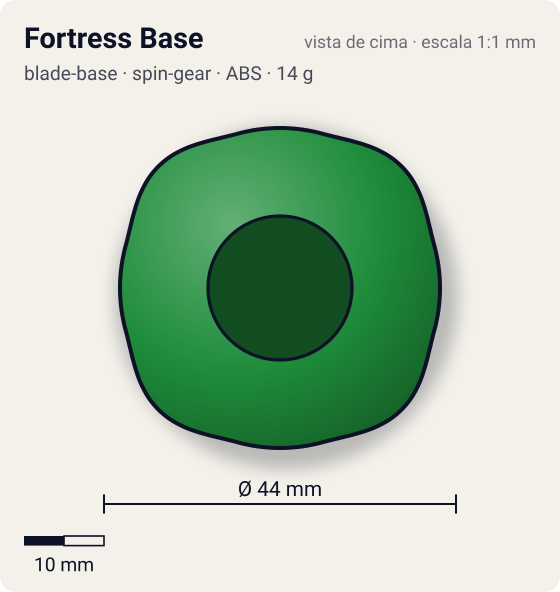
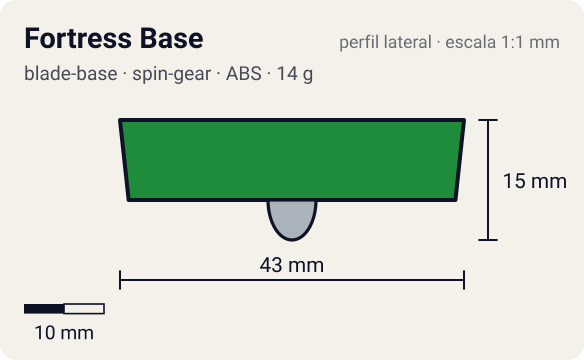

# Fortress Base

<!-- auto:inicio (gerado por npm run build:research; não edite este bloco) -->
 

| Medidas e material | |
|---|---|
| Diâmetro | 44 estimado mm |
| Altura / espessura | 15 estimado mm |
| Peso | 14 wiki g |
| Material | ABS + Aço (2 esferas de estoque, cabe até 6) + Metal (ponta bola do SG Oil Ball) (opaco) |
| Estrelas Takara (A / D / S) | 1 / 3,5 / 3,5 |
| Usada em | [Draciel F](../../../personagens/max-tate/beyblades/draciel-f/) |
<!-- auto:fim -->

Blade Base · sistema **spin-gear**

## Formato
Base verde larga e escalonada, com bolsões internos para até dois jogos de esferas de metal e dois furos extras; aceita SGs de rolamento.

## Função em batalha
Uma das melhores bases de defesa: a ponta de bola metálica lubrificada fica no centro e o peso extra das esferas impede que seja empurrada.

## Gimmick: como funciona
1. As esferas de metal entram nos bolsões da base (1 jogo de fábrica = 14 g; até 18 g com 3 jogos).
2. O Right SG (Oil Ball) traz a ponta de bola de metal com um reservatório de óleo logo acima.
3. O óleo reduz o atrito da bola no piso, prolongando o giro.
4. A massa extra perto da borda aumenta a inércia e reduz o recuo nos impactos.

## Padrão de movimento no estádio
Fica no centro do estádio, girando estável e absorvendo golpes. (`padrao_movimento`: centro; ponta metal-ball, atrito de referência 0,18; a ponta vem de: spin-gear (Right SG Oil Ball / Ball Bearing ver.).)

## Beys que usam
- `max-tate/draciel-f` ([ficha](../../../personagens/max-tate/beyblades/draciel-f/README.md))

## Medidas, material e stats
| Item | Valor | Fonte |
|---|---|---|
| Diâmetro | 44 mm | estimado |
| Altura (com ponta) | 15 mm | estimado |
| Peso | 14 g | wiki |
| Material | ABS + Aço (2 esferas de estoque, cabe até 6), Metal (ponta bola do SG Oil Ball) | Ponta de bola de metal com reservatório de óleo (graxa vem no kit Takara). |
| Ponta | metal-ball, raio 3 mm | estimado (tipo pela wiki/ficha da bey) |
| Ataque / Defesa / Stamina | 1 / 4 / 4 | Beyblade Wiki, Part Infobox (Fortress) |
| Cores | primária #1e8c3a, secundária #0f5a24, detalhe #c0c0c0 | diagrama local blade-base.gif |

## Referências locais
- [referencia/draciel-f-blade-base.gif](referencia/draciel-f-blade-base.gif) (cópia de `personagens/max-tate/beyblades/draciel-f/pecas/blade-base.gif`)
- [referencia/draciel-f-pecas-desmontadas.jpg](referencia/draciel-f-pecas-desmontadas.jpg) (cópia de `personagens/max-tate/beyblades/draciel-f/pecas/pecas-desmontadas.jpg`)

## Notas e incertezas
- Peso: 12 g só a base; 14 g com o jogo de esferas original (valor adotado); 16 g e 18 g com 2 e 3 jogos (wiki). WBO só permite 1 jogo.

## Fontes
- https://beyblade.fandom.com/wiki/Blade_Base_-_Fortress
- `pesquisa-bakuten/personagens/max-tate/beyblades/draciel-f/dados.json`
