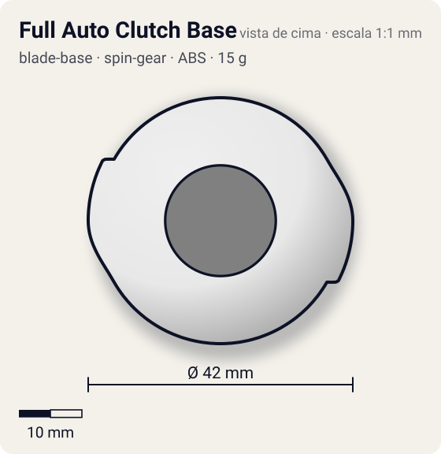
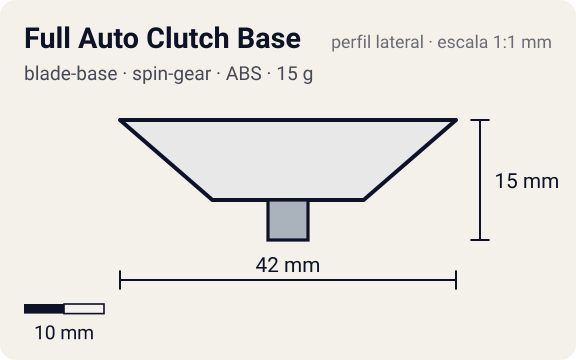

# Full Auto Clutch Base

<!-- auto:inicio (gerado por npm run build:research; não edite este bloco) -->
 

| Medidas e material | |
|---|---|
| Diâmetro | 42 estimado mm |
| Altura / espessura | 15 estimado mm |
| Peso | 15 wiki g |
| Material | ABS + Molas de aço (2) + Clipes metálicos (2) + Metal (eixo/ponta flat do SG) (opaco) |
| Estrelas Takara (A / D / S) | 3,5 / 1 / 3 |
| Usada em | [Driger F](../../../personagens/ray-kon/beyblades/driger-f/) |
<!-- auto:fim -->

Blade Base · sistema **spin-gear**

## Formato
Base pesada (15 g) que só aceita o Right SG (Full Auto Clutch Version); tem duas molas travadas por dois clipes metálicos.

## Função em batalha
Embreagem automática que muda o comportamento da ponta durante a batalha. Muito desbalanceada no brinquedo, sem uso competitivo.

## Gimmick: como funciona
1. O SG Full Auto Clutch encaixa na base; o eixo metálico com ponta flat atravessa o centro.
2. No lançamento, a rotação alta abre os clipes metálicos contra as molas (força centrífuga) e o eixo fica solto: a bey poupa rotação.
3. Quando a RPM cai, as molas vencem e fecham os clipes sobre o eixo.
4. Com o eixo travado, a ponta metal flat passa a tracionar e a bey parte para o ataque.

| Modo | Ponta | Atrito | Gatilho |
|---|---|---|---|
| Eixo livre (alta RPM) | metal-flat | 0,4 | automático: em alta rotação os clipes metálicos abrem por força centrífuga e o eixo gira solto |
| Eixo travado (baixa RPM) | metal-flat | 0,4 | automático: com RPM baixa as molas fecham os clipes e o eixo trava, a ponta passa a "puxar" a bey |

## Padrão de movimento no estádio
Começa mais contida e fica agressiva no fim; o desequilíbrio da base gera trepidação. (`padrao_movimento`: agressivo; ponta metal-flat, atrito de referência 0,4; a ponta vem de: spin-gear (Right SG Full Auto Clutch Version).)

## Beys que usam
- `ray-kon/driger-f` ([ficha](../../../personagens/ray-kon/beyblades/driger-f/README.md))

## Medidas, material e stats
| Item | Valor | Fonte |
|---|---|---|
| Diâmetro | 42 mm | estimado |
| Altura (com ponta) | 15 mm | estimado |
| Peso | 15 g | wiki |
| Material | ABS + Molas de aço (2), Clipes metálicos (2), Metal (eixo/ponta flat do SG) | A ponta é o eixo metálico do Right SG (Full Auto Clutch Version). |
| Ponta | metal-flat, raio 2,5 mm | estimado (tipo pela wiki/ficha da bey) |
| Ataque / Defesa / Stamina | sem stats oficiais | — |
| Cores | primária #e8e8e8, secundária #2e8b3a, detalhe #9a9ea3 | estimado (sem foto local) |

## Referências locais
- Nenhuma foto local desta peça no repositório.

## Notas e incertezas
- A wiki só descreve molas, clipes e peso. A sequência livre -> travado é da comunidade (comparação da wiki com Final Survive/Generate) e não está confirmada em detalhe.
- Cores estimadas.

## Fontes
- https://beyblade.fandom.com/wiki/Blade_Base_-_Full_Auto_Clutch_Base
- `pesquisa-bakuten/personagens/ray-kon/beyblades/driger-f/dados.json`
