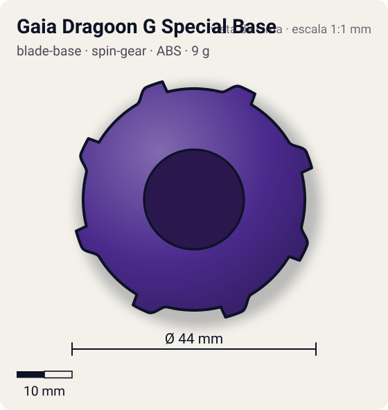
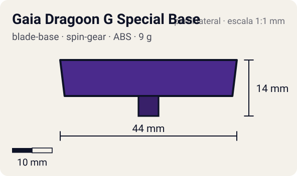

# Gaia Dragoon G Special Base

<!-- auto:inicio (gerado por npm run build:research; não edite este bloco) -->
 

| Medidas e material | |
|---|---|
| Diâmetro | 44 estimado mm |
| Altura / espessura | 14 estimado mm |
| Peso | 9 estimado g |
| Material | ABS + Aço (4 esferas) + Plástico translúcido amarelo (ponta) (opaco) |
| Estrelas Takara (A / D / S) | 4 / 2 / 0,5 |
| Usada em | [Gaia Dragoon (Strata Dragoon)](../../../personagens/daichi-sumeragi/beyblades/gaia-dragoon/) |
<!-- auto:fim -->

Blade Base · sistema **spin-gear**

## Formato
Base roxa, redonda, com oito abas retangulares na borda (duas são os clipes do SG) e quatro torres salientes nas diagonais, cada uma com uma esfera metálica. Ponta flat curta, amarela translúcida, no centro de um cone escalonado.

## Função em batalha
Ponta flat de ataque com peso extra das esferas. Na prática as torres que seguram as esferas raspam no estádio e a base é instável.

## Gimmick: como funciona
1. As quatro esferas de metal ficam em alojamentos nas diagonais da base.
2. O núcleo "G Ball" do Spin Gear encaixa por cima e trava as esferas no lugar.
3. O peso das esferas fica afastado do centro, aumentando a inércia; mas as torres sobressaem por baixo e encostam no piso quando a bey inclina.

## Padrão de movimento no estádio
Flat sem muita velocidade: anda pelo estádio de forma irregular e, quando inclina, as torres raspam e freiam a bey (movimento errático). (`padrao_movimento`: erratico; ponta flat, atrito de referência 0,5.)

## Beys que usam
- `daichi-sumeragi/gaia-dragoon` ([ficha](../../../personagens/daichi-sumeragi/beyblades/gaia-dragoon/README.md))

## Medidas, material e stats
| Item | Valor | Fonte |
|---|---|---|
| Diâmetro | 44 mm | estimado |
| Altura (com ponta) | 14 mm | estimado |
| Peso | 9 g | estimado |
| Material | ABS + Aço (4 esferas), Plástico translúcido amarelo (ponta) | Quatro esferas metálicas presas por baixo do núcleo G Ball do Spin Gear; ponta flat de plástico translúcido amarelo. |
| Ponta | flat, raio 2,5 mm | estimado (tipo pela wiki/ficha da bey) |
| Ataque / Defesa / Stamina | sem stats oficiais | — |
| Cores | primária #4a2a8c, secundária #bfc3c8, detalhe #e6c24a | fotos locais blade-base.jpg e blade-base-lateral.jpg |

## Referências locais
- [referencia/gaia-dragoon-blade-base.jpg](referencia/gaia-dragoon-blade-base.jpg) (cópia de `personagens/daichi-sumeragi/beyblades/gaia-dragoon/pecas/blade-base.jpg`)
- [referencia/gaia-dragoon-blade-base-lateral.jpg](referencia/gaia-dragoon-blade-base-lateral.jpg) (cópia de `personagens/daichi-sumeragi/beyblades/gaia-dragoon/pecas/blade-base-lateral.jpg`)
- [referencia/gaia-dragoon-montada-inferior.jpg](referencia/gaia-dragoon-montada-inferior.jpg) (cópia de `personagens/daichi-sumeragi/beyblades/gaia-dragoon/pecas/montada-inferior.jpg`)

## Notas e incertezas
- A wiki chama a página de "G Special Base"; o nome na infobox é "Gaia Dragoon G Special Base".
- Peso não informado na wiki: estimado considerando as 4 esferas.

## Fontes
- https://beyblade.fandom.com/wiki/Blade_Base_-_G_Special_Base
- `pesquisa-bakuten/personagens/daichi-sumeragi/beyblades/gaia-dragoon/dados.json`
