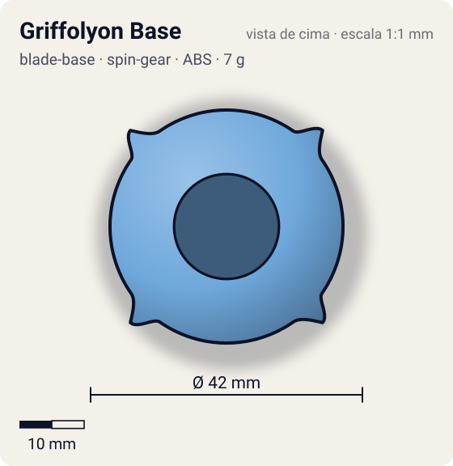
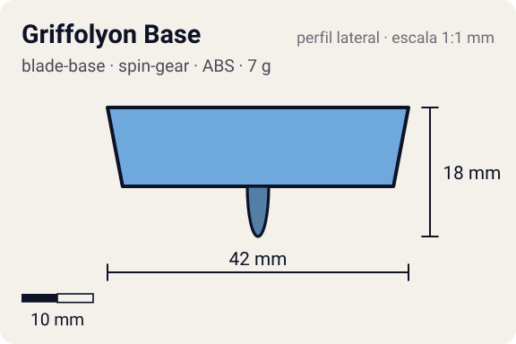

# Griffolyon Base

<!-- auto:inicio (gerado por npm run build:research; não edite este bloco) -->
 

| Medidas e material | |
|---|---|
| Diâmetro | 42 estimado mm |
| Altura / espessura | 18 estimado mm |
| Peso | 7 estimado g |
| Material | ABS (opaco) |
| Estrelas Takara (A / D / S) | 3 / 2,5 / 1 |
| Usada em | [Griffolyon](../../../personagens/robert-jurgen/beyblades/griffolyon/) |
<!-- auto:fim -->

Blade Base · sistema **spin-gear**

## Formato
Base azul-clara com Spin Gear integrado (como as 4-layer), quatro hastes cônicas verticais para a figura Hidden Spirit e ponta alta, estreita e arredondada num cilindro que gira um pouco solto.

## Função em batalha
Candidata a "pior base da geração plástica": pouca movimentação, sem defesa, equilíbrio ruim e as hastes raspam e geram recoil.

## Gimmick: como funciona
1. A ponta não é fixa na base: fica num cilindro dentro do eixo, que pode girar um pouco.
2. O atrito plástico-plástico limita esse giro livre.
3. As hastes da figura descem e saem do contorno: quando a bey inclina, raspam no piso e freiam.

## Padrão de movimento no estádio
Errático: perde o equilíbrio cedo e é jogada para fora com facilidade. (`padrao_movimento`: erratico; ponta ball, atrito de referência 0,25.)

## Beys que usam
- `robert-jurgen/griffolyon` ([ficha](../../../personagens/robert-jurgen/beyblades/griffolyon/README.md))

## Medidas, material e stats
| Item | Valor | Fonte |
|---|---|---|
| Diâmetro | 42 mm | estimado |
| Altura (com ponta) | 18 mm | estimado |
| Peso | 7 g | estimado |
| Material | ABS | SG integrado; ponta plástica presa a um cilindro com giro livre limitado (plástico com plástico). |
| Ponta | ball, raio 1,5 mm | estimado (tipo pela wiki/ficha da bey) |
| Ataque / Defesa / Stamina | 3 / 3 / 1 | Beyblade Wiki, Part Infobox (Griffolyon Base) |
| Cores | primária #6fa8dc, secundária #4f86c0, detalhe #8a8f96 | foto local blade-base.jpg |

## Referências locais
- [referencia/griffolyon-blade-base.jpg](referencia/griffolyon-blade-base.jpg) (cópia de `personagens/robert-jurgen/beyblades/griffolyon/pecas/blade-base.jpg`)
- [referencia/griffolyon-pecas-desmontadas.jpg](referencia/griffolyon-pecas-desmontadas.jpg) (cópia de `personagens/robert-jurgen/beyblades/griffolyon/pecas/pecas-desmontadas.jpg`)

## Notas e incertezas
- Hasbro removeu as hastes (os pés continuam). Ilegal na WBO.
- Peso não informado: estimado.

## Fontes
- https://beyblade.fandom.com/wiki/Blade_Base_-_Griffolyon_Base
- `pesquisa-bakuten/personagens/robert-jurgen/beyblades/griffolyon/dados.json`
