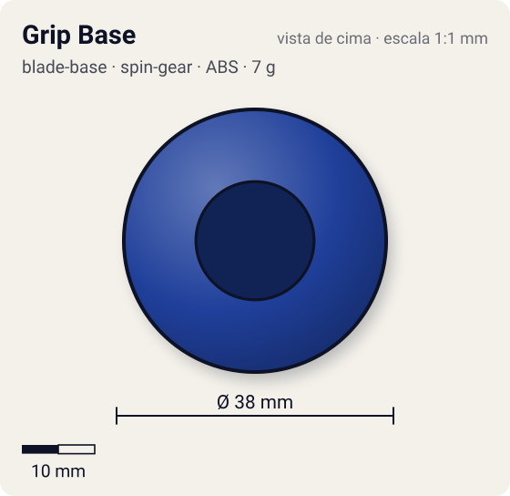
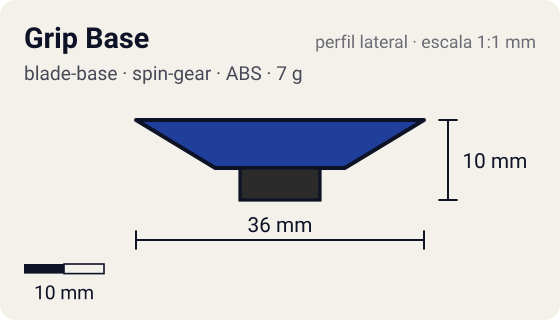

# Grip Base

<!-- auto:inicio (gerado por npm run build:research; não edite este bloco) -->
 

| Medidas e material | |
|---|---|
| Diâmetro | 38 estimado mm |
| Altura / espessura | 10 estimado mm |
| Peso | 7 wiki g |
| Material | ABS + Borracha (ponta flat larga) (opaco) |
| Estrelas Takara (A / D / S) | 4 / 1 / 0,5 |
| Usada em | [Dragoon Grip Attacker](../../../personagens/tyson-granger/beyblades/dragoon-grip-attacker/) |
<!-- auto:fim -->

Blade Base · sistema **spin-gear**

## Formato
Base muito baixa com ponta de borracha flat extremamente larga.

## Função em batalha
Uma das bases mais rápidas de todos os tempos, ótima para smash e upper; stamina muito curta e só funciona em rotação direita.

## Gimmick: como funciona
1. Sem gimmick: a borracha larga dá tração máxima contra o piso.

## Padrão de movimento no estádio
Agressivo ao extremo: flower muito rápido pela borda. (`padrao_movimento`: agressivo; ponta grip, atrito de referência 0,85.)

## Beys que usam
- `tyson-granger/dragoon-grip-attacker` ([ficha](../../../personagens/tyson-granger/beyblades/dragoon-grip-attacker/README.md))

## Medidas, material e stats
| Item | Valor | Fonte |
|---|---|---|
| Diâmetro | 38 mm | estimado |
| Altura (com ponta) | 10 mm | estimado |
| Peso | 7 g | wiki |
| Material | ABS + Borracha (ponta flat larga) | — |
| Ponta | grip, raio 5 mm | estimado (tipo pela wiki/ficha da bey) |
| Ataque / Defesa / Stamina | sem stats oficiais | — |
| Cores | primária #1f3f9a, secundária #1a1a1a, detalhe #c0c0c0 | estimado (sem foto local) |

## Referências locais
- Nenhuma foto local desta peça no repositório.

## Notas e incertezas
- Cores estimadas.

## Fontes
- https://beyblade.fandom.com/wiki/Blade_Base_-_Grip
- `pesquisa-bakuten/personagens/tyson-granger/beyblades/dragoon-grip-attacker/dados.json`
