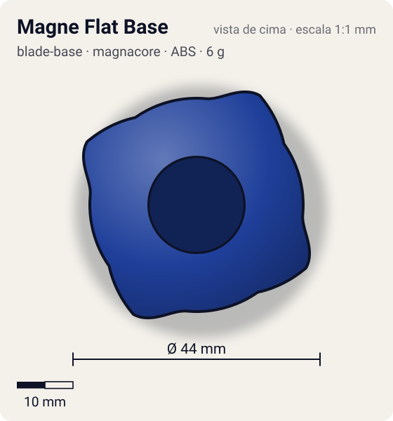
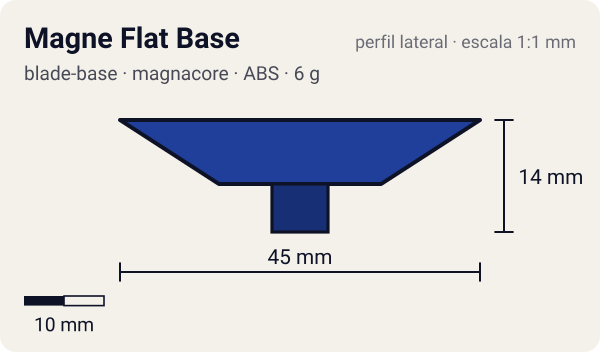

# Magne Flat Base

<!-- auto:inicio (gerado por npm run build:research; não edite este bloco) -->
 

| Medidas e material | |
|---|---|
| Diâmetro | 44 estimado mm |
| Altura / espessura | 14 estimado mm |
| Peso | 6 estimado g |
| Material | ABS + Ímã (na ponta) (opaco) |
| Estrelas Takara (A / D / S) | 3 / 1 / 1 |
| Usada em | [Dragoon V (Dragoon Victory)](../../../personagens/tyson-granger/beyblades/dragoon-v/) |
<!-- auto:fim -->

Blade Base · sistema **magnacore**

## Formato
Base com quatro asas saindo do topo (para smash em rotação esquerda) e ponta flat de plástico com ímã.

## Função em batalha
Flat rápido que dura mais que borracha, mas é menos veloz e controlável. O ímã foi o "gimmick" de marketing no lugar da borracha.

## Gimmick: como funciona
1. O Neo Left SG encaixa por cima.
2. O ímã da ponta é atraído/repelido pelos ímãs do estádio Magnacore, desviando a trajetória.

## Padrão de movimento no estádio
Flower rápido; as asas causam recoil nos choques. (`padrao_movimento`: agressivo; ponta flat, atrito de referência 0,5.)

## Beys que usam
- `tyson-granger/dragoon-v` ([ficha](../../../personagens/tyson-granger/beyblades/dragoon-v/README.md))

## Medidas, material e stats
| Item | Valor | Fonte |
|---|---|---|
| Diâmetro | 44 mm | estimado |
| Altura (com ponta) | 14 mm | estimado |
| Peso | 6 g | estimado |
| Material | ABS + Ímã (na ponta) | Ponta flat de plástico duro com ímã embutido. |
| Ponta | flat, raio 3,5 mm | estimado (tipo pela wiki/ficha da bey) |
| Ataque / Defesa / Stamina | 3 / 1 / 1 | Beyblade Wiki, Part Infobox (Magne Flat Base) |
| Cores | primária #1f3f9a, secundária #f2f2f2, detalhe #c8102e | estimado (sem foto local) |

## Referências locais
- Nenhuma foto local desta peça no repositório.

## Notas e incertezas
- Peso não informado na wiki: estimado.
- Cores estimadas.

## Fontes
- https://beyblade.fandom.com/wiki/Blade_Base_-_Magne_Flat_Base
- `pesquisa-bakuten/personagens/tyson-granger/beyblades/dragoon-v/dados.json`
