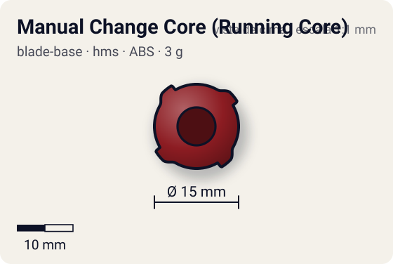
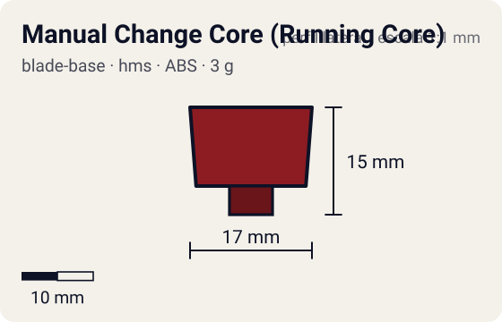

# Manual Change Core (Running Core)

<!-- auto:inicio (gerado por npm run build:research; não edite este bloco) -->
 

| Medidas e material | |
|---|---|
| Diâmetro | 15 estimado mm |
| Altura / espessura | 15 estimado mm |
| Peso | 3 wiki g |
| Material | ABS (opaco) |
| Estrelas Takara (A / D / S) | 3 / 1 / 3 |
<!-- auto:fim -->

Blade Base · sistema **hms**

## Formato
Running Core do HMS com ponta de duas posições: uma mais larga (Attack) e uma aguda (Endurance).

## Função em batalha
Escolher entre ataque e resistência sem trocar peças. Takara tem problemas de equilíbrio em baixa rotação; Hasbro usa ponta semi-flat, mais estável mas com menos stamina.

## Gimmick: como funciona
1. Antes da batalha, ajusta-se o core para expor a ponta larga (Attack) ou a aguda (Endurance).
2. A ponta fica travada na posição escolhida durante toda a batalha.
3. Na Hasbro não há troca efetiva: ponta semi-flat única.

| Modo | Ponta | Atrito | Gatilho |
|---|---|---|---|
| Attack Mode | flat | 0,5 | manual: girar/ajustar o core antes do lançamento |
| Endurance Mode | sharp | 0,1 | manual: girar/ajustar o core antes do lançamento |

## Padrão de movimento no estádio
Attack: velocidade alta demais, costuma sair do estádio sozinha. Endurance: fica girando no centro. (`padrao_movimento`: agressivo; ponta flat, atrito de referência 0,5.)

## Beys que usam
- `kai-hiwatari/dranzer-ms` ([ficha](../../../personagens/kai-hiwatari/beyblades/dranzer-ms/README.md))

## Medidas, material e stats
| Item | Valor | Fonte |
|---|---|---|
| Diâmetro | 15 mm | estimado |
| Altura (com ponta) | 15 mm | estimado |
| Peso | 3 g | wiki |
| Material | ABS | Takara: ponta de plástico com duas posições; Hasbro: ponta semi-flat fixa (outro molde, mais largo e plano nos primeiros lotes). |
| Ponta | flat, raio 3 mm | estimado (tipo pela wiki/ficha da bey) |
| Ataque / Defesa / Stamina | 3 / 1 / 3 | Beyblade Wiki, Part Infobox (EnduranceStat = stamina) |
| Cores | primária #8c1c22, secundária #1a1a1a, detalhe #d0d0d0 | estimado (sem foto local) |

## Referências locais
- Nenhuma foto local desta peça no repositório.

## Notas e incertezas
- HMS não tem Blade Base: catalogado aqui por vir na chave blade_base. O agente de Spin Gears também recebeu "Manual Change Core (Running Core)" na chave spin_gear: coordenar para não duplicar.
- Ponta exata do modo Attack (flat larga) é estimativa a partir da descrição da wiki.

## Fontes
- https://beyblade.fandom.com/wiki/Running_Core_-_Manual_Change_Core
- `pesquisa-bakuten/personagens/kai-hiwatari/beyblades/dranzer-ms/dados.json`
