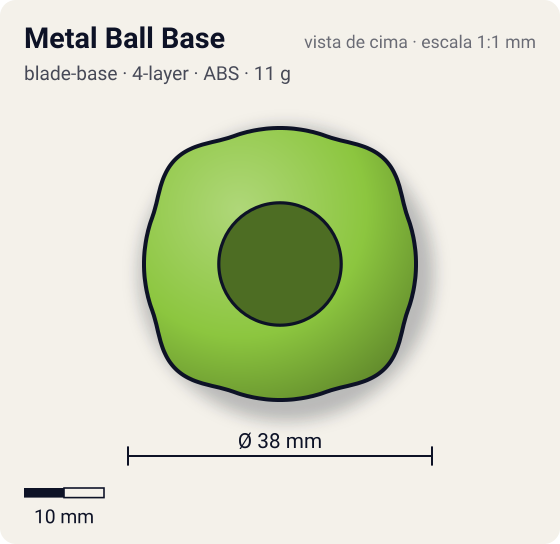
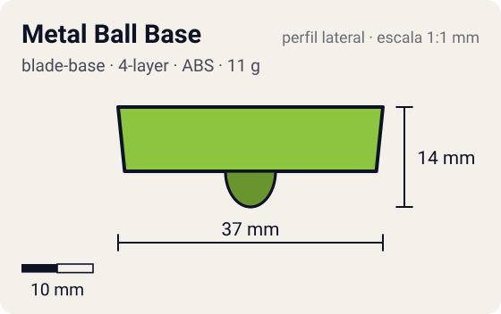

# Metal Ball Base

<!-- auto:inicio (gerado por npm run build:research; não edite este bloco) -->
 

| Medidas e material | |
|---|---|
| Diâmetro | 38 estimado mm |
| Altura / espessura | 14 estimado mm |
| Peso | 11 wiki g |
| Material | ABS + Aço (2 esferas de estoque) + Parafuso metálico (opaco) |
| Estrelas Takara (A / D / S) | 1 / 3 / 3 |
| Usada em | [Draciel Metal Ball Defenser](../../../personagens/max-tate/beyblades/draciel-metal-ball-defenser/) |
<!-- auto:fim -->

Blade Base · sistema **4-layer**

## Formato
Base verde-clara de rosca, herança do sistema 4-layer, compacta, com compartimento interno de esferas sobre rampas e ponta de bola.

## Função em batalha
Base de defesa sólida e pequena; o peso das esferas (até 2 jogos) ajuda contra KO e serve em combinações compactas.

## Gimmick: como funciona
1. As esferas ficam num compartimento com rampas que sobem em direção à borda (afrouxa-se o parafuso para colocar mais).
2. Em alta rotação, a força centrífuga empurra as esferas rampa acima: peso na periferia = mais estabilidade.
3. Quando a rotação cai, a gravidade vence e as esferas descem para o centro: a bey gira mais tempo, mas fica menos estável.
4. As rampas são rasas, então qualquer giro já leva as esferas para fora.

| Modo | Ponta | Atrito | Gatilho |
|---|---|---|---|
| Alta rotação: esferas na periferia | ball | 0,25 | automático: força centrífuga faz as esferas subirem as rampas |
| Baixa rotação: esferas no centro | ball | 0,25 | automático: com a RPM baixa a gravidade traz as esferas de volta |

## Padrão de movimento no estádio
Parada no centro durante a maior parte da batalha. (`padrao_movimento`: centro; ponta ball, atrito de referência 0,25.)

## Beys que usam
- `max-tate/draciel-metal-ball-defenser` ([ficha](../../../personagens/max-tate/beyblades/draciel-metal-ball-defenser/README.md))

## Medidas, material e stats
| Item | Valor | Fonte |
|---|---|---|
| Diâmetro | 38 mm | estimado |
| Altura (com ponta) | 14 mm | estimado |
| Peso | 11 g | wiki |
| Material | ABS + Aço (2 esferas de estoque), Parafuso metálico | Base de rosca (4-layer); ponta de bola plástica. |
| Ponta | ball, raio 3,5 mm | estimado (tipo pela wiki/ficha da bey) |
| Ataque / Defesa / Stamina | sem stats oficiais | — |
| Cores | primária #8cc63f, secundária #4f8a1e, detalhe #c0c0c0 | diagrama local blade-base.gif |

## Referências locais
- [referencia/draciel-metal-ball-defenser-blade-base.gif](referencia/draciel-metal-ball-defenser-blade-base.gif) (cópia de `personagens/max-tate/beyblades/draciel-metal-ball-defenser/pecas/blade-base.gif`)
- [referencia/draciel-metal-ball-defenser-pecas-desmontadas.jpg](referencia/draciel-metal-ball-defenser-pecas-desmontadas.jpg) (cópia de `personagens/max-tate/beyblades/draciel-metal-ball-defenser/pecas/pecas-desmontadas.jpg`)

## Notas e incertezas
- Peso: 9 g só a base, 11 g com o jogo original (adotado), 13 g com 2 jogos (wiki).
- Ponta de bola plástica: estimado pelo padrão 4-layer (wiki só diz "ponta de bola").

## Fontes
- https://beyblade.fandom.com/wiki/Blade_Base_-_Metal_Ball_Base
- `pesquisa-bakuten/personagens/max-tate/beyblades/draciel-metal-ball-defenser/dados.json`
