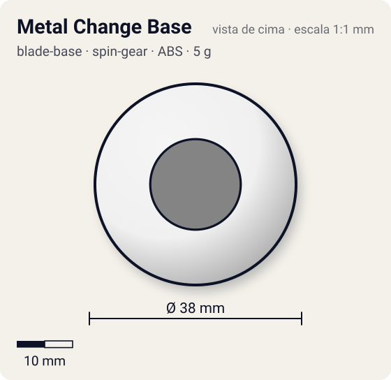
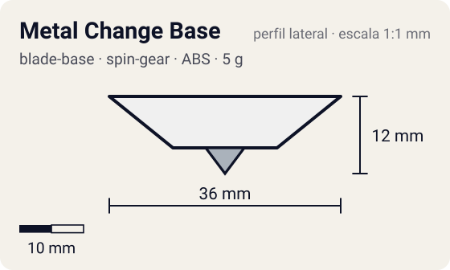

# Metal Change Base

<!-- auto:inicio (gerado por npm run build:research; não edite este bloco) -->
 

| Medidas e material | |
|---|---|
| Diâmetro | 38 estimado mm |
| Altura / espessura | 12 estimado mm |
| Peso | 5 wiki g |
| Material | ABS + Metal (ponta) (opaco) |
| Estrelas Takara (A / D / S) | 3 / 1 / 3 |
| Usada em | [Driger S](../../../personagens/ray-kon/beyblades/driger-s/) |
<!-- auto:fim -->

Blade Base · sistema **spin-gear**

## Formato
Base pequena, redonda e baixa, com ponta de metal larga: aguda exatamente no centro e plana na maior parte.

## Função em batalha
Mistura ataque e sobrevivência na mesma ponta. Excelente em combos compactos.

## Gimmick: como funciona
1. Lançada reta, a bey apoia no ponto agudo do centro: pouco atrito, gira no lugar (sobrevivência).
2. Lançada inclinada (ou tombada por um golpe), apoia na parte plana: atrito maior, anda rápido e ataca.
3. Ao recuperar o equilíbrio volta a apoiar no centro: alterna sozinha entre os modos.

| Modo | Ponta | Atrito | Gatilho |
|---|---|---|---|
| Survival (reta) | metal-sharp | 0,08 | inclinação: bey de pé apoia no centro agudo da ponta |
| Attack (inclinada) | metal-flat | 0,4 | inclinação: lançamento inclinado ou golpe que tomba a bey apoia na parte plana |

## Padrão de movimento no estádio
Reta: centro. Inclinada/sliding shoot: varre o centro do estádio alternando ataque e sobrevivência. (`padrao_movimento`: centro; ponta metal-sharp, atrito de referência 0,08.)

## Beys que usam
- `ray-kon/driger-s` ([ficha](../../../personagens/ray-kon/beyblades/driger-s/README.md))

## Medidas, material e stats
| Item | Valor | Fonte |
|---|---|---|
| Diâmetro | 38 mm | estimado |
| Altura (com ponta) | 12 mm | estimado |
| Peso | 5 g | wiki |
| Material | ABS + Metal (ponta) | Ponta metálica larga, aguda no centro e plana em volta. |
| Ponta | metal-sharp, raio 3 mm | estimado (tipo pela wiki/ficha da bey) |
| Ataque / Defesa / Stamina | 3 / 1 / 3 | Beyblade Wiki, Part Infobox (Metal Change) |
| Cores | primária #f0f0f0, secundária #2e8b3a, detalhe #c0c0c0 | estimado (sem foto local) |

## Referências locais
- Nenhuma foto local desta peça no repositório.

## Notas e incertezas
- Trocar a ponta é ilegal em torneios WBO (wiki).
- Cores estimadas.

## Fontes
- https://beyblade.fandom.com/wiki/Blade_Base_-_Metal_Change
- `pesquisa-bakuten/personagens/ray-kon/beyblades/driger-s/dados.json`
