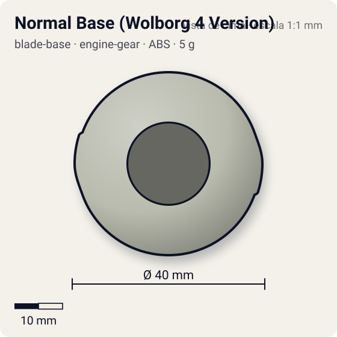
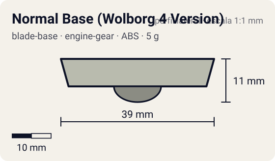

# Normal Base (Wolborg 4 Version)

<!-- auto:inicio (gerado por npm run build:research; não edite este bloco) -->
 

| Medidas e material | |
|---|---|
| Diâmetro | 40 estimado mm |
| Altura / espessura | 11 estimado mm |
| Peso | 5 wiki g |
| Material | ABS (opaco) |
| Estrelas Takara (A / D / S) | 1 / 1 / 1 |
| Usada em | [Wolborg 4](../../../personagens/tala/beyblades/wolborg-4/) |
<!-- auto:fim -->

Blade Base · sistema **engine-gear**

## Formato
Base cinza-esverdeada quase lisa e circular, com dois clipes que seguram o Engine Gear e furo central por onde passam os pinos do CEW; adesivo preto "BEYBLADE WOLBORG IV".

## Função em batalha
Estrutural: sem clutch. Mais baixa e leve que a Normal Base do Rock Bison, um pouco menos útil para defesa; boa em combos Circle Survivor.

## Gimmick: como funciona
1. Sem gimmick: o EG encaixa pelos dois clipes e o CEW Circle Survivor fica por baixo, sendo a ponta larga.
2. Sem trava de embreagem, o motor do EG gira desde o lançamento.

## Padrão de movimento no estádio
Ponta larga arredondada: fica no centro, resistindo e girando muito tempo. (`padrao_movimento`: centro; ponta ball, atrito de referência 0,25; a ponta vem de: engine-gear (Right EG com CEW Circle Survivor).)

## Beys que usam
- `tala/wolborg-4` ([ficha](../../../personagens/tala/beyblades/wolborg-4/README.md))

## Medidas, material e stats
| Item | Valor | Fonte |
|---|---|---|
| Diâmetro | 40 mm | estimado |
| Altura (com ponta) | 11 mm | estimado |
| Peso | 5 g | wiki |
| Material | ABS | Sem mola. A ponta é o CEW Circle Survivor do Engine Gear. |
| Ponta | ball, raio 6 mm | estimado (tipo pela wiki/ficha da bey) |
| Ataque / Defesa / Stamina | 1 / 1 / 1 | Beyblade Wiki, Part Infobox (Normal Base (Wolborg 4 Version)) |
| Cores | primária #b9bbae, secundária #1a1a1a, detalhe #ffffff | foto local blade-base.jpg |

## Referências locais
- [referencia/wolborg-4-blade-base.jpg](referencia/wolborg-4-blade-base.jpg) (cópia de `personagens/tala/beyblades/wolborg-4/pecas/blade-base.jpg`)
- [referencia/wolborg-4-blade-base-2.jpg](referencia/wolborg-4-blade-base-2.jpg) (cópia de `personagens/tala/beyblades/wolborg-4/pecas/blade-base-2.jpg`)

## Notas e incertezas
- Tipo de ponta "ball" larga é a do CEW Circle Survivor (ficha da bey); o agente de Spin Gears cataloga o EG/CEW.

## Fontes
- https://beyblade.fandom.com/wiki/Blade_Base_-_Normal_Base_(Wolborg_4_Version)
- `pesquisa-bakuten/personagens/tala/beyblades/wolborg-4/dados.json`
