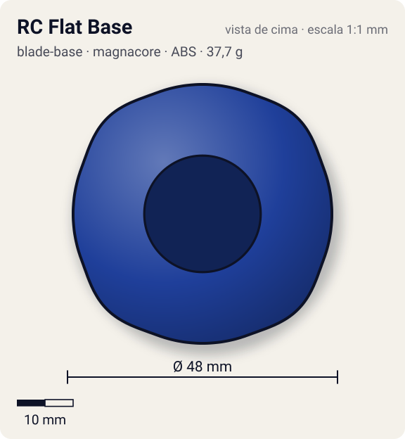
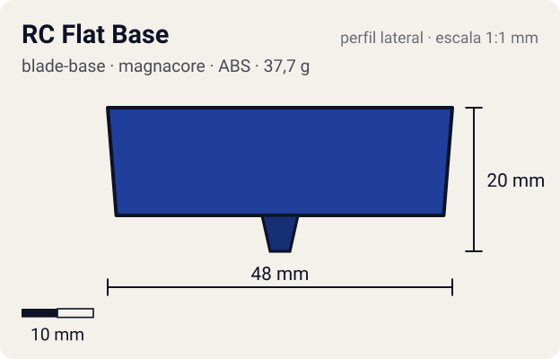

# RC Flat Base

<!-- auto:inicio (gerado por npm run build:research; não edite este bloco) -->
 

| Medidas e material | |
|---|---|
| Diâmetro | 48 estimado mm |
| Altura / espessura | 20 estimado mm |
| Peso | 37,7 wiki g |
| Material | ABS + Componentes internos do sistema RC (não detalhados) (opaco) |
| Estrelas Takara (A / D / S) | — |
| Usada em | [Dragoon V2 High Power Custom](../../../personagens/tyson-granger/beyblades/dragoon-v2-high-power-custom/) |
<!-- auto:fim -->

Blade Base · sistema **magnacore**

## Formato
Base larga e pesada (37,7 g) de rotação direita, com ponta semi-flat, feita para ser radiocontrolada pelo lançador próprio (linha RC Beyblade).

## Função em batalha
No brinquedo permite guiar a bey à distância. O peso muito maior dá muita inércia e pouca aceleração.

## Gimmick: como funciona
1. A bey é lançada com o lançador RC.
2. O jogador manda comandos pelo controle do lançador.
3. A base usa esses comandos para mudar a direção do movimento no estádio (detalhe interno não documentado).

| Modo | Ponta | Atrito | Gatilho |
|---|---|---|---|
| Rádio controlado | semi-flat | 0,3 | manual: comando remoto do lançador próprio durante a batalha |

## Padrão de movimento no estádio
Agressivo e guiado pelo jogador; na física do jogo, pesado e lento para acelerar. (`padrao_movimento`: agressivo; ponta semi-flat, atrito de referência 0,3.)

## Beys que usam
- `tyson-granger/dragoon-v2-high-power-custom` ([ficha](../../../personagens/tyson-granger/beyblades/dragoon-v2-high-power-custom/README.md))

## Medidas, material e stats
| Item | Valor | Fonte |
|---|---|---|
| Diâmetro | 48 mm | estimado |
| Altura (com ponta) | 20 mm | estimado |
| Peso | 37,7 g | wiki |
| Material | ABS + Componentes internos do sistema RC (não detalhados) | Ponta semi-flat amarela (Takara) ou branca (Hasbro). |
| Ponta | semi-flat, raio 2,5 mm | estimado (tipo pela wiki/ficha da bey) |
| Ataque / Defesa / Stamina | sem stats oficiais | — |
| Cores | primária #1f3f9a, secundária #1a1a1a, detalhe #c0c0c0 | estimado (sem foto local); ponta amarela segundo a wiki |

## Referências locais
- Nenhuma foto local desta peça no repositório.

## Notas e incertezas
- Sem página de peça na wiki; dados da página da bey.
- O peso de 37,7 g torna a bey muito mais pesada que as demais: provavelmente inclui a eletrônica (não confirmado).
- Rotação do brinquedo: direita (wiki); no anime a Dragoon é de rotação esquerda.

## Fontes
- https://beyblade.fandom.com/wiki/Dragoon_V2_High_Power_Custom
- https://beyblade.fandom.com/wiki/RC_Beyblade
- `pesquisa-bakuten/personagens/tyson-granger/beyblades/dragoon-v2-high-power-custom/dados.json`
