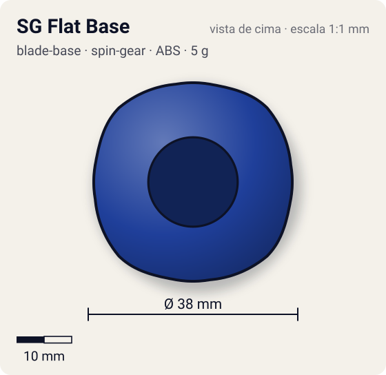
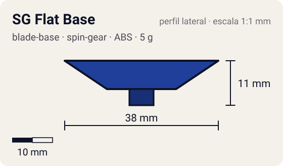

# SG Flat Base

<!-- auto:inicio (gerado por npm run build:research; não edite este bloco) -->
 

| Medidas e material | |
|---|---|
| Diâmetro | 38 estimado mm |
| Altura / espessura | 11 estimado mm |
| Peso | 5 wiki g |
| Material | ABS (opaco) |
| Estrelas Takara (A / D / S) | 3 / 2 / 1 |
| Usada em | [Master Dragoon (genérica, uso temporário)](../../../personagens/tyson-granger/beyblades/master-dragoon/) |
<!-- auto:fim -->

Blade Base · sistema **spin-gear** · também chamada: SG Flat

## Formato
Base baixa com ponta flat de plástico; sucessora da Flat Base das 4-layer.

## Função em batalha
Velocidade e altura baixa, boa para upper attack. Considerada ultrapassada pela Storm Grip e pela SG Metal Flat 2.

## Gimmick: como funciona
1. Sem gimmick: o Right SG encaixa por cima e a ponta flat é fixa.

## Padrão de movimento no estádio
Flower rápido pela borda. (`padrao_movimento`: agressivo; ponta flat, atrito de referência 0,5.)

## Beys que usam
- `tyson-granger/master-dragoon` ([ficha](../../../personagens/tyson-granger/beyblades/master-dragoon/README.md))

## Medidas, material e stats
| Item | Valor | Fonte |
|---|---|---|
| Diâmetro | 38 mm | estimado |
| Altura (com ponta) | 11 mm | estimado |
| Peso | 5 g | wiki |
| Material | ABS | Ponta flat de plástico. |
| Ponta | flat, raio 3 mm | estimado (tipo pela wiki/ficha da bey) |
| Ataque / Defesa / Stamina | sem stats oficiais | — |
| Cores | primária #1f3f9a, secundária #f2f2f2, detalhe #c0c0c0 | estimado (sem foto local) |

## Referências locais
- Nenhuma foto local desta peça no repositório.

## Notas e incertezas
- Usada em várias beys (Guardian Driger, Metal Dranzer, Galzzly, Kid Dragoon, Seaborg 2 etc.).
- Cores estimadas.

## Fontes
- https://beyblade.fandom.com/wiki/Blade_Base_-_SG_Flat_Base
- `pesquisa-bakuten/personagens/tyson-granger/beyblades/master-dragoon/dados.json`
