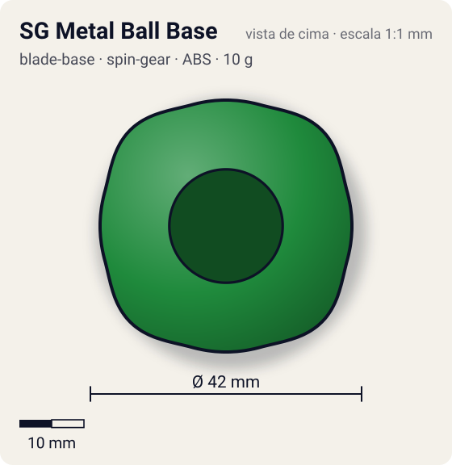
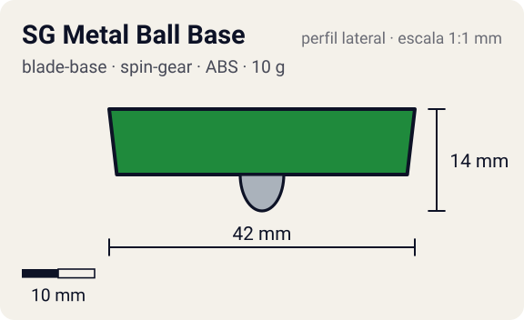

# SG Metal Ball Base

<!-- auto:inicio (gerado por npm run build:research; não edite este bloco) -->
 

| Medidas e material | |
|---|---|
| Diâmetro | 42 estimado mm |
| Altura / espessura | 14 estimado mm |
| Peso | 10 wiki g |
| Material | ABS + Aço (2 esferas de estoque) + Metal (ponta bola) (opaco) |
| Estrelas Takara (A / D / S) | 1 / 3 / 3,5 |
| Usada em | [Draciel S](../../../personagens/max-tate/beyblades/draciel-s/) |
<!-- auto:fim -->

Blade Base · sistema **spin-gear**

## Formato
Base verde escalonada com ponta de bola metálica e compartimento para até dois jogos de esferas; aceita Heavy Metal Core.

## Função em batalha
Uma das melhores bases de defesa: fica no centro e o peso extra compensa o baixo atrito da bola.

## Gimmick: como funciona
1. Coloca-se 1 ou 2 jogos de esferas no compartimento (8 g sem, 10 g com 1, 12 g com 2).
2. O SG encaixa por cima (pode levar Heavy Metal Core, passando de 20 g no total da base).
3. A bola metálica tem atrito baixo: a bey fica no centro e o peso segura os golpes.

## Padrão de movimento no estádio
Centro, girando estável. (`padrao_movimento`: centro; ponta metal-ball, atrito de referência 0,18.)

## Beys que usam
- `max-tate/draciel-s` ([ficha](../../../personagens/max-tate/beyblades/draciel-s/README.md))

## Medidas, material e stats
| Item | Valor | Fonte |
|---|---|---|
| Diâmetro | 42 mm | estimado |
| Altura (com ponta) | 14 mm | estimado |
| Peso | 10 g | wiki |
| Material | ABS + Aço (2 esferas de estoque), Metal (ponta bola) | Ponta de bola de metal. |
| Ponta | metal-ball, raio 3 mm | estimado (tipo pela wiki/ficha da bey) |
| Ataque / Defesa / Stamina | 1 / 3 / 4 | Beyblade Wiki, Part Infobox (SG Metal Ball) |
| Cores | primária #1f8a3c, secundária #0f5a24, detalhe #c0c0c0 | diagrama local blade-base.gif |

## Referências locais
- [referencia/draciel-s-blade-base.gif](referencia/draciel-s-blade-base.gif) (cópia de `personagens/max-tate/beyblades/draciel-s/pecas/blade-base.gif`)
- [referencia/draciel-s-pecas-desmontadas.jpg](referencia/draciel-s-pecas-desmontadas.jpg) (cópia de `personagens/max-tate/beyblades/draciel-s/pecas/pecas-desmontadas.jpg`)

## Notas e incertezas
- Peso adotado 10 g (com o jogo de esferas original).

## Fontes
- https://beyblade.fandom.com/wiki/Blade_Base_-_SG_Metal_Ball_Base
- `pesquisa-bakuten/personagens/max-tate/beyblades/draciel-s/dados.json`
