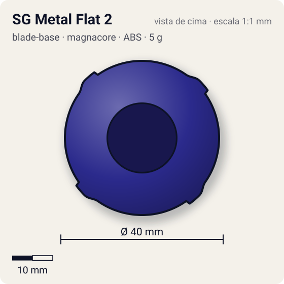
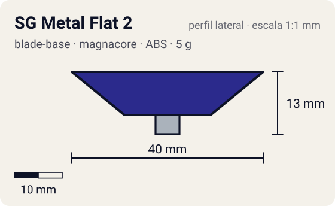

# SG Metal Flat 2

<!-- auto:inicio (gerado por npm run build:research; não edite este bloco) -->
 

| Medidas e material | |
|---|---|
| Diâmetro | 40 estimado mm |
| Altura / espessura | 13 estimado mm |
| Peso | 5 wiki g |
| Material | ABS + Metal (ponta flat) (opaco) |
| Estrelas Takara (A / D / S) | 4 / 1 / 1 |
| Usada em | [Gaia Dragoon V (Strata Dragoon V / Vast)](../../../personagens/daichi-sumeragi/beyblades/gaia-dragoon-v/) |
<!-- auto:fim -->

Blade Base · sistema **magnacore** · também chamada: SG Metal Flat Base (Gaia Dragoon V Version)

## Formato
Base azul-marinho, redonda e cônica, com saliências ovais em relevo no topo, dois clipes de SG e ponta flat de metal. Altura média para base de ataque.

## Função em batalha
Uma das melhores bases de ataque da era Magnacore: a ponta metálica tem menos atrito que borracha, então a bey anda rápido e ainda dura mais. Serve para smash e upper attack.

## Gimmick: como funciona
1. Sem gimmick móvel: o Neo SG encaixa por cima e a ponta flat metálica fica fixa no centro.

## Padrão de movimento no estádio
Agressivo: flower/órbita rápida pela borda do estádio; dura mais que bases grip. (`padrao_movimento`: agressivo; ponta metal-flat, atrito de referência 0,4.)

## Beys que usam
- `daichi-sumeragi/gaia-dragoon-v` ([ficha](../../../personagens/daichi-sumeragi/beyblades/gaia-dragoon-v/README.md))

## Medidas, material e stats
| Item | Valor | Fonte |
|---|---|---|
| Diâmetro | 40 mm | estimado |
| Altura (com ponta) | 13 mm | estimado |
| Peso | 5 g | wiki |
| Material | ABS + Metal (ponta flat) | Ponta flat metálica. |
| Ponta | metal-flat, raio 2,5 mm | estimado (tipo pela wiki/ficha da bey) |
| Ataque / Defesa / Stamina | 4 / 1 / 1 | Beyblade Wiki, Part Infobox (SG Metal Flat 2) |
| Cores | primária #2b2a8c, secundária #3b3aa6, detalhe #c9ccd1 | foto local blade-base.jpg |

## Referências locais
- [referencia/gaia-dragoon-v-blade-base.jpg](referencia/gaia-dragoon-v-blade-base.jpg) (cópia de `personagens/daichi-sumeragi/beyblades/gaia-dragoon-v/pecas/blade-base.jpg`)

## Notas e incertezas
- Segunda base com ponta metal flat, depois da SG Metal Flat Base (Driger V); 1 g mais pesada que a SG Flat.

## Fontes
- https://beyblade.fandom.com/wiki/Blade_Base_-_SG_Metal_Flat_2
- `pesquisa-bakuten/personagens/daichi-sumeragi/beyblades/gaia-dragoon-v/dados.json`
