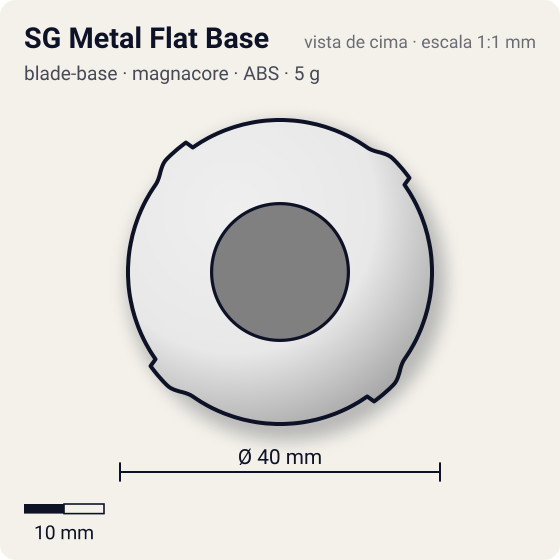
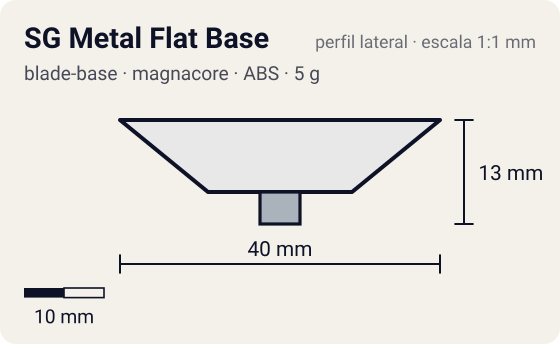

# SG Metal Flat Base

<!-- auto:inicio (gerado por npm run build:research; não edite este bloco) -->
 

| Medidas e material | |
|---|---|
| Diâmetro | 40 estimado mm |
| Altura / espessura | 13 estimado mm |
| Peso | 5 estimado g |
| Material | ABS + Metal (ponta) (opaco) |
| Estrelas Takara (A / D / S) | 2,5 / 1,5 / 1,5 |
| Usada em | [Driger V](../../../personagens/ray-kon/beyblades/driger-v/) |
<!-- auto:fim -->

Blade Base · sistema **magnacore**

## Formato
Primeira base com ponta metal flat da era Magnacore (Driger V).

## Função em batalha
Movimento rápido e agressivo com menos atrito que plástico/borracha.

## Gimmick: como funciona
1. Sem gimmick móvel: o Neo SG (South Core) encaixa por cima e a ponta metálica é fixa.

## Padrão de movimento no estádio
Agressivo, rodando pela borda do estádio. (`padrao_movimento`: agressivo; ponta metal-flat, atrito de referência 0,4.)

## Beys que usam
- `ray-kon/driger-v` ([ficha](../../../personagens/ray-kon/beyblades/driger-v/README.md))

## Medidas, material e stats
| Item | Valor | Fonte |
|---|---|---|
| Diâmetro | 40 mm | estimado |
| Altura (com ponta) | 13 mm | estimado |
| Peso | 5 g | estimado |
| Material | ABS + Metal (ponta) | Ponta metálica (Takara semi-flat; 1º lote Hasbro saiu sharp, depois corrigido). |
| Ponta | metal-flat, raio 2,5 mm | estimado (tipo pela wiki/ficha da bey) |
| Ataque / Defesa / Stamina | sem stats oficiais | — |
| Cores | primária #e8e8e8, secundária #2e8b3a, detalhe #c0c0c0 | estimado (sem foto local) |

## Referências locais
- Nenhuma foto local desta peça no repositório.

## Notas e incertezas
- Wiki sem descrição, peso ou stats: quase tudo estimado.
- Ficha da bey: Takara com ponta semi-flat; adotado metal-flat segundo a página da SG Metal Flat 2 ("SG Metal Flat (Driger V) foi a primeira com ponta metal flat").

## Fontes
- https://beyblade.fandom.com/wiki/Blade_Base_-_SG_Metal_Flat_Base
- `pesquisa-bakuten/personagens/ray-kon/beyblades/driger-v/dados.json`
