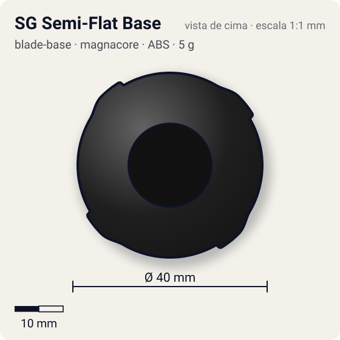
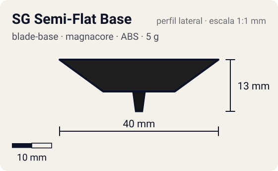

# SG Semi-Flat Base

<!-- auto:inicio (gerado por npm run build:research; não edite este bloco) -->
 

| Medidas e material | |
|---|---|
| Diâmetro | 40 estimado mm |
| Altura / espessura | 13 estimado mm |
| Peso | 5 wiki g |
| Material | ABS (opaco) |
| Estrelas Takara (A / D / S) | 2 / 2 / 2 |
| Usada em | [Galeon 2](../../../personagens/lee/beyblades/galeon-2/) |
<!-- auto:fim -->

Blade Base · sistema **magnacore**

## Formato
Base semi-flat da era Magnacore (estreou na Flash Leopard), mesma proposta da SG Semi-Flat: ponta aguda com extremidade achatada.

## Função em batalha
Equilíbrio: stamina no centro quando lançada reta, ataque circular quando inclinada.

## Gimmick: como funciona
1. Sem gimmick: o Neo SG (Metal Weight) encaixa por cima.

## Padrão de movimento no estádio
Centro em lançamento reto; órbita quando inclinada. (`padrao_movimento`: centro; ponta semi-flat, atrito de referência 0,3.)

## Beys que usam
- `lee/galeon-2` ([ficha](../../../personagens/lee/beyblades/galeon-2/README.md))

## Medidas, material e stats
| Item | Valor | Fonte |
|---|---|---|
| Diâmetro | 40 mm | estimado |
| Altura (com ponta) | 13 mm | estimado |
| Peso | 5 g | wiki |
| Material | ABS | Ponta plástica. |
| Ponta | semi-flat, raio 1,5 mm | estimado (tipo pela wiki/ficha da bey) |
| Ataque / Defesa / Stamina | 2 / 2 / 2 | Beyblade Wiki, Part Infobox (SG Semi-Flat Base) |
| Cores | primária #1f1f1f, secundária #c9a227, detalhe #c0c0c0 | estimado (sem foto local) |

## Referências locais
- Nenhuma foto local desta peça no repositório.

## Notas e incertezas
- Divergência de peso: a página "SG Semi-Flat Base" (Flash Leopard) dá 5 g; a página "SG Semi Flat Base" ligada à Galeon 2 dá 7 g e sistema Engine Gear (provável erro). Adotado 5 g.
- Cores estimadas.

## Fontes
- https://beyblade.fandom.com/wiki/Blade_Base_-_SG_Semi-Flat_Base
- https://beyblade.fandom.com/wiki/Blade_Base_-_SG_Semi_Flat_Base
- https://beyblade.fandom.com/wiki/Galeon_2
- `pesquisa-bakuten/personagens/lee/beyblades/galeon-2/dados.json`
