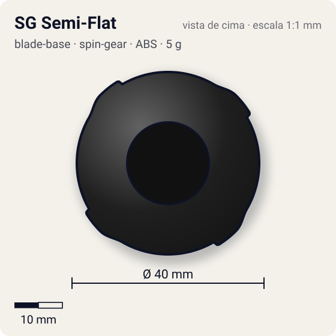
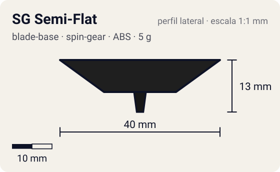

# SG Semi-Flat

<!-- auto:inicio (gerado por npm run build:research; não edite este bloco) -->
 

| Medidas e material | |
|---|---|
| Diâmetro | 40 estimado mm |
| Altura / espessura | 13 estimado mm |
| Peso | 5 wiki g |
| Material | ABS (opaco) |
| Estrelas Takara (A / D / S) | 2 / 2 / 2 |
| Usada em | [Galeon](../../../personagens/lee/beyblades/galeon/) |
<!-- auto:fim -->

Blade Base · sistema **spin-gear**

## Formato
Base SG comum com ponta aguda achatada na extremidade (semi-flat).

## Função em batalha
Equilíbrio entre sobrevivência e defesa; muito usada em combinações "compact".

## Gimmick: como funciona
1. Sem gimmick: o Right SG encaixa por cima e a ponta semi-flat é fixa.

## Padrão de movimento no estádio
Lançada reta: fica perto do centro (stamina). Lançada inclinada: órbita circular de ataque. (`padrao_movimento`: centro; ponta semi-flat, atrito de referência 0,3.)

## Beys que usam
- `lee/galeon` ([ficha](../../../personagens/lee/beyblades/galeon/README.md))

## Medidas, material e stats
| Item | Valor | Fonte |
|---|---|---|
| Diâmetro | 40 mm | estimado |
| Altura (com ponta) | 13 mm | estimado |
| Peso | 5 g | wiki |
| Material | ABS | Ponta plástica. |
| Ponta | semi-flat, raio 1,5 mm | estimado (tipo pela wiki/ficha da bey) |
| Ataque / Defesa / Stamina | sem stats oficiais | — |
| Cores | primária #1f1f1f, secundária #3a5fa8, detalhe #c0c0c0 | estimado (sem foto local) |

## Referências locais
- Nenhuma foto local desta peça no repositório.

## Notas e incertezas
- Peça da era Spin Gear (Galeon). A Galeon 2 usa a "SG Semi-Flat Base" (era Magnacore, mesma descrição na wiki): pode ser o mesmo molde, não confirmado, por isso duas fichas.
- Cores estimadas.

## Fontes
- https://beyblade.fandom.com/wiki/Blade_Base_-_SG_Semi-Flat
- `pesquisa-bakuten/personagens/lee/beyblades/galeon/dados.json`
