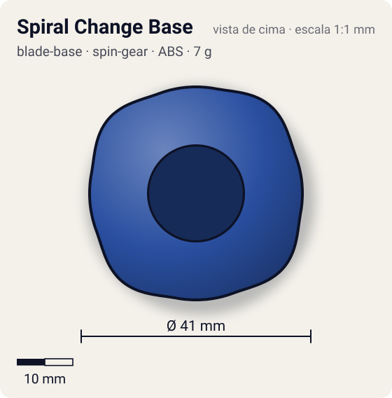
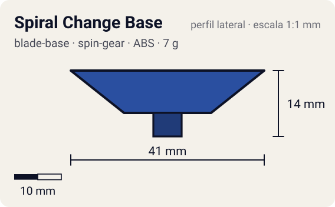

# Spiral Change Base

<!-- auto:inicio (gerado por npm run build:research; não edite este bloco) -->
 

| Medidas e material | |
|---|---|
| Diâmetro | 41 estimado mm |
| Altura / espessura | 14 estimado mm |
| Peso | 7 wiki g |
| Material | ABS + Metal (ponta sharp do eixo livre) (opaco) |
| Estrelas Takara (A / D / S) | 3 / 2 / 3,5 |
| Usada em | [Dranzer S](../../../personagens/kai-hiwatari/beyblades/dranzer-s/) |
<!-- auto:fim -->

Blade Base · sistema **spin-gear**

## Formato
Base da Dranzer S cujo fundo é um anel giratório: empurrando e girando, expõe-se a ponta flat de plástico ou a ponta sharp metálica do eixo livre.

## Função em batalha
Com o eixo livre, o modo flat tem o melhor "life after death" da era plástica; o modo sharp é instável e tem defesa fraca.

## Gimmick: como funciona
1. Encaixa-se o Right SG (Free Shaft Version), cujo eixo metálico gira solto num rolamento.
2. Empurra-se o fundo da base para dentro e gira-se.
3. Numa posição a ponta metálica sharp do eixo fica para fora; na outra o anel plástico flat cobre o eixo e toca o piso.
4. A ponta não muda sozinha durante a batalha.

| Modo | Ponta | Atrito | Gatilho |
|---|---|---|---|
| Attack (flat plástico) | flat | 0,5 | manual: empurrar o fundo e girar antes da batalha |
| Survival (metal sharp, eixo livre) | metal-sharp | 0,08 | manual: empurrar o fundo e girar antes da batalha |

## Padrão de movimento no estádio
Flat: flower amplo, difícil de controlar, mas continua girando muito tempo mesmo inclinada. Sharp: centro, porém instável. (`padrao_movimento`: flower; ponta flat, atrito de referência 0,5; a ponta vem de: base (flat) ou Right SG Free Shaft (metal sharp).)

## Beys que usam
- `kai-hiwatari/dranzer-s` ([ficha](../../../personagens/kai-hiwatari/beyblades/dranzer-s/README.md))

## Medidas, material e stats
| Item | Valor | Fonte |
|---|---|---|
| Diâmetro | 41 mm | estimado |
| Altura (com ponta) | 14 mm | estimado |
| Peso | 7 g | wiki |
| Material | ABS + Metal (ponta sharp do eixo livre) | Modo flat: ponta plástica da base. Modo sharp: ponta metálica do Right SG (Free Shaft Version), com rolamento. |
| Ponta | flat, raio 3 mm | estimado (tipo pela wiki/ficha da bey) |
| Ataque / Defesa / Stamina | sem stats oficiais | — |
| Cores | primária #2a4fa0, secundária #c8102e, detalhe #c0c0c0 | estimado (sem foto local) |

## Referências locais
- Nenhuma foto local desta peça no repositório.

## Notas e incertezas
- Também aceita SGs e Neo SGs sem gimmick (wiki).
- Cores estimadas (sem foto local); medidas estimadas.

## Fontes
- https://beyblade.fandom.com/wiki/Blade_Base_-_Spiral_Change_Base
- `pesquisa-bakuten/personagens/kai-hiwatari/beyblades/dranzer-s/dados.json`
