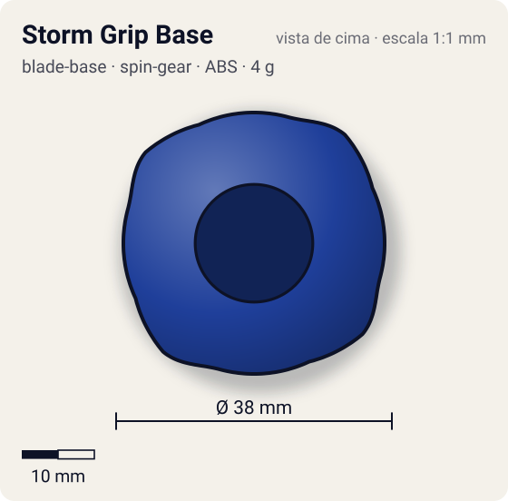
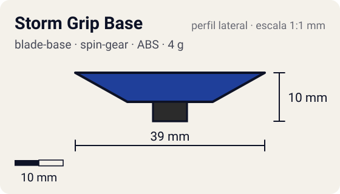

# Storm Grip Base

<!-- auto:inicio (gerado por npm run build:research; não edite este bloco) -->
 

| Medidas e material | |
|---|---|
| Diâmetro | 38 estimado mm |
| Altura / espessura | 10 estimado mm |
| Peso | 4 wiki g |
| Material | ABS + Borracha (ponta) (opaco) |
| Estrelas Takara (A / D / S) | 3,5 / 1 / 1 |
| Usada em | [Dragoon S (Dragoon Storm)](../../../personagens/tyson-granger/beyblades/dragoon-s/) |
<!-- auto:fim -->

Blade Base · sistema **spin-gear**

## Formato
Base baixa e leve (4 g) com ponta de borracha.

## Função em batalha
A melhor base de ataque antes do sistema Magne: rápida e baixa, boa para upper attack.

## Gimmick: como funciona
1. Sem gimmick: a borracha agarra o piso e converte rotação em velocidade.

## Padrão de movimento no estádio
Flower rápido e agressivo pela borda. (`padrao_movimento`: agressivo; ponta grip, atrito de referência 0,85.)

## Beys que usam
- `tyson-granger/dragoon-s` ([ficha](../../../personagens/tyson-granger/beyblades/dragoon-s/README.md))

## Medidas, material e stats
| Item | Valor | Fonte |
|---|---|---|
| Diâmetro | 38 mm | estimado |
| Altura (com ponta) | 10 mm | estimado |
| Peso | 4 g | wiki |
| Material | ABS + Borracha (ponta) | A borracha gasta com o uso. |
| Ponta | grip, raio 3,5 mm | estimado (tipo pela wiki/ficha da bey) |
| Ataque / Defesa / Stamina | sem stats oficiais | — |
| Cores | primária #1f3f9a, secundária #f2f2f2, detalhe #1a1a1a | estimado (sem foto local) |

## Referências locais
- Nenhuma foto local desta peça no repositório.

## Notas e incertezas
- Lançamento japonês: julho de 2000 (wiki).
- Cores e medidas estimadas.

## Fontes
- https://beyblade.fandom.com/wiki/Blade_Base_-_Storm_Grip
- `pesquisa-bakuten/personagens/tyson-granger/beyblades/dragoon-s/dados.json`
