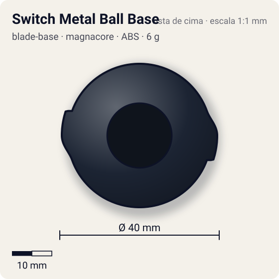
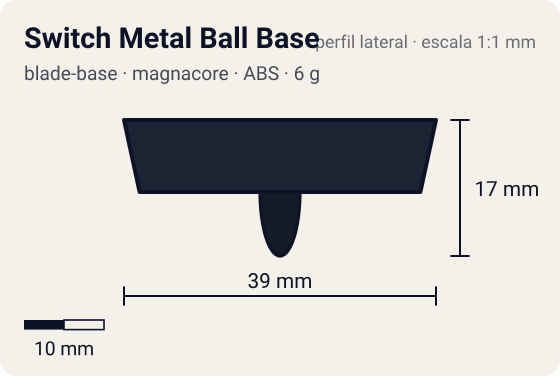

# Switch Metal Ball Base

<!-- auto:inicio (gerado por npm run build:research; não edite este bloco) -->
 

| Medidas e material | |
|---|---|
| Diâmetro | 40 estimado mm |
| Altura / espessura | 17 estimado mm |
| Peso | 6 wiki g |
| Material | ABS + Aço (2 esferas fixas) (opaco) |
| Estrelas Takara (A / D / S) | 1 / 4 / 3,5 |
| Usada em | [Draciel V2](../../../personagens/max-tate/beyblades/draciel-v2/) |
<!-- auto:fim -->

Blade Base · sistema **magnacore**

## Formato
Base azul-escura quase preta (série V2), com trilho em cruz no topo, duas esferas metálicas presas que deslizam em dois cursores laterais, e ponta redonda alta.

## Função em batalha
Troca a distribuição de peso (dentro = gira mais rápido; fora = mais inércia). A ponta alta e redonda limita muito o desempenho; a principal virtude é aceitar Support Parts.

## Gimmick: como funciona
1. As duas esferas ficam presas em cursores no topo da base, sem sair.
2. Antes da batalha, desliza-se os cursores para a posição interna ou externa.
3. Dentro: menos inércia, aceleração e giro mais rápido; fora: mais momento de inércia, resiste melhor a golpes.

| Modo | Ponta | Atrito | Gatilho |
|---|---|---|---|
| Esferas para dentro | ball | 0,25 | manual: deslizar as esferas antes da batalha |
| Esferas para fora | ball | 0,25 | manual: deslizar as esferas antes da batalha |

## Padrão de movimento no estádio
Fica perto do centro, oscilando pela ponta alta. (`padrao_movimento`: centro; ponta ball, atrito de referência 0,25.)

## Beys que usam
- `max-tate/draciel-v2` ([ficha](../../../personagens/max-tate/beyblades/draciel-v2/README.md))

## Medidas, material e stats
| Item | Valor | Fonte |
|---|---|---|
| Diâmetro | 40 mm | estimado |
| Altura (com ponta) | 17 mm | estimado |
| Peso | 6 g | wiki |
| Material | ABS + Aço (2 esferas fixas) | Ponta redonda alta de plástico. |
| Ponta | ball, raio 2,5 mm | estimado (tipo pela wiki/ficha da bey) |
| Ataque / Defesa / Stamina | 1 / 4 / 3 | Beyblade Wiki, Part Infobox (Switch Metal Ball Base) |
| Cores | primária #1c2433, secundária #2d3a52, detalhe #3a6fd0 | foto local blade-base.jpg |

## Referências locais
- [referencia/draciel-v2-blade-base.jpg](referencia/draciel-v2-blade-base.jpg) (cópia de `personagens/max-tate/beyblades/draciel-v2/pecas/blade-base.jpg`)
- [referencia/draciel-v2-pecas-desmontadas.jpg](referencia/draciel-v2-pecas-desmontadas.jpg) (cópia de `personagens/max-tate/beyblades/draciel-v2/pecas/pecas-desmontadas.jpg`)

## Notas e incertezas
- A foto local mostra a base já com o Support Part Fin Tector encaixado.

## Fontes
- https://beyblade.fandom.com/wiki/Blade_Base_-_Switch_Metal_Ball_Base
- `pesquisa-bakuten/personagens/max-tate/beyblades/draciel-v2/dados.json`
