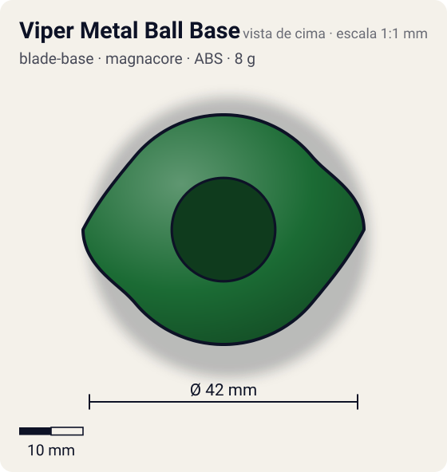
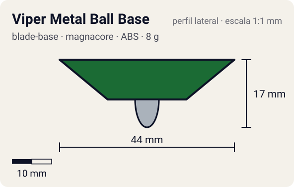

# Viper Metal Ball Base

<!-- auto:inicio (gerado por npm run build:research; não edite este bloco) -->
 

| Medidas e material | |
|---|---|
| Diâmetro | 42 estimado mm |
| Altura / espessura | 17 estimado mm |
| Peso | 8 estimado g |
| Material | ABS + Aço (2 esferas fixas no eixo) + Metal (haste magnetizável e ponta bola) (opaco) |
| Estrelas Takara (A / D / S) | 1 / 3,5 / 2,5 |
| Usada em | [Draciel V](../../../personagens/max-tate/beyblades/draciel-v/) |
<!-- auto:fim -->

Blade Base · sistema **magnacore**

## Formato
Base verde-escura com abas laterais em forma de asa, eixo longo contendo duas esferas de metal fixas e ponta de bola metálica que gira parcialmente livre.

## Função em batalha
Gimmick magnético; na prática o eixo alto e os entalhes da base pioram equilíbrio e life after death: base ruim para defesa no brinquedo real.

## Gimmick: como funciona
1. O Neo SG com Magnecore (Norte ou Sul) encaixa por cima.
2. A haste metálica da base encosta no ímã e assume a mesma polaridade.
3. As duas esferas do eixo ficam grudadas na haste magnetizada (não saem).
4. A ponta de bola gira parcialmente solta, reduzindo o atrito.

## Padrão de movimento no estádio
Tenta ficar no centro, mas o centro de gravidade baixo e o eixo alto fazem a bey oscilar e perder estabilidade. (`padrao_movimento`: centro; ponta metal-ball, atrito de referência 0,18.)

## Beys que usam
- `max-tate/draciel-v` ([ficha](../../../personagens/max-tate/beyblades/draciel-v/README.md))

## Medidas, material e stats
| Item | Valor | Fonte |
|---|---|---|
| Diâmetro | 42 mm | estimado |
| Altura (com ponta) | 17 mm | estimado |
| Peso | 8 g | estimado |
| Material | ABS + Aço (2 esferas fixas no eixo), Metal (haste magnetizável e ponta bola) | Haste adota a polaridade do Magnecore. |
| Ponta | metal-ball, raio 3 mm | estimado (tipo pela wiki/ficha da bey) |
| Ataque / Defesa / Stamina | 1 / 4 / 3 | Beyblade Wiki, Part Infobox (Viper Metal Ball Base) |
| Cores | primária #1b6b34, secundária #0e4421, detalhe #c0c0c0 | diagrama local blade-base.gif |

## Referências locais
- [referencia/draciel-v-blade-base.gif](referencia/draciel-v-blade-base.gif) (cópia de `personagens/max-tate/beyblades/draciel-v/pecas/blade-base.gif`)
- [referencia/draciel-v-pecas-desmontadas.jpg](referencia/draciel-v-pecas-desmontadas.jpg) (cópia de `personagens/max-tate/beyblades/draciel-v/pecas/pecas-desmontadas.jpg`)

## Notas e incertezas
- Peso não informado na wiki: estimado.
- Simetria 2 (asas laterais) inferida do diagrama.

## Fontes
- https://beyblade.fandom.com/wiki/Blade_Base_-_Viper_Metal_Ball_Base
- `pesquisa-bakuten/personagens/max-tate/beyblades/draciel-v/dados.json`
