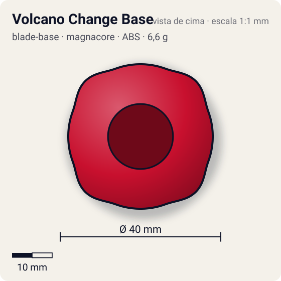
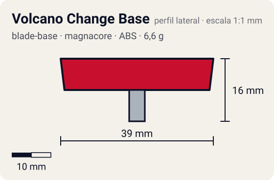

# Volcano Change Base

<!-- auto:inicio (gerado por npm run build:research; não edite este bloco) -->
 

| Medidas e material | |
|---|---|
| Diâmetro | 40 estimado mm |
| Altura / espessura | 16 estimado mm |
| Peso | 6,6 wiki g |
| Material | ABS + Metal (eixo com ponta flat e ponta sharp) + Plástico (disco de giro livre) (opaco) |
| Estrelas Takara (A / D / S) | 2 / 2 / 2 |
| Usada em | [Dranzer V](../../../personagens/kai-hiwatari/beyblades/dranzer-v/) |
<!-- auto:fim -->

Blade Base · sistema **magnacore**

## Formato
Base em duas partes: uma metade superior baixa e quase circular que cobre o Spin Gear, e uma metade inferior com eixo metálico de duas pontas (flat de um lado, sharp do outro) e um disco plástico que gira livre em volta.

## Função em batalha
Attack Mode é controlável, com atrito baixo e bom life after death (útil até em zombie). Endurance Mode é muito instável e quase inútil.

## Gimmick: como funciona
1. A metade superior encaixa no Neo SG com os clipes.
2. A metade inferior não tem clipe: uma ponta do eixo entra no furo do Magnecore e fica presa pelo ímã.
3. Para trocar de modo, puxa-se a metade inferior, vira-se o eixo e encaixa-se de novo.
4. Durante a batalha o disco plástico gira solto ao redor do eixo, prolongando o giro quando a bey inclina.

| Modo | Ponta | Atrito | Gatilho |
|---|---|---|---|
| Attack Mode (ponta "semi-flat", na prática flat estreita) | metal-flat | 0,4 | manual: retirar a metade inferior e virar o eixo |
| Endurance Mode | metal-sharp | 0,08 | manual: retirar a metade inferior e virar o eixo |

## Padrão de movimento no estádio
Attack: flower controlado e rápido para uma base de metal. Endurance: tenta ficar no centro mas oscila muito. (`padrao_movimento`: flower; ponta metal-flat, atrito de referência 0,4.)

## Beys que usam
- `kai-hiwatari/dranzer-v` ([ficha](../../../personagens/kai-hiwatari/beyblades/dranzer-v/README.md))

## Medidas, material e stats
| Item | Valor | Fonte |
|---|---|---|
| Diâmetro | 40 mm | estimado |
| Altura (com ponta) | 16 mm | estimado |
| Peso | 6,6 g | wiki |
| Material | ABS + Metal (eixo com ponta flat e ponta sharp), Plástico (disco de giro livre) | Metade inferior presa só pelo ímã do Magnecore. |
| Ponta | metal-flat, raio 2 mm | estimado (tipo pela wiki/ficha da bey) |
| Ataque / Defesa / Stamina | 2 / 2 / 2 | Beyblade Wiki, Part Infobox (Volcano Change Base) |
| Cores | primária #c8102e, secundária #bfc3c8, detalhe #f2f2f2 | estimado (sem foto local) |

## Referências locais
- Nenhuma foto local desta peça no repositório.

## Notas e incertezas
- Takara rotula a ponta do Attack Mode como semi-flat; a wiki diz que é flat estreita. Adotado metal-flat.
- Cores estimadas; medidas estimadas.

## Fontes
- https://beyblade.fandom.com/wiki/Blade_Base_-_Volcano_Change_Base
- `pesquisa-bakuten/personagens/kai-hiwatari/beyblades/dranzer-v/dados.json`
