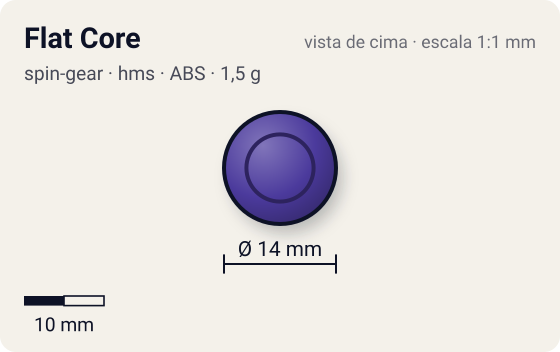
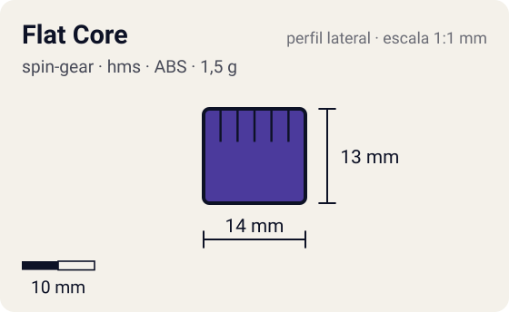

# Flat Core

<!-- auto:inicio (gerado por npm run build:research; não edite este bloco) -->
 

| Medidas e material | |
|---|---|
| Diâmetro | 14 estimado mm |
| Altura / espessura | 13 estimado mm |
| Peso | 1,5 comunidade g |
| Material | ABS (opaco) |
| Estrelas Takara (A / D / S) | 3 / 1 / 1 |
| Usada em | [Gaia Dragoon MS (Strata Dragoon MS / Metal Spike)](../../../personagens/daichi-sumeragi/beyblades/gaia-dragoon-ms/) |
<!-- auto:fim -->

Running Core · sistema **hms** · rotação **dupla** · id `spin-gear/flat-core`

## Descrição

Primeiro Running Core lançado (Strata/Gaia Dragoon MS). A foto mostra um cilindro roxo com abas laterais de encaixe e ponta escalonada terminando num disco plano.

**Função:** Ponta plana: movimento decente para ataque, mas foi logo superado pelo Grip Flat Core e outros.

## Funcionamento interno

Gimmick: **running-core**. Ativação: **nenhum**.

### Running Core (Hard Metal System)

No HMS o Spin Gear e o Blade Base viraram uma peça só, o **Running Core**: ele forma o eixo, define a ponta e prende o Weight Disk e o AR de metal. As beys HMS são dual-spin (o lançador engata nos dois sentidos), por isso a rotação aqui é "dupla". A ponta define o movimento; o RC pesa só 1–3 g, então quase todo o peso fica no AR/frame de metal e no WD.

## Beys que usam

- `daichi-sumeragi/gaia-dragoon-ms` ([ficha](../../../personagens/daichi-sumeragi/beyblades/gaia-dragoon-ms/))

## Medidas, material e stats

| Item | Valor | Fonte |
|---|---|---|
| Peso | 1,5 g | comunidade (WBO; a Beyblade Wiki não informa) |
| Diâmetro | 14 mm | estimado |
| Altura | 13 mm | estimado |
| Material | ABS | foto local: plástico roxo |
| Stats oficiais (A/D/S) | 3 / 1 / 1 | Beyblade Wiki, Part Infobox (Running Core - Flat Core) |

Diâmetro e altura não são publicados nas fontes consultadas; são estimativas coerentes com o tamanho de uma bey completa (~45–50 mm de diâmetro, ~25–35 mm de altura; Engine Gears deixam a bey mais alta). As cores seguem as fotos locais quando existem; nos demais casos são estimadas.

## Referência

- `referencia/flat-core.jpg` (copiada de `personagens/daichi-sumeragi/beyblades/gaia-dragoon-ms/pecas/running-core.jpg`)

## Fontes

- https://beyblade.fandom.com/wiki/Running_Core_-_Flat_Core
- https://beyblade.fandom.com/wiki/Running_Core
- http://wiki.worldbeyblade.org/index.php?title=Gaia_Dragoon_MS
