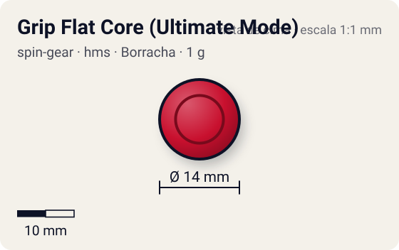
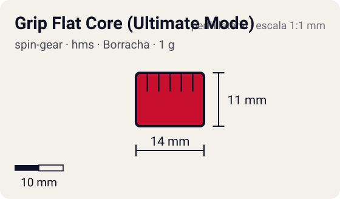

# Grip Flat Core (Ultimate Mode)

<!-- auto:inicio (gerado por npm run build:research; não edite este bloco) -->
 

| Medidas e material | |
|---|---|
| Diâmetro | 14 estimado mm |
| Altura / espessura | 11 estimado mm |
| Peso | 1 wiki g |
| Material | Borracha (opaco) |
| Estrelas Takara (A / D / S) | 4 / 1 / 0,5 |
| Usada em | [Dragoon MS Ultimate Version](../../../personagens/tyson-granger/beyblades/dragoon-ms-ultimate-version/) |
<!-- auto:fim -->

Running Core · sistema **hms** · rotação **dupla** · id `spin-gear/grip-flat-core-ultimate-mode`

## Descrição

Versão do Grip Flat Core do Dragoon MS Ultimate Version: ponta plana de borracha vermelha macia, com 5 mm de diâmetro.

**Função:** Tração e mobilidade enormes; popular em customizações de ataque HMS, mas difícil de controlar.

## Funcionamento interno

Gimmick: **running-core**. Ativação: **nenhum**.

### Running Core (Hard Metal System)

No HMS o Spin Gear e o Blade Base viraram uma peça só, o **Running Core**: ele forma o eixo, define a ponta e prende o Weight Disk e o AR de metal. As beys HMS são dual-spin (o lançador engata nos dois sentidos), por isso a rotação aqui é "dupla". A ponta define o movimento; o RC pesa só 1–3 g, então quase todo o peso fica no AR/frame de metal e no WD.

## Beys que usam

- `tyson-granger/dragoon-ms-ultimate-version` ([ficha](../../../personagens/tyson-granger/beyblades/dragoon-ms-ultimate-version/))

## Medidas, material e stats

| Item | Valor | Fonte |
|---|---|---|
| Peso | 1 g | wiki |
| Diâmetro | 14 mm | estimado |
| Altura | 11 mm | estimado |
| Material | Borracha | borracha mole vermelha (wiki) |
| Stats oficiais (A/D/S) | não publicados | infobox em branco |

Diâmetro e altura não são publicados nas fontes consultadas; são estimativas coerentes com o tamanho de uma bey completa (~45–50 mm de diâmetro, ~25–35 mm de altura; Engine Gears deixam a bey mais alta). As cores seguem as fotos locais quando existem; nos demais casos são estimadas.

## Referência

- Sem foto local desta peça no repositório.

## Fontes

- https://beyblade.fandom.com/wiki/Running_Core_-_Grip_Flat_Core_(Ultimate_Mode)
- http://wiki.worldbeyblade.org/index.php?title=Dragoon_MS_UV
