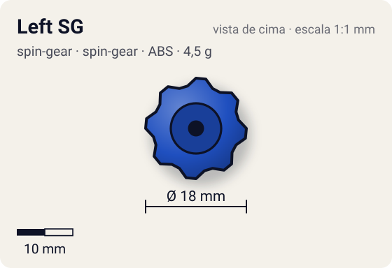
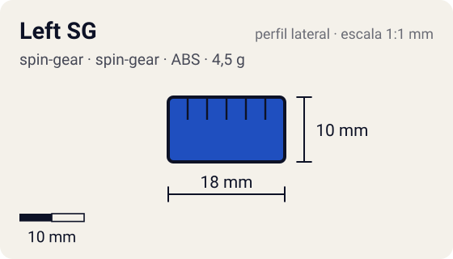

# Left SG

<!-- auto:inicio (gerado por npm run build:research; não edite este bloco) -->
 

| Medidas e material | |
|---|---|
| Diâmetro | 18 estimado mm |
| Altura / espessura | 10 estimado mm |
| Peso | 4,5 estimado g |
| Material | ABS + anel metálico interno (opaco) |
| Estrelas Takara (A / D / S) | — |
| Usada em | [Dragoon F (Dragoon Fantom)](../../../personagens/tyson-granger/beyblades/dragoon-f/), [Dragoon S (Dragoon Storm)](../../../personagens/tyson-granger/beyblades/dragoon-s/) |
<!-- auto:fim -->

Spin Gear (レフトスピンギア) · sistema **spin-gear** · rotação **esquerda** · id `spin-gear/left-sg`

## Descrição

Spin Gear padrão de rotação esquerda (estreia com Dragoon S, jul/2000). Igual ao Right SG, mas com as abas do lado oposto e um pouco mais salientes, de modo que lançador direito não engata nele e vice-versa.

**Função:** Permite a rotação esquerda, usada pelo Dragoon do Tyson: contra beys de rotação direita, os contatos se somam (golpes mais fortes e roubo de rotação).

## Funcionamento interno

Gimmick: **nenhum**. Ativação: **nenhum**.

### Como um Spin Gear funciona

O Spin Gear é o "miolo" da bey de plástico: fica entre o Weight Disk e o Blade Base, no eixo de rotação. A casca tem duas abas onde o lançador engata. A posição das abas define o sentido (direita ou esquerda), e as abas do SG esquerdo são mais salientes para não encaixarem no lançador direito. Embaixo, uma peça em estrela trava no Blade Base; em cima, o AR rosqueia num rebaixo (no sentido contrário ao da rotação, para não soltar). No SG comum há um anel de metal interno que dá um pouco de peso e equilíbrio. Como fica no eixo, o peso do SG praticamente não aumenta o momento de inércia: ele soma massa sem "atrasar" a rotação.

## Beys que usam

- `tyson-granger/dragoon-f` ([ficha](../../../personagens/tyson-granger/beyblades/dragoon-f/))
- `tyson-granger/dragoon-s` ([ficha](../../../personagens/tyson-granger/beyblades/dragoon-s/))

## Medidas, material e stats

| Item | Valor | Fonte |
|---|---|---|
| Peso | 4,5 g | estimado (mesma construção do Right SG) |
| Diâmetro | 18 mm | estimado |
| Altura | 10 mm | estimado |
| Material | ABS + anel metálico interno | casca de plástico em duas metades em volta de um anel de metal |
| Stats oficiais (A/D/S) | não publicados | infobox em branco |

Diâmetro e altura não são publicados nas fontes consultadas; são estimativas coerentes com o tamanho de uma bey completa (~45–50 mm de diâmetro, ~25–35 mm de altura; Engine Gears deixam a bey mais alta). As cores seguem as fotos locais quando existem; nos demais casos são estimadas.

## Referência

- Sem foto local desta peça no repositório.

## Fontes

- https://beyblade.fandom.com/wiki/Spin_Gear_-_Left_SG
- http://wiki.worldbeyblade.org/index.php?title=Spin_Gear
