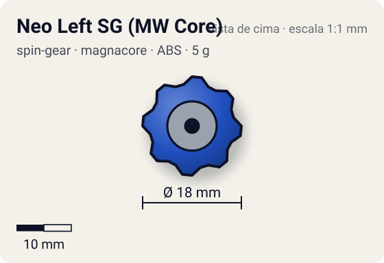
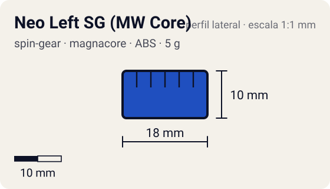

# Neo Left SG (MW Core)

<!-- auto:inicio (gerado por npm run build:research; não edite este bloco) -->
 

| Medidas e material | |
|---|---|
| Diâmetro | 18 estimado mm |
| Altura / espessura | 10 estimado mm |
| Peso | 5 wiki g |
| Material | ABS + cilindro de metal (Metal Weight Core) (opaco) |
| Estrelas Takara (A / D / S) | — |
| Usada em | [Dragoon V (Dragoon Victory)](../../../personagens/tyson-granger/beyblades/dragoon-v/) |
<!-- auto:fim -->

Spin Gear · sistema **magnacore** · rotação **esquerda** · id `spin-gear/neo-left-sg-mw-core`

## Descrição

Neo Spin Gear esquerdo com Metal Weight Core. Segundo a wiki, foi o primeiro Metal Weight Core da linha: a ponta da Magne Flat Base do Dragoon V já tem um ímã embutido, então o núcleo não precisava ser magnético.

**Função:** Peso extra no centro, sem efeito magnético (o ímã do Dragoon V fica na base).

## Funcionamento interno

Gimmick: **metal-weight**. Ativação: **nenhum**.

### Como um Spin Gear funciona

O Spin Gear é o "miolo" da bey de plástico: fica entre o Weight Disk e o Blade Base, no eixo de rotação. A casca tem duas abas onde o lançador engata. A posição das abas define o sentido (direita ou esquerda), e as abas do SG esquerdo são mais salientes para não encaixarem no lançador direito. Embaixo, uma peça em estrela trava no Blade Base; em cima, o AR rosqueia num rebaixo (no sentido contrário ao da rotação, para não soltar). No SG comum há um anel de metal interno que dá um pouco de peso e equilíbrio. Como fica no eixo, o peso do SG praticamente não aumenta o momento de inércia: ele soma massa sem "atrasar" a rotação.

### Neo Spin Gear e núcleos (cores)

No Magnacore System o SG ganhou a casca **Neo**, oca no meio, que recebe um núcleo trocável: Normal Core (plástico, ~3–3,6 g no total), Metal Weight Core (metal sem ímã, ~4–5 g), Magnecore Norte ou Sul (ímã, ~6 g) e Heavy Metal Core (todo de metal, ~9 g). Núcleo mais pesado = mais massa bem em cima da ponta: mais RPM e mais peso para defesa; núcleo leve = distribuição de massa mais externa, melhor para mobilidade e sobrevivência.

## Beys que usam

- `tyson-granger/dragoon-v` ([ficha](../../../personagens/tyson-granger/beyblades/dragoon-v/))

## Medidas, material e stats

| Item | Valor | Fonte |
|---|---|---|
| Peso | 5 g | wiki (valor da página Core - Metal Weight Core ("5 g com NEO SG")) |
| Diâmetro | 18 mm | estimado |
| Altura | 10 mm | estimado |
| Material | ABS + cilindro de metal (Metal Weight Core) | — |
| Stats oficiais (A/D/S) | não publicados | infobox em branco |

Diâmetro e altura não são publicados nas fontes consultadas; são estimativas coerentes com o tamanho de uma bey completa (~45–50 mm de diâmetro, ~25–35 mm de altura; Engine Gears deixam a bey mais alta). As cores seguem as fotos locais quando existem; nos demais casos são estimadas.

## Referência

- Sem foto local desta peça no repositório.

## Fontes

- https://beyblade.fandom.com/wiki/Dragoon_V
- https://beyblade.fandom.com/wiki/Spin_Gear_-_NEO_Left_SG
- https://beyblade.fandom.com/wiki/Core_-_Metal_Weight_Core
- http://wiki.worldbeyblade.org/index.php?title=Dragoon_V
