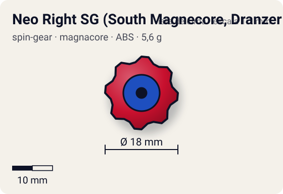
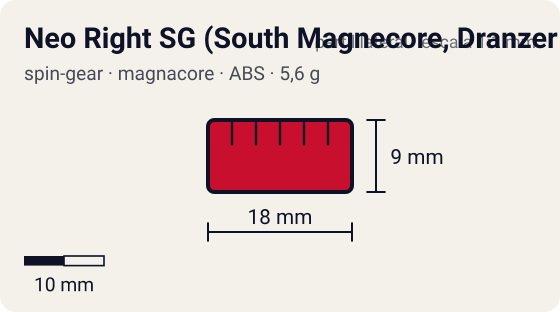

# Neo Right SG (South Magnecore, Dranzer V Version)

<!-- auto:inicio (gerado por npm run build:research; não edite este bloco) -->
 

| Medidas e material | |
|---|---|
| Diâmetro | 18 estimado mm |
| Altura / espessura | 9 estimado mm |
| Peso | 5,6 wiki g |
| Material | ABS + ímã (polo Sul) (opaco) |
| Estrelas Takara (A / D / S) | — |
| Usada em | [Dranzer V](../../../personagens/kai-hiwatari/beyblades/dranzer-v/) |
<!-- auto:fim -->

Spin Gear · sistema **magnacore** · rotação **direita** · id `spin-gear/neo-right-sg-south-magnecore-dranzer-v`

## Descrição

Magnecore Sul exclusivo do Dranzer V, feito para a Volcano Change Base ficar mais baixa: o ímã fica mais alto no núcleo (preso por pequenas saliências, entrando parcialmente na tampa da casca) e a engrenagem de baixo e o cilindro que ela envolve são mais curtos. O nome é não oficial; a Takara só chamava de "South Magnecore". A versão Hyper Red do Magne Dome (A-80) traz um Magnecore Norte equivalente.

**Função:** Igual a um Magnecore Sul, mas deixa a bey mais baixa, o que melhora a Volcano Change Base. Também faz as pontas da Magne Flat Base, SG Grip Base e Customize Grip Base ficarem mais altas.

## Funcionamento interno

Gimmick: **magnecore**. Ativação: **nenhum**: o efeito magnético é passivo.

### Como um Spin Gear funciona

O Spin Gear é o "miolo" da bey de plástico: fica entre o Weight Disk e o Blade Base, no eixo de rotação. A casca tem duas abas onde o lançador engata. A posição das abas define o sentido (direita ou esquerda), e as abas do SG esquerdo são mais salientes para não encaixarem no lançador direito. Embaixo, uma peça em estrela trava no Blade Base; em cima, o AR rosqueia num rebaixo (no sentido contrário ao da rotação, para não soltar). No SG comum há um anel de metal interno que dá um pouco de peso e equilíbrio. Como fica no eixo, o peso do SG praticamente não aumenta o momento de inércia: ele soma massa sem "atrasar" a rotação.

### Neo Spin Gear e núcleos (cores)

No Magnacore System o SG ganhou a casca **Neo**, oca no meio, que recebe um núcleo trocável: Normal Core (plástico, ~3–3,6 g no total), Metal Weight Core (metal sem ímã, ~4–5 g), Magnecore Norte ou Sul (ímã, ~6 g) e Heavy Metal Core (todo de metal, ~9 g). Núcleo mais pesado = mais massa bem em cima da ponta: mais RPM e mais peso para defesa; núcleo leve = distribuição de massa mais externa, melhor para mobilidade e sobrevivência.

### Como o Magnecore interage com o estádio

Os estádios Magnacore recebem ímãs embaixo do piso (bandeja da Takara com 6 ímãs redondos e 3 bastões; Magne Dome DX; bandeja magnética da Hasbro). O ímã do núcleo fica a poucos milímetros do piso, bem no eixo: quando a bey passa sobre um ímã, a força magnética puxa (atração) ou empurra (repulsão) a ponta. Atração prende a bey sobre o ímã: fica mais difícil de empurrar (defesa), mas o atrito extra rouba rotação. Repulsão desvia a bey: movimento irregular e imprevisível (ataque). Em estádio comum, sem ímãs, o Magnecore é só um núcleo pesado de ~6 g. O Magne Weight Disk reforça o efeito e funciona até em beys sem Magnecore.

**Divergência de fontes:** a Beyblade Wiki diz que os estádios usam a face **Sul** para cima, que o núcleo **Norte atrai** (defesa) e o **Sul repele** (ataque). A WBO diz que o estádio Magnacore usa ímãs **Norte**, e descreve o núcleo Norte sendo repelido e o Sul preso sobre o ímã. Para o jogo, seguimos a Beyblade Wiki (Norte = atração/defesa, Sul = repulsão/ataque), que também casa com o uso no anime (Draciel V de defesa com Norte; Driger V e Gaia Dragoon V de ataque com Sul).

## Beys que usam

- `kai-hiwatari/dranzer-v` ([ficha](../../../personagens/kai-hiwatari/beyblades/dranzer-v/))

## Medidas, material e stats

| Item | Valor | Fonte |
|---|---|---|
| Peso | 5,6 g | wiki (núcleo sozinho: 3,3 g) |
| Diâmetro | 18 mm | estimado |
| Altura | 9 mm | estimado (mais baixo que o Magnecore comum) |
| Material | ABS + ímã (polo Sul) | — |
| Stats oficiais (A/D/S) | não publicados | infobox em branco |

Diâmetro e altura não são publicados nas fontes consultadas; são estimativas coerentes com o tamanho de uma bey completa (~45–50 mm de diâmetro, ~25–35 mm de altura; Engine Gears deixam a bey mais alta). As cores seguem as fotos locais quando existem; nos demais casos são estimadas.

## Referência

- Sem foto local desta peça no repositório.

## Fontes

- https://beyblade.fandom.com/wiki/Spin_Gear_-_Neo_Right_SG_(South_Magnecore_(Dranzer_V_Version))
- http://wiki.worldbeyblade.org/index.php?title=Dranzer_V
