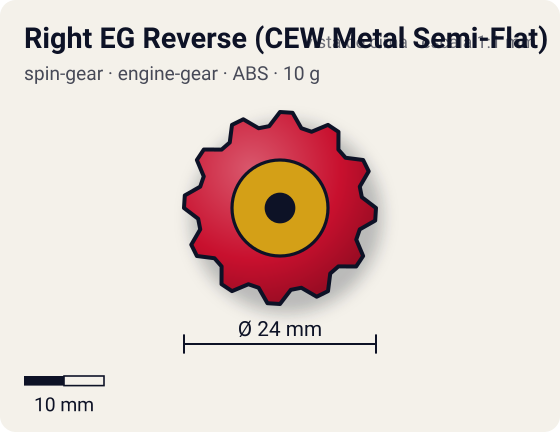
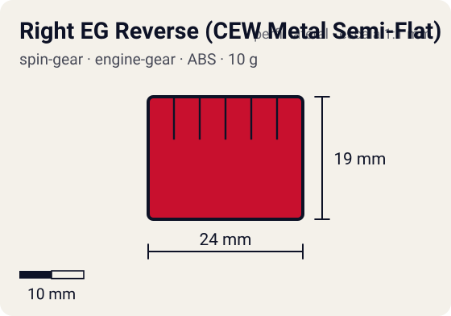

# Right EG Reverse (CEW Metal Semi-Flat)

<!-- auto:inicio (gerado por npm run build:research; não edite este bloco) -->
 

| Medidas e material | |
|---|---|
| Diâmetro | 24 estimado mm |
| Altura / espessura | 19 estimado mm |
| Peso | 10 estimado g |
| Material | ABS + mola espiral + CEW (Customize Engine Weight) Metal Semi-Flat de metal (opaco) |
| Estrelas Takara (A / D / S) | 3 / 0 / 0 |
| Usada em | [Dranzer GT](../../../personagens/kai-hiwatari/beyblades/dranzer-gt/) |
<!-- auto:fim -->

Engine Gear · sistema **engine-gear** · rotação **direita** · id `spin-gear/right-eg-reverse`

## Descrição

Engine Gear "reverso", exclusivo do Dranzer GT (Engine Gear Turbo System): quando ativado, o mecanismo interno gira para a esquerda, contra a rotação direita da bey. Vem com a ponta trocável (CEW) Metal Semi-Flat; aqui EG + CEW formam uma peça só.

**Função:** Muda o movimento para ziguezague e permite um contra-ataque surpresa (Dranzer Gigs Turbo Reverse Attack), mas o giro contrário drena muita rotação. A wiki o considera pior que os outros Engine Gears.

## Funcionamento interno

Gimmick: **engine-gear**. Ativação: **clutch**: na Hit Release do Dranzer GT, no meio da luta; ao soltar, o mecanismo gira para a ESQUERDA, contra a rotação da bey.

### Como um Spin Gear funciona

O Spin Gear é o "miolo" da bey de plástico: fica entre o Weight Disk e o Blade Base, no eixo de rotação. A casca tem duas abas onde o lançador engata. A posição das abas define o sentido (direita ou esquerda), e as abas do SG esquerdo são mais salientes para não encaixarem no lançador direito. Embaixo, uma peça em estrela trava no Blade Base; em cima, o AR rosqueia num rebaixo (no sentido contrário ao da rotação, para não soltar). No SG comum há um anel de metal interno que dá um pouco de peso e equilíbrio. Como fica no eixo, o peso do SG praticamente não aumenta o momento de inércia: ele soma massa sem "atrasar" a rotação.

### Como o Engine Gear armazena e libera energia

O Engine Gear é um Spin Gear maior com uma **mola espiral** dentro e a ponta da bey presa a ele. Antes da luta, gira-se a engrenagem com o **Turbo Winder**, o que enrola a mola e guarda energia elástica. Uma trava (clutch) do Blade Base segura o mecanismo; quando a trava solta, a mola desenrola e faz a ponta girar mais rápido que o corpo. A ponta "rola" contra o piso e empurra a bey: é um surto de velocidade (mais aceleração e um pouco de rotação), não uma rotação infinita.

O **momento** da liberação é definido pelo Blade Base:
- **First Clutch / Instant Release**: solta logo depois do lançamento (surto imediato);
- **Final Clutch** (a Beyblade Wiki chama também de Hit Release): solta com um impacto ou quando a rotação cai;
- **Middle Clutch** (citado pela WBO): solta no meio da luta. As fichas das beys tratam a Hit Release do Dranzer GT como liberação no meio da luta;
- **No Clutch / Steady Release**: a mola se solta aos poucos durante toda a luta (usada com CEWs pesados, como no Wolborg 4).

Variações: o **Turbo** tem uma mola especial que libera cerca de 4x mais força num tempo menor; o **Reverse** gira para o lado oposto da bey e muda o movimento para ziguezague, ao custo de rotação. As pontas trocáveis (**CEW**, Customize Engine Weight) encaixam no EG e definem a ponta (metal semi-flat, metal grip, light sharp, tigela Circle Survivor etc.). A **Customize Gear** tem o tamanho de um EG, mas troca o motor por outro gimmick (no Zeus, eixo livre com dois rolamentos). O EG concentra massa no eixo, mas deixa a bey bem mais alta, o que atrapalha o contato do AR e facilita auto-KO.

## Beys que usam

- `kai-hiwatari/dranzer-gt` ([ficha](../../../personagens/kai-hiwatari/beyblades/dranzer-gt/))

## Medidas, material e stats

| Item | Valor | Fonte |
|---|---|---|
| Peso | 10 g | estimado (sem peso publicado; ~7 g do EG + ~3 g do CEW, por analogia com o Left EG Turbo) |
| Diâmetro | 24 mm | estimado |
| Altura | 19 mm | estimado |
| Material | ABS + mola espiral, CEW (Customize Engine Weight) Metal Semi-Flat de metal | — |
| Stats oficiais (A/D/S) | 4 / — / — · potência do EG 1 | Beyblade Wiki, Part Infobox (Engine Gear - Right EG Reverse); defesa e stamina em branco |

Diâmetro e altura não são publicados nas fontes consultadas; são estimativas coerentes com o tamanho de uma bey completa (~45–50 mm de diâmetro, ~25–35 mm de altura; Engine Gears deixam a bey mais alta). As cores seguem as fotos locais quando existem; nos demais casos são estimadas.

## Referência

- Sem foto local desta peça no repositório.

## Fontes

- https://beyblade.fandom.com/wiki/Engine_Gear_-_Right_EG_Reverse
- https://beyblade.fandom.com/wiki/Engine_Gear
- https://beyblade.fandom.com/wiki/Engine_Gear_System
- https://beyblade.fandom.com/wiki/Dranzer_GT
