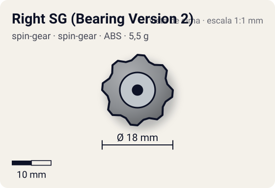
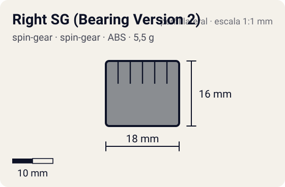

# Right SG (Bearing Version 2)

<!-- auto:inicio (gerado por npm run build:research; não edite este bloco) -->
 

| Medidas e material | |
|---|---|
| Diâmetro | 18 estimado mm |
| Altura / espessura | 16 estimado mm |
| Peso | 5,5 wiki g |
| Material | ABS + eixo de metal + rolamento + ponta de borracha (opaco) |
| Estrelas Takara (A / D / S) | — |
| Usada em | [Wolborg 2](../../../personagens/tala/beyblades/wolborg-2/) |
<!-- auto:fim -->

Spin Gear · sistema **spin-gear** · rotação **direita** · id `spin-gear/right-sg-bearing-version-2`

## Descrição

Sucessor do SG (Bearing Version) do Wolborg: eixo apoiado em rolamento, agora com ponta de borracha. A foto aberta mostra a casca cinza, o eixo metálico e a ponta de borracha azul.

**Função:** A bey gira em volta do eixo enquanto a ponta de borracha fica quase parada, ancorando a bey: defesa enorme com stamina boa, coisa rara para ponta de borracha. Peça-chave dos "Defensive Zombies". Ponto fraco: altura, que expõe a bey a upper attack.

## Funcionamento interno

Gimmick: **bearing**. Ativação: **nenhum**: o eixo gira livre sobre o rolamento o tempo todo.

### Como um Spin Gear funciona

O Spin Gear é o "miolo" da bey de plástico: fica entre o Weight Disk e o Blade Base, no eixo de rotação. A casca tem duas abas onde o lançador engata. A posição das abas define o sentido (direita ou esquerda), e as abas do SG esquerdo são mais salientes para não encaixarem no lançador direito. Embaixo, uma peça em estrela trava no Blade Base; em cima, o AR rosqueia num rebaixo (no sentido contrário ao da rotação, para não soltar). No SG comum há um anel de metal interno que dá um pouco de peso e equilíbrio. Como fica no eixo, o peso do SG praticamente não aumenta o momento de inércia: ele soma massa sem "atrasar" a rotação.

### Eixo livre e rolamentos

Em vez de ponta fixa, a ponta fica num eixo que gira solto dentro da casca, apoiado em rolamento(s). O corpo da bey gira em volta do eixo quase sem atrito, e a ponta pode ficar quase parada no chão. Resultado: muito menos rotação perdida por atrito com o piso e nos impactos (stamina). Com ponta de borracha (Bearing Version 2), a ponta ancora a bey e dá defesa sem destruir a stamina.

## Beys que usam

- `tala/wolborg-2` ([ficha](../../../personagens/tala/beyblades/wolborg-2/))

## Medidas, material e stats

| Item | Valor | Fonte |
|---|---|---|
| Peso | 5,5 g | wiki |
| Diâmetro | 18 mm | estimado |
| Altura | 16 mm | estimado (eixo alto, citado como ponto fraco) |
| Material | ABS + eixo de metal, rolamento, ponta de borracha | ponta de borracha clara e mole (boosters Takara) ou escura e dura (recolor azul Ito Yokado) |
| Stats oficiais (A/D/S) | não publicados | infobox em branco |

Diâmetro e altura não são publicados nas fontes consultadas; são estimativas coerentes com o tamanho de uma bey completa (~45–50 mm de diâmetro, ~25–35 mm de altura; Engine Gears deixam a bey mais alta). As cores seguem as fotos locais quando existem; nos demais casos são estimadas.

## Referência

- `referencia/right-sg-bearing-version-2.jpg` (copiada de `personagens/tala/beyblades/wolborg-2/pecas/spin-gear.jpg`)
- `referencia/right-sg-bearing-version-2-aberto.jpg` (copiada de `personagens/tala/beyblades/wolborg-2/pecas/spin-gear-aberto.jpg`)

## Fontes

- https://beyblade.fandom.com/wiki/Spin_Gear_-_Right_SG_(Bearing_Version_2)
- http://wiki.worldbeyblade.org/index.php?title=Wolborg_2
