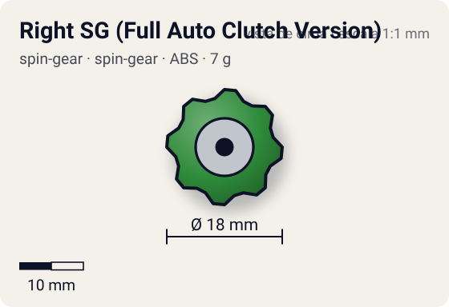
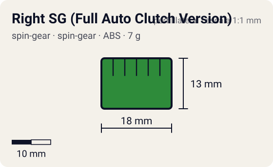

# Right SG (Full Auto Clutch Version)

<!-- auto:inicio (gerado por npm run build:research; não edite este bloco) -->
 

| Medidas e material | |
|---|---|
| Diâmetro | 18 estimado mm |
| Altura / espessura | 13 estimado mm |
| Peso | 7 wiki g |
| Material | ABS + eixo de metal com ponta metal flat + rolamento (opaco) |
| Estrelas Takara (A / D / S) | — |
| Usada em | [Driger F](../../../personagens/ray-kon/beyblades/driger-f/) |
<!-- auto:fim -->

Spin Gear · sistema **spin-gear** · rotação **direita** · id `spin-gear/right-sg-full-auto-clutch-version`

## Descrição

Spin Gear com eixo de metal apoiado num rolamento e terminado em ponta metal flat.

**Função:** O eixo gira solto e reduz a perda de rotação quando a bey é atingida. Testes da WBO (2011) mostraram que a ponta é muito agressiva e difícil de controlar, boa para ataque.

## Funcionamento interno

Gimmick: **free-shaft**. Ativação: **clutch**: a Full Auto Clutch Base troca de modo pela rotação: com a bey rápida, a força centrífuga abre as travas e a ponta fica num modo; quando a rotação cai, as molas fecham e o modo muda.

### Como um Spin Gear funciona

O Spin Gear é o "miolo" da bey de plástico: fica entre o Weight Disk e o Blade Base, no eixo de rotação. A casca tem duas abas onde o lançador engata. A posição das abas define o sentido (direita ou esquerda), e as abas do SG esquerdo são mais salientes para não encaixarem no lançador direito. Embaixo, uma peça em estrela trava no Blade Base; em cima, o AR rosqueia num rebaixo (no sentido contrário ao da rotação, para não soltar). No SG comum há um anel de metal interno que dá um pouco de peso e equilíbrio. Como fica no eixo, o peso do SG praticamente não aumenta o momento de inércia: ele soma massa sem "atrasar" a rotação.

### Eixo livre e rolamentos

Em vez de ponta fixa, a ponta fica num eixo que gira solto dentro da casca, apoiado em rolamento(s). O corpo da bey gira em volta do eixo quase sem atrito, e a ponta pode ficar quase parada no chão. Resultado: muito menos rotação perdida por atrito com o piso e nos impactos (stamina). Com ponta de borracha (Bearing Version 2), a ponta ancora a bey e dá defesa sem destruir a stamina.

### Clutch automático

Na Full Auto Clutch Base, travas com mola reagem à força centrífuga: com a bey rápida, as travas abrem e a ponta trabalha num modo; quando a rotação cai, as molas vencem a força centrífuga e a ponta muda de modo. O SG do Driger F fornece o eixo livre de metal sobre o qual esse mecanismo atua.

## Beys que usam

- `ray-kon/driger-f` ([ficha](../../../personagens/ray-kon/beyblades/driger-f/))

## Medidas, material e stats

| Item | Valor | Fonte |
|---|---|---|
| Peso | 7 g | wiki |
| Diâmetro | 18 mm | estimado |
| Altura | 13 mm | estimado |
| Material | ABS + eixo de metal com ponta metal flat, rolamento | — |
| Stats oficiais (A/D/S) | não publicados | infobox em branco |

Diâmetro e altura não são publicados nas fontes consultadas; são estimativas coerentes com o tamanho de uma bey completa (~45–50 mm de diâmetro, ~25–35 mm de altura; Engine Gears deixam a bey mais alta). As cores seguem as fotos locais quando existem; nos demais casos são estimadas.

## Referência

- Sem foto local desta peça no repositório.

## Fontes

- https://beyblade.fandom.com/wiki/Spin_Gear_-_Right_SG_(Full_Auto_Clutch_Version)
- http://wiki.worldbeyblade.org/index.php?title=Spin_Gear
