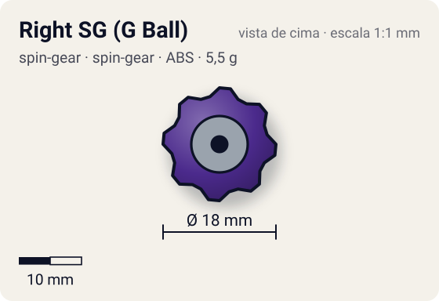
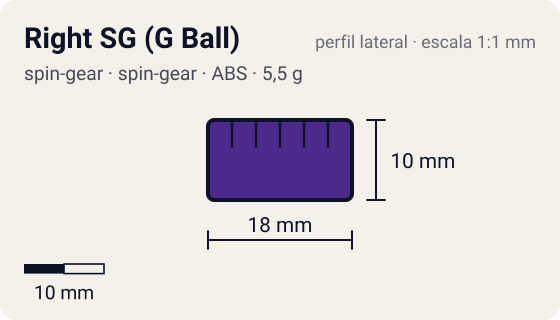

# Right SG (G Ball)

<!-- auto:inicio (gerado por npm run build:research; não edite este bloco) -->
 

| Medidas e material | |
|---|---|
| Diâmetro | 18 estimado mm |
| Altura / espessura | 10 estimado mm |
| Peso | 5,5 estimado g |
| Material | ABS + esfera de metal (opaco) |
| Estrelas Takara (A / D / S) | — |
| Usada em | [Gaia Dragoon (Strata Dragoon)](../../../personagens/daichi-sumeragi/beyblades/gaia-dragoon/) |
<!-- auto:fim -->

Spin Gear · sistema **spin-gear** · rotação **direita** · id `spin-gear/right-sg-g-ball`

## Descrição

Casca de Right SG normal (na foto: roxa, com o adesivo "RIGHT SPIN / 右回転") e um núcleo exclusivo com uma esfera de metal e quatro formas quadradas que prendem as esferas da base.

**Função:** Só funciona com a G Special Base do Gaia Dragoon; sem uso competitivo fora dela.

## Funcionamento interno

Gimmick: **nenhum**. Ativação: **nenhum**: o núcleo trava nas esferas da G Special Base; não há acionamento.

### Como um Spin Gear funciona

O Spin Gear é o "miolo" da bey de plástico: fica entre o Weight Disk e o Blade Base, no eixo de rotação. A casca tem duas abas onde o lançador engata. A posição das abas define o sentido (direita ou esquerda), e as abas do SG esquerdo são mais salientes para não encaixarem no lançador direito. Embaixo, uma peça em estrela trava no Blade Base; em cima, o AR rosqueia num rebaixo (no sentido contrário ao da rotação, para não soltar). No SG comum há um anel de metal interno que dá um pouco de peso e equilíbrio. Como fica no eixo, o peso do SG praticamente não aumenta o momento de inércia: ele soma massa sem "atrasar" a rotação.

## Beys que usam

- `daichi-sumeragi/gaia-dragoon` ([ficha](../../../personagens/daichi-sumeragi/beyblades/gaia-dragoon/))

## Medidas, material e stats

| Item | Valor | Fonte |
|---|---|---|
| Peso | 5,5 g | estimado (sem peso publicado; casca padrão + 1 esfera metálica) |
| Diâmetro | 18 mm | estimado |
| Altura | 10 mm | estimado |
| Material | ABS + esfera de metal | casca roxa (foto local) com adesivo "RIGHT SPIN" |
| Stats oficiais (A/D/S) | não publicados | infobox em branco |

Diâmetro e altura não são publicados nas fontes consultadas; são estimativas coerentes com o tamanho de uma bey completa (~45–50 mm de diâmetro, ~25–35 mm de altura; Engine Gears deixam a bey mais alta). As cores seguem as fotos locais quando existem; nos demais casos são estimadas.

## Referência

- `referencia/right-sg-g-ball.jpg` (copiada de `personagens/daichi-sumeragi/beyblades/gaia-dragoon/pecas/spin-gear.jpg`)
- `referencia/right-sg-g-ball-nucleo.jpg` (copiada de `personagens/daichi-sumeragi/beyblades/gaia-dragoon/pecas/spin-gear-core.jpg`)

## Fontes

- https://beyblade.fandom.com/wiki/Spin_Gear_-_Right_SG_(G_Ball)
- https://beyblade.fandom.com/wiki/Blade_Base_-_G_Special_Base
