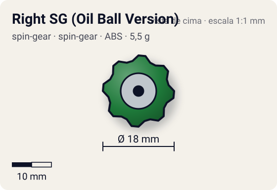
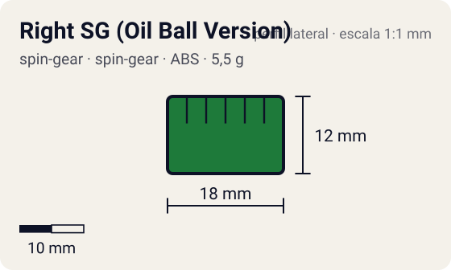

# Right SG (Oil Ball Version)

<!-- auto:inicio (gerado por npm run build:research; não edite este bloco) -->
 

| Medidas e material | |
|---|---|
| Diâmetro | 18 estimado mm |
| Altura / espessura | 12 estimado mm |
| Peso | 5,5 estimado g |
| Material | ABS + esfera de metal + graxa (opaco) |
| Estrelas Takara (A / D / S) | — |
| Usada em | [Draciel F](../../../personagens/max-tate/beyblades/draciel-f/) |
<!-- auto:fim -->

Spin Gear · sistema **spin-gear** · rotação **direita** · id `spin-gear/right-sg-oil-ball-version`

## Descrição

Spin Gear direito do Draciel F com uma esfera de metal na ponta e um reservatório de óleo/graxa logo acima. Nomes nas fontes: "Right SG (Oil Ball Ver.)" (wiki), "Right SG (SG Grease Ball Ver.)" e "Oil Ball Version" (WBO); o GIF da wiki se chama "Ball Bearing spin gear".

**Função:** Ponta redonda de metal, lubrificada: pouco atrito, tende a ficar no centro do estádio. Junto com as bolas de metal da Fortress Base, faz uma defesa pesada.

## Funcionamento interno

Gimmick: **bearing**. Ativação: **nenhum**: a esfera rola o tempo todo; não há acionamento.

### Como um Spin Gear funciona

O Spin Gear é o "miolo" da bey de plástico: fica entre o Weight Disk e o Blade Base, no eixo de rotação. A casca tem duas abas onde o lançador engata. A posição das abas define o sentido (direita ou esquerda), e as abas do SG esquerdo são mais salientes para não encaixarem no lançador direito. Embaixo, uma peça em estrela trava no Blade Base; em cima, o AR rosqueia num rebaixo (no sentido contrário ao da rotação, para não soltar). No SG comum há um anel de metal interno que dá um pouco de peso e equilíbrio. Como fica no eixo, o peso do SG praticamente não aumenta o momento de inércia: ele soma massa sem "atrasar" a rotação.

### Eixo livre e rolamentos

Em vez de ponta fixa, a ponta fica num eixo que gira solto dentro da casca, apoiado em rolamento(s). O corpo da bey gira em volta do eixo quase sem atrito, e a ponta pode ficar quase parada no chão. Resultado: muito menos rotação perdida por atrito com o piso e nos impactos (stamina). Com ponta de borracha (Bearing Version 2), a ponta ancora a bey e dá defesa sem destruir a stamina.

## Observações

- O "gimmick" foi classificado como bearing (esfera que rola lubrificada) por falta de categoria melhor; não é um rolamento de esferas de verdade como o do Wolborg.

## Beys que usam

- `max-tate/draciel-f` ([ficha](../../../personagens/max-tate/beyblades/draciel-f/))

## Medidas, material e stats

| Item | Valor | Fonte |
|---|---|---|
| Peso | 5,5 g | estimado (sem peso publicado) |
| Diâmetro | 18 mm | estimado |
| Altura | 12 mm | estimado |
| Material | ABS + esfera de metal, graxa | a versão Hasbro não trazia o pote de graxa nem o cotonete |
| Stats oficiais (A/D/S) | não publicados | infobox em branco |

Diâmetro e altura não são publicados nas fontes consultadas; são estimativas coerentes com o tamanho de uma bey completa (~45–50 mm de diâmetro, ~25–35 mm de altura; Engine Gears deixam a bey mais alta). As cores seguem as fotos locais quando existem; nos demais casos são estimadas.

## Referência

- `referencia/right-sg-oil-ball-version.gif` (copiada de `personagens/max-tate/beyblades/draciel-f/pecas/spin-gear.gif`)

## Fontes

- https://beyblade.fandom.com/wiki/Draciel_F
- http://wiki.worldbeyblade.org/index.php?title=Draciel_F
- http://wiki.worldbeyblade.org/index.php?title=Spin_Gear
