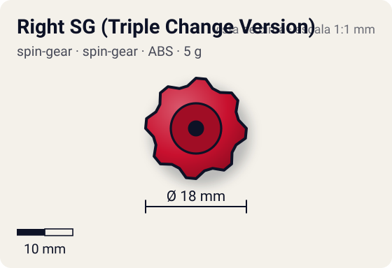
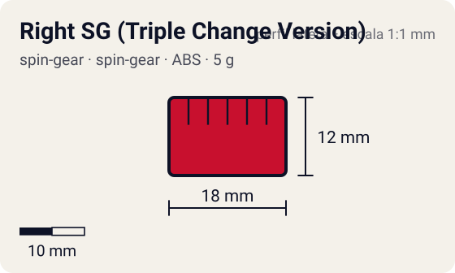

# Right SG (Triple Change Version)

<!-- auto:inicio (gerado por npm run build:research; não edite este bloco) -->
 

| Medidas e material | |
|---|---|
| Diâmetro | 18 estimado mm |
| Altura / espessura | 12 estimado mm |
| Peso | 5 wiki g |
| Material | ABS + peça de três pontas em plástico vermelho (opaco) |
| Estrelas Takara (A / D / S) | — |
| Usada em | [Dranzer F (Dranzer Flame) - emprestada](../../../personagens/tyson-granger/beyblades/dranzer-f/), [Black Dranzer](../../../personagens/kai-hiwatari/beyblades/black-dranzer/), [Dranzer F](../../../personagens/kai-hiwatari/beyblades/dranzer-f/) |
<!-- auto:fim -->

Spin Gear · sistema **spin-gear** · rotação **direita** · id `spin-gear/right-sg-triple-change-version`

## Descrição

Spin Gear direito cuja casca abriga uma peça de plástico com três pontas. Só funciona com a Flame Change Base (Dranzer F / Black Dranzer).

**Função:** Troca manual entre ponta flat (ataque), sharp (stamina) e semi-flat (equilíbrio). Versátil e bom para iniciantes, mas nenhuma das três pontas é excelente.

## Funcionamento interno

Gimmick: **nenhum**. Ativação: **manual**: puxando a peça de três pontas para baixo e girando, escolhe-se ponta flat, sharp ou semi-flat antes da luta.

### Como um Spin Gear funciona

O Spin Gear é o "miolo" da bey de plástico: fica entre o Weight Disk e o Blade Base, no eixo de rotação. A casca tem duas abas onde o lançador engata. A posição das abas define o sentido (direita ou esquerda), e as abas do SG esquerdo são mais salientes para não encaixarem no lançador direito. Embaixo, uma peça em estrela trava no Blade Base; em cima, o AR rosqueia num rebaixo (no sentido contrário ao da rotação, para não soltar). No SG comum há um anel de metal interno que dá um pouco de peso e equilíbrio. Como fica no eixo, o peso do SG praticamente não aumenta o momento de inércia: ele soma massa sem "atrasar" a rotação.

## Observações

- A página "Spin Gear - Right SG" lista Dranzer F e Black Dranzer como Right SG comum; as páginas das beys e a da peça dizem Triple Change Version. Ficou a versão Triple Change.

## Beys que usam

- `kai-hiwatari/black-dranzer` ([ficha](../../../personagens/kai-hiwatari/beyblades/black-dranzer/))
- `kai-hiwatari/dranzer-f` ([ficha](../../../personagens/kai-hiwatari/beyblades/dranzer-f/))
- `tyson-granger/dranzer-f` ([ficha](../../../personagens/tyson-granger/beyblades/dranzer-f/))

## Medidas, material e stats

| Item | Valor | Fonte |
|---|---|---|
| Peso | 5 g | wiki |
| Diâmetro | 18 mm | estimado |
| Altura | 12 mm | estimado |
| Material | ABS + peça de três pontas em plástico vermelho | Black Dranzer (A-38) vem com SG vermelho; versão BBA Championship, verde |
| Stats oficiais (A/D/S) | não publicados | infobox em branco |

Diâmetro e altura não são publicados nas fontes consultadas; são estimativas coerentes com o tamanho de uma bey completa (~45–50 mm de diâmetro, ~25–35 mm de altura; Engine Gears deixam a bey mais alta). As cores seguem as fotos locais quando existem; nos demais casos são estimadas.

## Referência

- Sem foto local desta peça no repositório.

## Fontes

- https://beyblade.fandom.com/wiki/Spin_Gear_-_Right_SG_(Triple_Change_Version)
- https://beyblade.fandom.com/wiki/Dranzer_F
- https://beyblade.fandom.com/wiki/Black_Dranzer
- http://wiki.worldbeyblade.org/index.php?title=Dranzer_F
