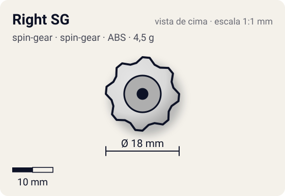
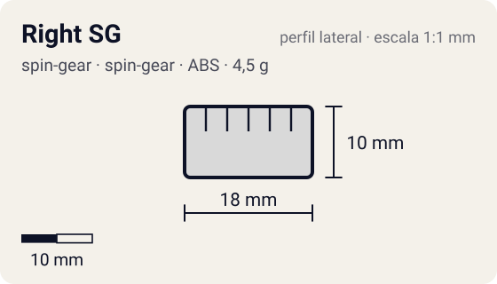

# Right SG

<!-- auto:inicio (gerado por npm run build:research; não edite este bloco) -->
 

| Medidas e material | |
|---|---|
| Diâmetro | 18 estimado mm |
| Altura / espessura | 10 estimado mm |
| Peso | 4,5 estimado g |
| Material | ABS + anel metálico interno (opaco) |
| Estrelas Takara (A / D / S) | — |
| Usada em | [Master Dragoon (genérica, uso temporário)](../../../personagens/tyson-granger/beyblades/master-dragoon/), [Driger S](../../../personagens/ray-kon/beyblades/driger-s/), [Draciel Metal Ball Defenser](../../../personagens/max-tate/beyblades/draciel-metal-ball-defenser/), [Draciel S](../../../personagens/max-tate/beyblades/draciel-s/), [Falborg](../../../personagens/bryan-kuznetsov/beyblades/falborg/), [Falborg 2](../../../personagens/bryan-kuznetsov/beyblades/falborg-2/), [Galeon](../../../personagens/lee/beyblades/galeon/) |
<!-- auto:fim -->

Spin Gear · sistema **spin-gear** · rotação **direita** · id `spin-gear/right-sg`

## Descrição

Spin Gear padrão de rotação direita (estreia com Driger S, jul/2000). Casca de plástico em duas metades, anel de metal interno, peça em estrela embaixo que trava no Blade Base e duas abas perto do lado direito, onde o lançador direito engata.

**Função:** Define o sentido de rotação (direita) e prende a bey: o WD encaixa nas abas, o AR rosqueia no rebaixo de cima (girando no sentido anti-horário para travar) e a estrela de baixo trava no Blade Base. O núcleo não é trocável.

## Funcionamento interno

Gimmick: **nenhum**. Ativação: **nenhum**.

### Como um Spin Gear funciona

O Spin Gear é o "miolo" da bey de plástico: fica entre o Weight Disk e o Blade Base, no eixo de rotação. A casca tem duas abas onde o lançador engata. A posição das abas define o sentido (direita ou esquerda), e as abas do SG esquerdo são mais salientes para não encaixarem no lançador direito. Embaixo, uma peça em estrela trava no Blade Base; em cima, o AR rosqueia num rebaixo (no sentido contrário ao da rotação, para não soltar). No SG comum há um anel de metal interno que dá um pouco de peso e equilíbrio. Como fica no eixo, o peso do SG praticamente não aumenta o momento de inércia: ele soma massa sem "atrasar" a rotação.

## Observações

- Falborg 2 é bey só de anime/mangá: a infobox da wiki diz Right SG, mas a trivia diz que no anime ela usa Engine Gear. Mapeada aqui pela infobox (não confirmado).
- Draciel Metal Ball Defenser: a infobox diz Right SG, mas a bey é da transição 4-layer (fixação por rosca). Mapeada pela infobox.

## Beys que usam

- `bryan-kuznetsov/falborg` ([ficha](../../../personagens/bryan-kuznetsov/beyblades/falborg/))
- `bryan-kuznetsov/falborg-2` ([ficha](../../../personagens/bryan-kuznetsov/beyblades/falborg-2/))
- `lee/galeon` ([ficha](../../../personagens/lee/beyblades/galeon/))
- `max-tate/draciel-metal-ball-defenser` ([ficha](../../../personagens/max-tate/beyblades/draciel-metal-ball-defenser/))
- `max-tate/draciel-s` ([ficha](../../../personagens/max-tate/beyblades/draciel-s/))
- `ray-kon/driger-s` ([ficha](../../../personagens/ray-kon/beyblades/driger-s/))
- `tyson-granger/master-dragoon` ([ficha](../../../personagens/tyson-granger/beyblades/master-dragoon/))

## Medidas, material e stats

| Item | Valor | Fonte |
|---|---|---|
| Peso | 4,5 g | estimado (sem peso publicado; coerente com o Triple Change (5 g) e o Neo SG + Normal Core (3,6 g)) |
| Diâmetro | 18 mm | estimado |
| Altura | 10 mm | estimado |
| Material | ABS + anel metálico interno | casca de plástico em duas metades em volta de um anel de metal e da engrenagem; a cor da casca varia por bey |
| Stats oficiais (A/D/S) | não publicados | infobox em branco |

Diâmetro e altura não são publicados nas fontes consultadas; são estimativas coerentes com o tamanho de uma bey completa (~45–50 mm de diâmetro, ~25–35 mm de altura; Engine Gears deixam a bey mais alta). As cores seguem as fotos locais quando existem; nos demais casos são estimadas.

## Referência

- `referencia/right-sg.gif` (copiada de `personagens/max-tate/beyblades/draciel-s/pecas/spin-gear.gif`)

## Fontes

- https://beyblade.fandom.com/wiki/Spin_Gear_-_Right_SG
- http://wiki.worldbeyblade.org/index.php?title=Spin_Gear
- https://beyblade.fandom.com/wiki/Falborg_2
- https://beyblade.fandom.com/wiki/Draciel_Metal_Ball_Defenser
