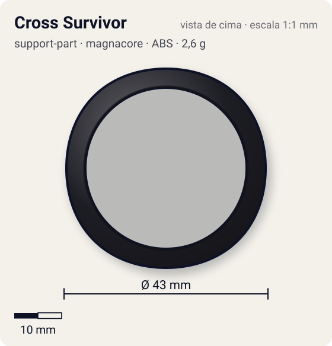
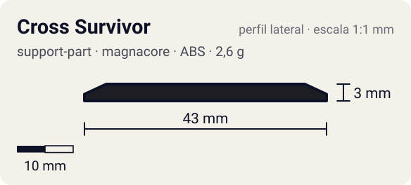

# Cross Survivor

<!-- auto:inicio (gerado por npm run build:research; não edite este bloco) -->
 

| Medidas e material | |
|---|---|
| Diâmetro | 43 estimado mm |
| Altura / espessura | 3 estimado mm |
| Peso | 2,6 wiki g |
| Material | ABS (opaco) |
| Estrelas Takara (A / D / S) | 2 / 0 / 2 |
| Usada em | [Dranzer V2](../../../personagens/kai-hiwatari/beyblades/dranzer-v2/) |
<!-- auto:fim -->

| Campo | Valor |
|---|---|
| Id | `support-part/cross-survivor` |
| Categoria | Support Part |
| Sistema | Magnacore System |
| Material | ABS |
| Acabamento | opaco |
| Cores (primária / secundária / detalhe) | `#1d1d24` / `#2457c5` / `#d8262c` |

## Beys que usam

- `kai-hiwatari/dranzer-v2` ([ficha](../../../personagens/kai-hiwatari/beyblades/dranzer-v2/README.md))

## Formato

Aro **circular** fino (~43 mm) com 4 ondulações quase imperceptíveis; fica entre o WD e a base.

Support Part circular que leva o peso para a periferia.

## Função em batalha

Aumenta a stamina (inércia) e o life after death; usada também em ataque.

## Reação por sentido de rotação

- **Direita (horário visto de cima):** Redondo: igual nos dois sentidos.
- **Esquerda (anti-horário):** Igual.
- Sentido ótimo: **ambos**. Tipo de contato: **survival**, 0 contato(s), recoil 0,1 (0–1, estimado).

## Combos conhecidos

- Wiki (Dragoon V2): Cross Survivor como alternativa ao Defense Ring em zombies defensivos.

## Medidas, material e stats

| Item | Valor | Fonte |
|---|---|---|
| Diâmetro | 43 mm | estimado (2 × maior raio da `forma`) |
| Altura | 3 mm | estimado |
| Peso | 2,6 g | wiki |
| Material | ABS | Anel único sob o Weight Disk. |
| Ataque / Defesa / Stamina | 2 / 0 / 2 | Beyblade Wiki, Part Infobox |
| Raio de contato | 21,5 mm | estimado |

## Forma (parâmetros do gerador de SVG)

Convenção: ângulos em graus, sentido horário visto de cima, 0° = topo; o setor (0 a 90°) se repete 4 vezes. Na rotação **direita** a face em `fim` é a que bate; na **esquerda**, a face em `inicio`. Anel base com raio 21 mm, furo central 17 mm, espessura 3 mm.

| início | pico | fim | raio (mm) | borda | altura (mm) | material |
|---|---|---|---|---|---|---|
| 0° | 45° | 90° | 21,5 | curva | 3 | ABS/PC |

## Observações

Cores aproximadas.

## Referências locais

- Nenhuma foto local desta peça no repositório.

## Fontes

- https://beyblade.fandom.com/wiki/Support_Parts_-_Cross_Survivor
- https://beyblade.fandom.com/wiki/Dranzer_V2
