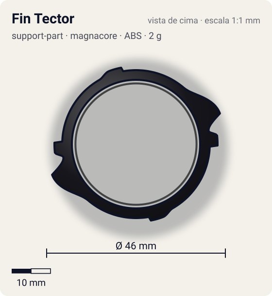
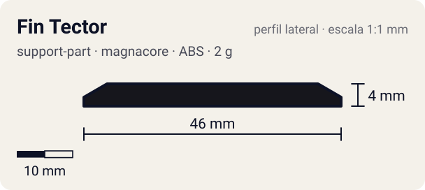

# Fin Tector

<!-- auto:inicio (gerado por npm run build:research; não edite este bloco) -->
 

| Medidas e material | |
|---|---|
| Diâmetro | 46 estimado mm |
| Altura / espessura | 4 estimado mm |
| Peso | 2 wiki g |
| Material | ABS (opaco) |
| Estrelas Takara (A / D / S) | 1,5 / 1 / 0 |
| Usada em | [Draciel V2](../../../personagens/max-tate/beyblades/draciel-v2/) |
<!-- auto:fim -->

| Campo | Valor |
|---|---|
| Id | `support-part/fin-tector` |
| Categoria | Support Part |
| Sistema | Magnacore System |
| Material | ABS |
| Acabamento | opaco |
| Cores (primária / secundária / detalhe) | `#16161c` / `#c5dc2a` / `#2e9e44` |

## Beys que usam

- `max-tate/draciel-v2` ([ficha](../../../personagens/max-tate/beyblades/draciel-v2/README.md))

## Formato

Duas meias-luas finas (raio ~19 mm) que formam um aro com 2 vãos. Cada uma tem uma **aleta em seta** que sai em ponta (~23 mm) com um degrau atrás (~21 mm), e nas extremidades os encaixes com pinos.

Duas peças em "C" pretas com aleta em seta amarelo-esverdeada (adesivo "FIN TECTOR"), reversíveis.

## Função em batalha

Modo Ataque: melhor SP para smash (wiki). Modo Defesa: uso moderado em zombie.

## Reação por sentido de rotação

- **Direita (horário visto de cima):** Modo ataque: as pontas das setas lideram (smash).
- **Esquerda (anti-horário):** Invertendo as peças, as setas apontam para o outro lado.
- Sentido ótimo: **direita**. Tipo de contato: **smash**, 2 contato(s), recoil 0,45 (0–1, estimado).

## Combos conhecidos

- Wiki: Double Wing, Wide Defense, Left SG (Bearing Ver. 2), Fin Tector (modo ataque): smash.

## Medidas, material e stats

| Item | Valor | Fonte |
|---|---|---|
| Diâmetro | 46 mm | estimado (2 × maior raio da `forma`) |
| Altura | 4 mm | estimado |
| Peso | 2 g | wiki |
| Material | ABS | Par de peças reversíveis (modo Ataque / modo Defesa); frágeis. |
| Ataque / Defesa / Stamina | — (não publicados) | — |
| Raio de contato | 23 mm | estimado |

## Forma (parâmetros do gerador de SVG)

Convenção: ângulos em graus, sentido horário visto de cima, 0° = topo; o setor (0 a 180°) se repete 2 vezes. Na rotação **direita** a face em `fim` é a que bate; na **esquerda**, a face em `inicio`. Anel base com raio 19 mm, furo central 16,5 mm, espessura 3 mm.

| início | pico | fim | raio (mm) | borda | altura (mm) | material |
|---|---|---|---|---|---|---|
| 40° | 70° | 80° | 23 | ponta | 4 | ABS/PC |
| 80° | 84° | 92° | 21 | reta | 4 | ABS/PC |
| 150° | 160° | 170° | 20 | reta | 4 | ABS/PC |

## Observações

Peso da página da Draciel V2 (2 g para o par).

## Referências locais

- [referencia/draciel-v2-support-part.jpg](referencia/draciel-v2-support-part.jpg) (cópia de `personagens/max-tate/beyblades/draciel-v2/pecas/support-part.jpg`)
- [referencia/draciel-v2-pecas-desmontadas.jpg](referencia/draciel-v2-pecas-desmontadas.jpg) (cópia de `personagens/max-tate/beyblades/draciel-v2/pecas/pecas-desmontadas.jpg`)

## Fontes

- https://beyblade.fandom.com/wiki/Draciel_V2
