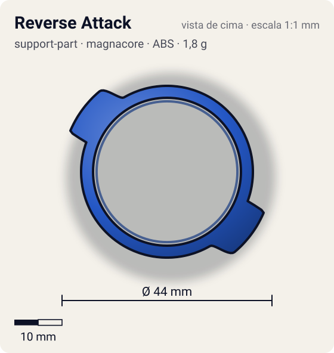
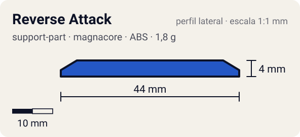

# Reverse Attack

<!-- auto:inicio (gerado por npm run build:research; não edite este bloco) -->
 

| Medidas e material | |
|---|---|
| Diâmetro | 44 estimado mm |
| Altura / espessura | 4 estimado mm |
| Peso | 1,8 wiki g |
| Material | ABS (opaco) |
| Estrelas Takara (A / D / S) | 2 / 0 / 0 |
| Usada em | [Dragoon V2 (Dragoon Victory 2)](../../../personagens/tyson-granger/beyblades/dragoon-v2/), [Dragoon V2 High Power Custom](../../../personagens/tyson-granger/beyblades/dragoon-v2-high-power-custom/) |
<!-- auto:fim -->

| Campo | Valor |
|---|---|
| Id | `support-part/reverse-attack` |
| Categoria | Support Part |
| Sistema | Magnacore System |
| Material | ABS |
| Acabamento | opaco |
| Cores (primária / secundária / detalhe) | `#2457c5` / `#f0f0f0` / `#d8262c` |

## Beys que usam

- `tyson-granger/dragoon-v2` ([ficha](../../../personagens/tyson-granger/beyblades/dragoon-v2/README.md))
- `tyson-granger/dragoon-v2-high-power-custom` ([ficha](../../../personagens/tyson-granger/beyblades/dragoon-v2-high-power-custom/README.md))

## Formato

Dois arcos finos (raio ~18 mm) com uma **aleta** cada, de face reta virada para o sentido anti-horário (~22 mm), afinando para trás.

Duas peças laterais encaixadas na Customize Grip Base, com contatos baixos.

## Função em batalha

Mais pontos de contato baixos para smash em rotação esquerda.

## Reação por sentido de rotação

- **Direita (horário visto de cima):** Aletas de costas: pouco efeito.
- **Esquerda (anti-horário):** Faces retas lideram: contato baixo extra.
- Sentido ótimo: **esquerda**. Tipo de contato: **smash**, 2 contato(s), recoil 0,5 (0–1, estimado).

## Combos conhecidos

- Nenhum combo documentado nas fontes.

## Medidas, material e stats

| Item | Valor | Fonte |
|---|---|---|
| Diâmetro | 44 mm | estimado (2 × maior raio da `forma`) |
| Altura | 4 mm | estimado |
| Peso | 1,8 g | wiki |
| Material | ABS | Par de peças de 0,9 g cada. |
| Ataque / Defesa / Stamina | — (não publicados) | — |
| Raio de contato | 22 mm | estimado |

## Forma (parâmetros do gerador de SVG)

Convenção: ângulos em graus, sentido horário visto de cima, 0° = topo; o setor (0 a 180°) se repete 2 vezes. Na rotação **direita** a face em `fim` é a que bate; na **esquerda**, a face em `inicio`. Anel base com raio 18 mm, furo central 15,5 mm, espessura 3 mm.

| início | pico | fim | raio (mm) | borda | altura (mm) | material |
|---|---|---|---|---|---|---|
| 30° | 40° | 70° | 22 | reta | 4 | ABS/PC |

## Observações

Peso da wiki (0,9 g cada). Forma e cores estimadas (sem foto local, sem página própria na wiki).

## Referências locais

- Nenhuma foto local desta peça no repositório.

## Fontes

- https://beyblade.fandom.com/wiki/Dragoon_V2
- https://beyblade.fandom.com/wiki/Special_Parts
