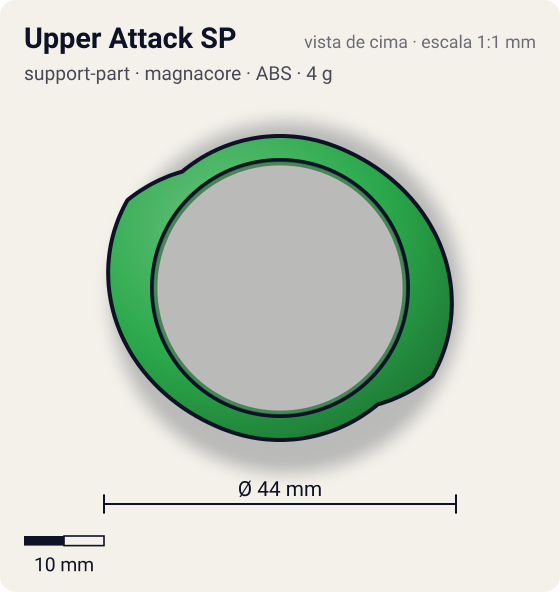
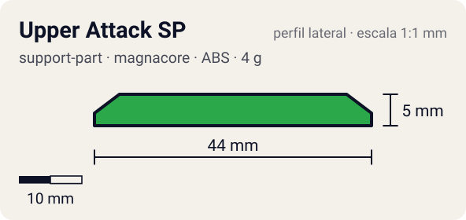

# Upper Attack SP

<!-- auto:inicio (gerado por npm run build:research; não edite este bloco) -->
 

| Medidas e material | |
|---|---|
| Diâmetro | 44 estimado mm |
| Altura / espessura | 5 estimado mm |
| Peso | 4 wiki g |
| Material | ABS (opaco) |
| Estrelas Takara (A / D / S) | 2 / 0 / 0 |
| Usada em | [Driger V2](../../../personagens/ray-kon/beyblades/driger-v2/) |
<!-- auto:fim -->

| Campo | Valor |
|---|---|
| Id | `support-part/upper-attack-sp` |
| Categoria | Support Part |
| Sistema | Magnacore System |
| Material | ABS |
| Acabamento | opaco |
| Cores (primária / secundária / detalhe) | `#2aa84a` / `#e8e8e8` / `#1a1a1a` |

## Beys que usam

- `ray-kon/driger-v2` ([ficha](../../../personagens/ray-kon/beyblades/driger-v2/README.md))

## Formato

Duas peças em arco (raio ~19 mm) penduradas bem baixo, cada uma com uma **rampa longa** (~100°) que sobe até ~22 mm e encontra a rampa do Upper Claw.

SP baixas com rampa que se alinha à rampa do Upper Claw, dobrando o comprimento da rampa.

## Função em batalha

Começa a rampa mais baixa que qualquer AR: entra embaixo até de beys baixas; pode raspar no chão.

## Reação por sentido de rotação

- **Direita (horário visto de cima):** Rampas lideram: upper forte (com o Upper Claw).
- **Esquerda (anti-horário):** Sem rampa útil.
- Sentido ótimo: **direita**. Tipo de contato: **upper**, 2 contato(s), recoil 0,3 (0–1, estimado).

## Combos conhecidos

- Wiki: Upper Claw, Ten Heavy, Neo Right SG (Heavy Metal Core), Upper Attack SP, Customize Grip Base: upper.

## Medidas, material e stats

| Item | Valor | Fonte |
|---|---|---|
| Diâmetro | 44 mm | estimado (2 × maior raio da `forma`) |
| Altura | 5 mm | estimado |
| Peso | 4 g | wiki |
| Material | ABS | Par de peças; podem ser invertidas (exige 6 Heavy). |
| Ataque / Defesa / Stamina | — (não publicados) | — |
| Raio de contato | 22 mm | estimado |

## Forma (parâmetros do gerador de SVG)

Convenção: ângulos em graus, sentido horário visto de cima, 0° = topo; o setor (0 a 180°) se repete 2 vezes. Na rotação **direita** a face em `fim` é a que bate; na **esquerda**, a face em `inicio`. Anel base com raio 19 mm, furo central 16 mm, espessura 4 mm.

| início | pico | fim | raio (mm) | borda | altura (mm) | material |
|---|---|---|---|---|---|---|
| 20° | 120° | 140° | 22 | rampa | 5 | ABS/PC |

## Observações

Cores aproximadas.

## Referências locais

- Nenhuma foto local desta peça no repositório.

## Fontes

- https://beyblade.fandom.com/wiki/Support_Part_-_Upper_Attack_SP
- https://beyblade.fandom.com/wiki/Driger_V2
