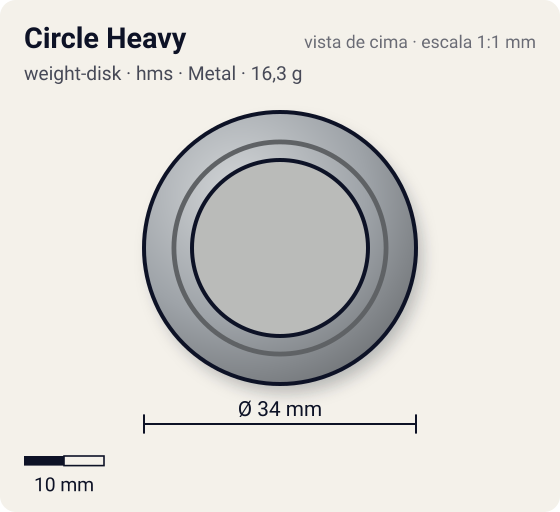
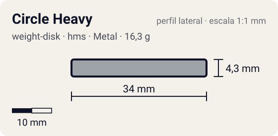

# Circle Heavy

<!-- auto:inicio (gerado por npm run build:research; não edite este bloco) -->
 

| Medidas e material | |
|---|---|
| Diâmetro | 34 estimado mm |
| Altura / espessura | 4,3 estimado mm |
| Peso | 16,3 wiki g |
| Material | Metal (metalico) |
| Estrelas Takara (A / D / S) | 2 / 2 / 1 |
| Usada em | [Gaia Dragoon MS (Strata Dragoon MS / Metal Spike)](../../../personagens/daichi-sumeragi/beyblades/gaia-dragoon-ms/) |
<!-- auto:fim -->

Weight Disk (サークルヘビィ) · sistema **hms** · id `weight-disk/circle-heavy`

## Descrição

Disco circular e pesado do HMS (estreia com Strata/Gaia Dragoon MS, ago/2003). É o mais compacto e pesado dos três Circle.

**Função:** A wiki diz que ele tem distribuição de peso "alta para fora" (OWD) e serve para ataque e defesa. Como é o menor dos três Circle, aqui fica como "equilibrado": pesado, mas sem a massa na borda de um Wide.

## Funcionamento interno

O Weight Disk é o anel de metal entre o Attack Ring e o Spin Gear (ou Running Core). É a peça mais pesada da bey de plástico (13–17 g, quase metade do peso total), então é ela que mais define massa e momento de inércia. Este disco tem distribuição **equilibrado** (massa distribuída entre o centro e a borda).

### Por que o lugar do peso muda RPM e estabilidade

O lançador entrega à bey um impulso de rotação (momento angular, `L = I·ω`). O momento de inércia `I` soma cada pedaço de massa vezes o quadrado da distância ao eixo (`I = Σ m·r²`), então **onde** o metal fica pesa mais que **quanto** metal existe.

- **Peso no centro** (Heavy): `I` menor para a mesma massa. Com o mesmo puxão, a bey sai com **mais RPM**, fica mais compacta e mais difícil de empurrar (massa alta), o que ajuda defesa e combos compactos. Em compensação guarda menos energia por RPM e perde rotação mais rápido quando atrita.
- **Peso na periferia** (Wide, Circle Wide): `I` maior. A bey sai com RPM um pouco menor, mas guarda mais energia de rotação e tem mais estabilidade giroscópica. Perde rotação mais devagar a cada choque ou atrito (stamina, roubo de rotação) e entrega golpes mais fortes, porque a massa está no raio de contato (smash attack). Também ajuda a controlar o recuo de ARs agressivos.
- **Balance** fica no meio-termo.

## Beys que usam

- `daichi-sumeragi/gaia-dragoon-ms` ([ficha](../../../personagens/daichi-sumeragi/beyblades/gaia-dragoon-ms/))

## Medidas, material e stats

| Item | Valor | Fonte |
|---|---|---|
| Peso | 16,3 g | wiki |
| Diâmetro (vértice a vértice) | 34 mm | estimado |
| Espessura | 4,3 mm | estimado (calculada do peso com densidade 7.1 g/cm³) |
| Lados | circular | wiki (nome/descrição) |
| Material | Metal | metal fundido; a liga não é especificada nas fontes |
| Stats oficiais (A/D/S) | 2 / 2 / 1 | Beyblade Wiki, Part Infobox (Weight Disk - Circle Heavy) |

Não há medidas de diâmetro/espessura publicadas nas fontes consultadas (Beyblade Wiki e WBO). Diâmetro e furo central foram estimados pela proporção das fotos e pelo tamanho típico de uma bey de plástico (~45–50 mm). A espessura foi calculada para fechar com o peso publicado, assumindo densidade de 7,1 g/cm³.

## Referência

- Sem foto local desta peça no repositório.

## Fontes

- https://beyblade.fandom.com/wiki/Weight_Disk_-_Circle_Heavy
- http://wiki.worldbeyblade.org/index.php?title=Gaia_Dragoon_MS
