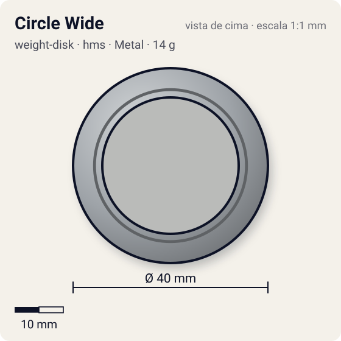
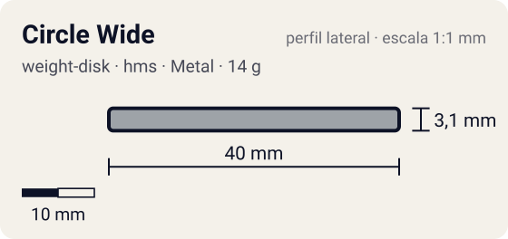

# Circle Wide

<!-- auto:inicio (gerado por npm run build:research; não edite este bloco) -->
 

| Medidas e material | |
|---|---|
| Diâmetro | 40 estimado mm |
| Altura / espessura | 3,1 estimado mm |
| Peso | 14 wiki g |
| Material | Metal (metalico) |
| Estrelas Takara (A / D / S) | 1 / 1 / 3 |
| Usada em | [Dragoon MS (Dragoon Metal Storm)](../../../personagens/tyson-granger/beyblades/dragoon-ms/), [Dragoon MS Ultimate Version](../../../personagens/tyson-granger/beyblades/dragoon-ms-ultimate-version/), [Draciel MS](../../../personagens/max-tate/beyblades/draciel-ms/) |
<!-- auto:fim -->

Weight Disk · sistema **hms** · id `weight-disk/circle-wide`

## Descrição

O maior e mais leve dos três Weight Disks originais do Hard Metal System: um círculo perfeito com a massa afastada do eixo. Há variação de molde: o do Draciel MS Takara é mais pesado; os da Sonokong têm os rasgos de encaixe no Running Core um pouco menores.

**Função:** Massa na periferia: bom para stamina (o eixo de massa afastado sustenta a rotação) e para ataque (leve, rápido e com o peso nas projeções do AR).

## Funcionamento interno

O Weight Disk é o anel de metal entre o Attack Ring e o Spin Gear (ou Running Core). É a peça mais pesada da bey de plástico (13–17 g, quase metade do peso total), então é ela que mais define massa e momento de inércia. Este disco tem distribuição **periferia** (massa jogada para a borda).

### Por que o lugar do peso muda RPM e estabilidade

O lançador entrega à bey um impulso de rotação (momento angular, `L = I·ω`). O momento de inércia `I` soma cada pedaço de massa vezes o quadrado da distância ao eixo (`I = Σ m·r²`), então **onde** o metal fica pesa mais que **quanto** metal existe.

- **Peso no centro** (Heavy): `I` menor para a mesma massa. Com o mesmo puxão, a bey sai com **mais RPM**, fica mais compacta e mais difícil de empurrar (massa alta), o que ajuda defesa e combos compactos. Em compensação guarda menos energia por RPM e perde rotação mais rápido quando atrita.
- **Peso na periferia** (Wide, Circle Wide): `I` maior. A bey sai com RPM um pouco menor, mas guarda mais energia de rotação e tem mais estabilidade giroscópica. Perde rotação mais devagar a cada choque ou atrito (stamina, roubo de rotação) e entrega golpes mais fortes, porque a massa está no raio de contato (smash attack). Também ajuda a controlar o recuo de ARs agressivos.
- **Balance** fica no meio-termo.

## Beys que usam

- `max-tate/draciel-ms` ([ficha](../../../personagens/max-tate/beyblades/draciel-ms/))
- `tyson-granger/dragoon-ms` ([ficha](../../../personagens/tyson-granger/beyblades/dragoon-ms/))
- `tyson-granger/dragoon-ms-ultimate-version` ([ficha](../../../personagens/tyson-granger/beyblades/dragoon-ms-ultimate-version/))

## Medidas, material e stats

| Item | Valor | Fonte |
|---|---|---|
| Peso | 14 g | wiki (o molde Takara do Draciel MS pesa 0,5–0,7 g a mais (WBO: 15 g)) |
| Diâmetro (vértice a vértice) | 40 mm | estimado |
| Espessura | 3,1 mm | estimado (calculada do peso com densidade 7.1 g/cm³) |
| Lados | circular | wiki (nome/descrição) |
| Material | Metal | metal fundido; a liga não é especificada nas fontes |
| Stats oficiais (A/D/S) | não publicados | infobox em branco |

Não há medidas de diâmetro/espessura publicadas nas fontes consultadas (Beyblade Wiki e WBO). Diâmetro e furo central foram estimados pela proporção das fotos e pelo tamanho típico de uma bey de plástico (~45–50 mm). A espessura foi calculada para fechar com o peso publicado, assumindo densidade de 7,1 g/cm³.

## Referência

- `referencia/circle-wide.jpg` (copiada de `personagens/max-tate/beyblades/draciel-ms/pecas/weight-disk.jpg`)

## Fontes

- https://beyblade.fandom.com/wiki/Weight_Disk_-_Circle_Wide
- http://wiki.worldbeyblade.org/index.php?title=Draciel_MS
