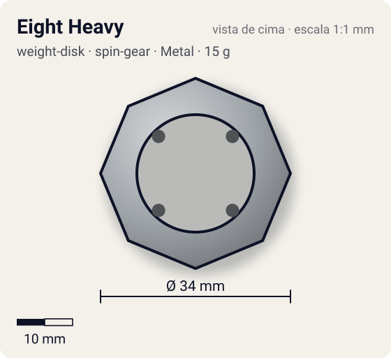
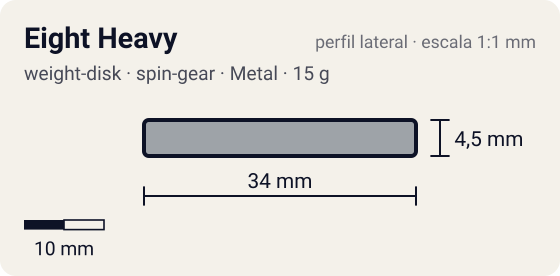

# Eight Heavy

<!-- auto:inicio (gerado por npm run build:research; não edite este bloco) -->
 

| Medidas e material | |
|---|---|
| Diâmetro | 34 estimado mm |
| Altura / espessura | 4,5 estimado mm |
| Peso | 15 wiki g |
| Material | Metal (metalico) |
| Estrelas Takara (A / D / S) | 0,5 / 3 / 1,5 |
| Usada em | [Dranzer F (Dranzer Flame) - emprestada](../../../personagens/tyson-granger/beyblades/dranzer-f/), [Master Dragoon (genérica, uso temporário)](../../../personagens/tyson-granger/beyblades/master-dragoon/), [Black Dranzer](../../../personagens/kai-hiwatari/beyblades/black-dranzer/), [Dranzer F](../../../personagens/kai-hiwatari/beyblades/dranzer-f/), [Driger S](../../../personagens/ray-kon/beyblades/driger-s/), [Falborg](../../../personagens/bryan-kuznetsov/beyblades/falborg/), [Galeon](../../../personagens/lee/beyblades/galeon/) |
<!-- auto:fim -->

Weight Disk · sistema **spin-gear** · id `weight-disk/eight-heavy`

## Descrição

Disco octogonal compacto e grosso da série Heavy. A foto mostra o octógono com a abertura central larga, duas pontes internas com dois furos cada e o número "8" gravado.

**Função:** Massa perto do centro: mais RPM e estabilidade, bom para combos compactos e de defesa. Curiosamente é mais leve que o Six Heavy (15 g contra 16 g).

## Funcionamento interno

O Weight Disk é o anel de metal entre o Attack Ring e o Spin Gear (ou Running Core). É a peça mais pesada da bey de plástico (13–17 g, quase metade do peso total), então é ela que mais define massa e momento de inércia. Este disco tem distribuição **centro** (massa concentrada perto do eixo).

### Por que o lugar do peso muda RPM e estabilidade

O lançador entrega à bey um impulso de rotação (momento angular, `L = I·ω`). O momento de inércia `I` soma cada pedaço de massa vezes o quadrado da distância ao eixo (`I = Σ m·r²`), então **onde** o metal fica pesa mais que **quanto** metal existe.

- **Peso no centro** (Heavy): `I` menor para a mesma massa. Com o mesmo puxão, a bey sai com **mais RPM**, fica mais compacta e mais difícil de empurrar (massa alta), o que ajuda defesa e combos compactos. Em compensação guarda menos energia por RPM e perde rotação mais rápido quando atrita.
- **Peso na periferia** (Wide, Circle Wide): `I` maior. A bey sai com RPM um pouco menor, mas guarda mais energia de rotação e tem mais estabilidade giroscópica. Perde rotação mais devagar a cada choque ou atrito (stamina, roubo de rotação) e entrega golpes mais fortes, porque a massa está no raio de contato (smash attack). Também ajuda a controlar o recuo de ARs agressivos.
- **Balance** fica no meio-termo.

## Beys que usam

- `bryan-kuznetsov/falborg` ([ficha](../../../personagens/bryan-kuznetsov/beyblades/falborg/))
- `kai-hiwatari/black-dranzer` ([ficha](../../../personagens/kai-hiwatari/beyblades/black-dranzer/))
- `kai-hiwatari/dranzer-f` ([ficha](../../../personagens/kai-hiwatari/beyblades/dranzer-f/))
- `lee/galeon` ([ficha](../../../personagens/lee/beyblades/galeon/))
- `ray-kon/driger-s` ([ficha](../../../personagens/ray-kon/beyblades/driger-s/))
- `tyson-granger/dranzer-f` ([ficha](../../../personagens/tyson-granger/beyblades/dranzer-f/))
- `tyson-granger/master-dragoon` ([ficha](../../../personagens/tyson-granger/beyblades/master-dragoon/))

## Medidas, material e stats

| Item | Valor | Fonte |
|---|---|---|
| Peso | 15 g | wiki |
| Diâmetro (vértice a vértice) | 34 mm | estimado |
| Espessura | 4,5 mm | estimado (calculada do peso com densidade 7.1 g/cm³) |
| Lados | 8 | wiki (nome/descrição) |
| Material | Metal | metal fundido; a liga não é especificada nas fontes |
| Stats oficiais (A/D/S) | não publicados | infobox em branco |

Não há medidas de diâmetro/espessura publicadas nas fontes consultadas (Beyblade Wiki e WBO). Diâmetro e furo central foram estimados pela proporção das fotos e pelo tamanho típico de uma bey de plástico (~45–50 mm). A espessura foi calculada para fechar com o peso publicado, assumindo densidade de 7,1 g/cm³.

## Referência

- `referencia/eight-heavy.png` (copiada de `personagens/bryan-kuznetsov/beyblades/falborg/pecas/weight-disk.png`)

## Fontes

- https://beyblade.fandom.com/wiki/Weight_Disk_-_Eight_Heavy
- http://wiki.worldbeyblade.org/index.php?title=Heavy_Weight_Disks
