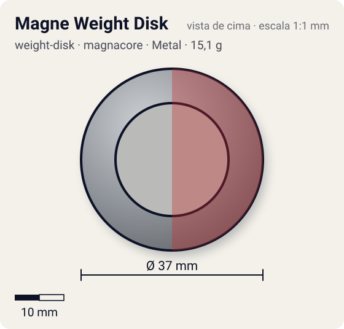
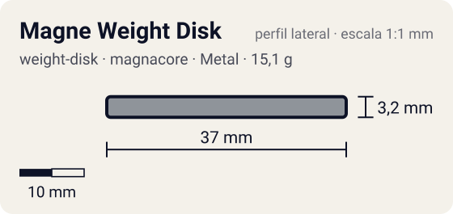

# Magne Weight Disk

<!-- auto:inicio (gerado por npm run build:research; não edite este bloco) -->
 

| Medidas e material | |
|---|---|
| Diâmetro | 37 estimado mm |
| Altura / espessura | 3,2 estimado mm |
| Peso | 15,1 wiki g |
| Material | Metal + Ímã (metalico) |
| Estrelas Takara (A / D / S) | 3 / 3 / 3 |
| Usada em | [Dragoon V2 (Dragoon Victory 2)](../../../personagens/tyson-granger/beyblades/dragoon-v2/) |
<!-- auto:fim -->

Weight Disk (マグネウエイトディスク) · sistema **magnacore** · id `weight-disk/magne-weight-disk`

## Descrição

Weight Disk magnético com dois lados distintos, polo Norte e polo Sul: virando o disco, troca-se a polaridade que fica para cima. Também chamado "Magnetic Weight Disk". Saiu com Dragoon V2 e Voltaic Ape e em pacotes avulsos. Formato exato não confirmado nas fontes de texto (a forma aqui é aproximada).

**Função:** Reforça o efeito de um Magnecore e permite movimentos mais irregulares em estádio magnético. Entre duas beys com Magne WD, polos iguais para cima se repelem (a luta vira de resistência) e polos diferentes se atraem (contato constante). Permite que beys de Spin Gear comum usem o sistema Magnacore.

## Funcionamento interno

O Weight Disk é o anel de metal entre o Attack Ring e o Spin Gear (ou Running Core). É a peça mais pesada da bey de plástico (13–17 g, quase metade do peso total), então é ela que mais define massa e momento de inércia. Este disco tem distribuição **equilibrado** (massa distribuída entre o centro e a borda).

### Por que o lugar do peso muda RPM e estabilidade

O lançador entrega à bey um impulso de rotação (momento angular, `L = I·ω`). O momento de inércia `I` soma cada pedaço de massa vezes o quadrado da distância ao eixo (`I = Σ m·r²`), então **onde** o metal fica pesa mais que **quanto** metal existe.

- **Peso no centro** (Heavy): `I` menor para a mesma massa. Com o mesmo puxão, a bey sai com **mais RPM**, fica mais compacta e mais difícil de empurrar (massa alta), o que ajuda defesa e combos compactos. Em compensação guarda menos energia por RPM e perde rotação mais rápido quando atrita.
- **Peso na periferia** (Wide, Circle Wide): `I` maior. A bey sai com RPM um pouco menor, mas guarda mais energia de rotação e tem mais estabilidade giroscópica. Perde rotação mais devagar a cada choque ou atrito (stamina, roubo de rotação) e entrega golpes mais fortes, porque a massa está no raio de contato (smash attack). Também ajuda a controlar o recuo de ARs agressivos.
- **Balance** fica no meio-termo.

### Magnetismo

O disco tem uma face Norte e uma face Sul. Ele soma força ao Magnecore no eixo e reage aos ímãs do estádio e a outro Magne WD (polos iguais se repelem, diferentes se atraem). Ver a seção sobre Magnecore no [README da categoria spin-gear](../../spin-gear/README.md).

## Beys que usam

- `tyson-granger/dragoon-v2` ([ficha](../../../personagens/tyson-granger/beyblades/dragoon-v2/))

## Medidas, material e stats

| Item | Valor | Fonte |
|---|---|---|
| Peso | 15,1 g | wiki (WBO mediu 14,6 g na unidade do Dragoon V2) |
| Diâmetro (vértice a vértice) | 37 mm | estimado |
| Espessura | 3,2 mm | estimado (calculada do peso com densidade 7.1 g/cm³) |
| Lados | circular | wiki (nome/descrição) |
| Material | Metal + Ímã | disco magnético com face Norte e face Sul |
| Stats oficiais (A/D/S) | 3 / 3 / 3 | Beyblade Wiki, Part Infobox (Weight Disk - Magnetic Weight Disk) |

Não há medidas de diâmetro/espessura publicadas nas fontes consultadas (Beyblade Wiki e WBO). Diâmetro e furo central foram estimados pela proporção das fotos e pelo tamanho típico de uma bey de plástico (~45–50 mm). A espessura foi calculada para fechar com o peso publicado, assumindo densidade de 7,1 g/cm³.

## Referência

- Sem foto local desta peça no repositório.

## Fontes

- https://beyblade.fandom.com/wiki/Weight_Disk_-_Magnetic_Weight_Disk
- http://wiki.worldbeyblade.org/index.php?title=Magnecore
- http://wiki.worldbeyblade.org/index.php?title=Dragoon_V2
