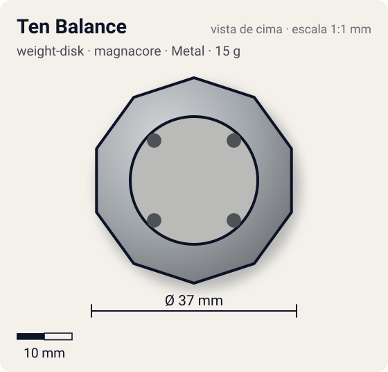
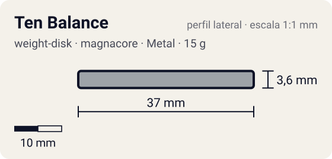

# Ten Balance

<!-- auto:inicio (gerado por npm run build:research; não edite este bloco) -->
 

| Medidas e material | |
|---|---|
| Diâmetro | 37 estimado mm |
| Altura / espessura | 3,6 estimado mm |
| Peso | 15 wiki g |
| Material | Metal (metalico) |
| Estrelas Takara (A / D / S) | 1 / 2 / 3 |
| Usada em | [Dranzer G](../../../personagens/kai-hiwatari/beyblades/dranzer-g/), [Dranzer GT](../../../personagens/kai-hiwatari/beyblades/dranzer-gt/), [Dranzer V](../../../personagens/kai-hiwatari/beyblades/dranzer-v/), [Dranzer V2](../../../personagens/kai-hiwatari/beyblades/dranzer-v2/), [Driger G](../../../personagens/ray-kon/beyblades/driger-g/), [Driger V](../../../personagens/ray-kon/beyblades/driger-v/), [Driger V2](../../../personagens/ray-kon/beyblades/driger-v2/), [Draciel V](../../../personagens/max-tate/beyblades/draciel-v/) |
<!-- auto:fim -->

Weight Disk · sistema **magnacore** · id `weight-disk/ten-balance`

## Descrição

Disco decagonal, o mais pesado da série Balance, com os dois Attack Points comuns à série "Ten".

**Função:** Distribuição de massa equilibrada, stamina razoável; é o Balance preferido, mas perde para o Ten Heavy em customização.

## Funcionamento interno

O Weight Disk é o anel de metal entre o Attack Ring e o Spin Gear (ou Running Core). É a peça mais pesada da bey de plástico (13–17 g, quase metade do peso total), então é ela que mais define massa e momento de inércia. Este disco tem distribuição **equilibrado** (massa distribuída entre o centro e a borda).

### Por que o lugar do peso muda RPM e estabilidade

O lançador entrega à bey um impulso de rotação (momento angular, `L = I·ω`). O momento de inércia `I` soma cada pedaço de massa vezes o quadrado da distância ao eixo (`I = Σ m·r²`), então **onde** o metal fica pesa mais que **quanto** metal existe.

- **Peso no centro** (Heavy): `I` menor para a mesma massa. Com o mesmo puxão, a bey sai com **mais RPM**, fica mais compacta e mais difícil de empurrar (massa alta), o que ajuda defesa e combos compactos. Em compensação guarda menos energia por RPM e perde rotação mais rápido quando atrita.
- **Peso na periferia** (Wide, Circle Wide): `I` maior. A bey sai com RPM um pouco menor, mas guarda mais energia de rotação e tem mais estabilidade giroscópica. Perde rotação mais devagar a cada choque ou atrito (stamina, roubo de rotação) e entrega golpes mais fortes, porque a massa está no raio de contato (smash attack). Também ajuda a controlar o recuo de ARs agressivos.
- **Balance** fica no meio-termo.

## Beys que usam

- `kai-hiwatari/dranzer-g` ([ficha](../../../personagens/kai-hiwatari/beyblades/dranzer-g/))
- `kai-hiwatari/dranzer-gt` ([ficha](../../../personagens/kai-hiwatari/beyblades/dranzer-gt/))
- `kai-hiwatari/dranzer-v` ([ficha](../../../personagens/kai-hiwatari/beyblades/dranzer-v/))
- `kai-hiwatari/dranzer-v2` ([ficha](../../../personagens/kai-hiwatari/beyblades/dranzer-v2/))
- `max-tate/draciel-v` ([ficha](../../../personagens/max-tate/beyblades/draciel-v/))
- `ray-kon/driger-g` ([ficha](../../../personagens/ray-kon/beyblades/driger-g/))
- `ray-kon/driger-v` ([ficha](../../../personagens/ray-kon/beyblades/driger-v/))
- `ray-kon/driger-v2` ([ficha](../../../personagens/ray-kon/beyblades/driger-v2/))

## Medidas, material e stats

| Item | Valor | Fonte |
|---|---|---|
| Peso | 15 g | wiki (WBO mediu 14,9 g (Dranzer V e Driger G)) |
| Diâmetro (vértice a vértice) | 37 mm | estimado |
| Espessura | 3,6 mm | estimado (calculada do peso com densidade 7.1 g/cm³) |
| Lados | 10 | wiki (nome/descrição) |
| Material | Metal | metal fundido; a liga não é especificada nas fontes |
| Stats oficiais (A/D/S) | 1 / 2 / 3 | Beyblade Wiki, Part Infobox (Weight Disk - Ten Balance) |

Não há medidas de diâmetro/espessura publicadas nas fontes consultadas (Beyblade Wiki e WBO). Diâmetro e furo central foram estimados pela proporção das fotos e pelo tamanho típico de uma bey de plástico (~45–50 mm). A espessura foi calculada para fechar com o peso publicado, assumindo densidade de 7,1 g/cm³.

## Referência

- `referencia/ten-balance.gif` (copiada de `personagens/max-tate/beyblades/draciel-v/pecas/weight-disk.gif`)

## Fontes

- https://beyblade.fandom.com/wiki/Weight_Disk_-_Ten_Balance
- http://wiki.worldbeyblade.org/index.php?title=Balance_Weight_Disks
- http://wiki.worldbeyblade.org/index.php?title=Dranzer_V
- http://wiki.worldbeyblade.org/index.php?title=Driger_G
