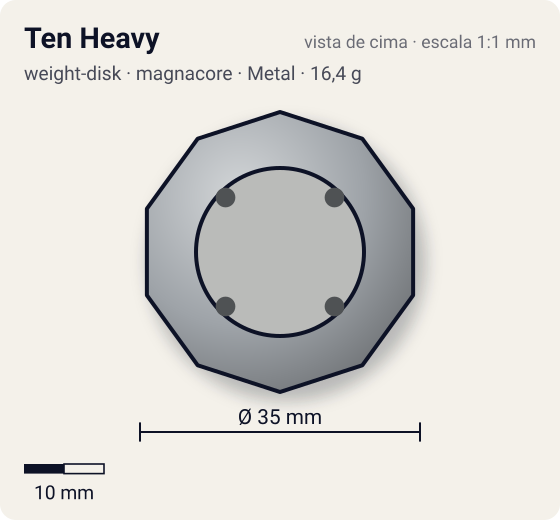
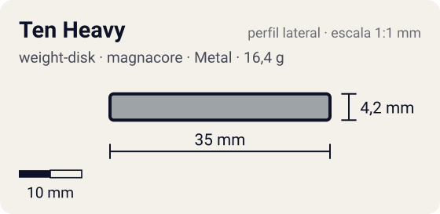

# Ten Heavy

<!-- auto:inicio (gerado por npm run build:research; não edite este bloco) -->
 

| Medidas e material | |
|---|---|
| Diâmetro | 35 estimado mm |
| Altura / espessura | 4,2 estimado mm |
| Peso | 16,4 wiki g |
| Material | Metal (metalico) |
| Estrelas Takara (A / D / S) | 1 / 3 / 2 |
| Usada em | [Draciel V2](../../../personagens/max-tate/beyblades/draciel-v2/), [Gaia Dragoon G (Strata Dragoon G / Great)](../../../personagens/daichi-sumeragi/beyblades/gaia-dragoon-g/) |
<!-- auto:fim -->

Weight Disk · sistema **magnacore** · id `weight-disk/ten-heavy`

## Descrição

Disco decagonal, o mais pesado de toda a série Heavy e de todos os discos de 6/8/10 lados. Tem os dois Attack Points da série "Ten".

**Função:** Massa máxima concentrada perto do eixo: mais RPM, mais peso para defesa e para combos compactos e de upper attack. É o disco "padrão" das customizações pesadas.

## Funcionamento interno

O Weight Disk é o anel de metal entre o Attack Ring e o Spin Gear (ou Running Core). É a peça mais pesada da bey de plástico (13–17 g, quase metade do peso total), então é ela que mais define massa e momento de inércia. Este disco tem distribuição **centro** (massa concentrada perto do eixo).

### Por que o lugar do peso muda RPM e estabilidade

O lançador entrega à bey um impulso de rotação (momento angular, `L = I·ω`). O momento de inércia `I` soma cada pedaço de massa vezes o quadrado da distância ao eixo (`I = Σ m·r²`), então **onde** o metal fica pesa mais que **quanto** metal existe.

- **Peso no centro** (Heavy): `I` menor para a mesma massa. Com o mesmo puxão, a bey sai com **mais RPM**, fica mais compacta e mais difícil de empurrar (massa alta), o que ajuda defesa e combos compactos. Em compensação guarda menos energia por RPM e perde rotação mais rápido quando atrita.
- **Peso na periferia** (Wide, Circle Wide): `I` maior. A bey sai com RPM um pouco menor, mas guarda mais energia de rotação e tem mais estabilidade giroscópica. Perde rotação mais devagar a cada choque ou atrito (stamina, roubo de rotação) e entrega golpes mais fortes, porque a massa está no raio de contato (smash attack). Também ajuda a controlar o recuo de ARs agressivos.
- **Balance** fica no meio-termo.

## Beys que usam

- `daichi-sumeragi/gaia-dragoon-g` ([ficha](../../../personagens/daichi-sumeragi/beyblades/gaia-dragoon-g/))
- `max-tate/draciel-v2` ([ficha](../../../personagens/max-tate/beyblades/draciel-v2/))

## Medidas, material e stats

| Item | Valor | Fonte |
|---|---|---|
| Peso | 16,4 g | wiki (a página "Weight Disk - Heavy" e a WBO arredondam para 17 g) |
| Diâmetro (vértice a vértice) | 35 mm | estimado |
| Espessura | 4,2 mm | estimado (calculada do peso com densidade 7.1 g/cm³) |
| Lados | 10 | wiki (nome/descrição) |
| Material | Metal | metal fundido; a liga não é especificada nas fontes |
| Stats oficiais (A/D/S) | não publicados | infobox em branco |

Não há medidas de diâmetro/espessura publicadas nas fontes consultadas (Beyblade Wiki e WBO). Diâmetro e furo central foram estimados pela proporção das fotos e pelo tamanho típico de uma bey de plástico (~45–50 mm). A espessura foi calculada para fechar com o peso publicado, assumindo densidade de 7,1 g/cm³.

## Referência

- `referencia/ten-heavy.png` (copiada de `personagens/daichi-sumeragi/beyblades/gaia-dragoon-g/pecas/weight-disk.png`)

## Fontes

- https://beyblade.fandom.com/wiki/Weight_Disk_-_Ten_Heavy
- https://beyblade.fandom.com/wiki/Weight_Disk_-_Heavy
- http://wiki.worldbeyblade.org/index.php?title=Heavy_Weight_Disks
