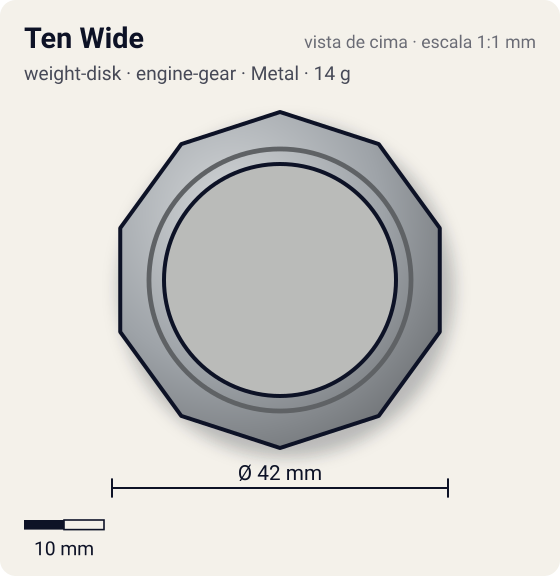
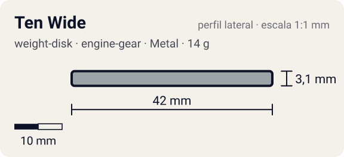

# Ten Wide

<!-- auto:inicio (gerado por npm run build:research; não edite este bloco) -->
 

| Medidas e material | |
|---|---|
| Diâmetro | 42 estimado mm |
| Altura / espessura | 3,1 estimado mm |
| Peso | 14 wiki g |
| Material | Metal (metalico) |
| Estrelas Takara (A / D / S) | 1 / 1,5 / 4 |
| Usada em | [Dragoon G (Dragoon Galaxy)](../../../personagens/tyson-granger/beyblades/dragoon-g/), [Dragoon GT (Dragoon Galaxy Turbo)](../../../personagens/tyson-granger/beyblades/dragoon-gt/), [Dragoon V (Dragoon Victory)](../../../personagens/tyson-granger/beyblades/dragoon-v/), [Draciel G](../../../personagens/max-tate/beyblades/draciel-g/), [Gaia Dragoon V (Strata Dragoon V / Vast)](../../../personagens/daichi-sumeragi/beyblades/gaia-dragoon-v/), [Wolborg 4](../../../personagens/tala/beyblades/wolborg-4/), [Zeus](../../../personagens/brooklyn-masefield/beyblades/zeus/), [Galeon 2](../../../personagens/lee/beyblades/galeon-2/) |
<!-- auto:fim -->

Weight Disk · sistema **engine-gear** · id `weight-disk/ten-wide`

## Descrição

Disco decagonal (10 lados), o mais largo e o mais pesado da série Wide. A foto de referência mostra um aro metálico fino com janelas grandes e quatro braços internos com furos de encaixe; como todo disco da série "Ten", tem dois ressaltos ("Attack Points", segundo a Takara), um em cima e outro embaixo.

**Função:** Coloca a massa na borda: muita inércia, bom para smash attack (mais alcance e impacto) e para stamina (resiste mais à perda de rotação). É o Wide preferido nas customizações, no lugar do Six e do Eight Wide.

> A infobox da wiki diz Engine Gear System (estreia com Dragoon G, dez/2002), mas a própria lista de produtos inclui Dragoon V e Driger V2 (Magnacore). Mantido o que diz a infobox.

## Funcionamento interno

O Weight Disk é o anel de metal entre o Attack Ring e o Spin Gear (ou Running Core). É a peça mais pesada da bey de plástico (13–17 g, quase metade do peso total), então é ela que mais define massa e momento de inércia. Este disco tem distribuição **periferia** (massa jogada para a borda).

### Por que o lugar do peso muda RPM e estabilidade

O lançador entrega à bey um impulso de rotação (momento angular, `L = I·ω`). O momento de inércia `I` soma cada pedaço de massa vezes o quadrado da distância ao eixo (`I = Σ m·r²`), então **onde** o metal fica pesa mais que **quanto** metal existe.

- **Peso no centro** (Heavy): `I` menor para a mesma massa. Com o mesmo puxão, a bey sai com **mais RPM**, fica mais compacta e mais difícil de empurrar (massa alta), o que ajuda defesa e combos compactos. Em compensação guarda menos energia por RPM e perde rotação mais rápido quando atrita.
- **Peso na periferia** (Wide, Circle Wide): `I` maior. A bey sai com RPM um pouco menor, mas guarda mais energia de rotação e tem mais estabilidade giroscópica. Perde rotação mais devagar a cada choque ou atrito (stamina, roubo de rotação) e entrega golpes mais fortes, porque a massa está no raio de contato (smash attack). Também ajuda a controlar o recuo de ARs agressivos.
- **Balance** fica no meio-termo.

## Beys que usam

- `brooklyn-masefield/zeus` ([ficha](../../../personagens/brooklyn-masefield/beyblades/zeus/))
- `daichi-sumeragi/gaia-dragoon-v` ([ficha](../../../personagens/daichi-sumeragi/beyblades/gaia-dragoon-v/))
- `lee/galeon-2` ([ficha](../../../personagens/lee/beyblades/galeon-2/))
- `max-tate/draciel-g` ([ficha](../../../personagens/max-tate/beyblades/draciel-g/))
- `tala/wolborg-4` ([ficha](../../../personagens/tala/beyblades/wolborg-4/))
- `tyson-granger/dragoon-g` ([ficha](../../../personagens/tyson-granger/beyblades/dragoon-g/))
- `tyson-granger/dragoon-gt` ([ficha](../../../personagens/tyson-granger/beyblades/dragoon-gt/))
- `tyson-granger/dragoon-v` ([ficha](../../../personagens/tyson-granger/beyblades/dragoon-v/))

## Medidas, material e stats

| Item | Valor | Fonte |
|---|---|---|
| Peso | 14 g | wiki |
| Diâmetro (vértice a vértice) | 42 mm | estimado |
| Espessura | 3,1 mm | estimado (calculada do peso com densidade 7.1 g/cm³) |
| Lados | 10 | wiki (nome/descrição) |
| Material | Metal | metal fundido; a liga não é especificada nas fontes |
| Stats oficiais (A/D/S) | 1 / 2 / 4 | Beyblade Wiki, Part Infobox (Weight Disk - Ten Wide) |

Não há medidas de diâmetro/espessura publicadas nas fontes consultadas (Beyblade Wiki e WBO). Diâmetro e furo central foram estimados pela proporção das fotos e pelo tamanho típico de uma bey de plástico (~45–50 mm). A espessura foi calculada para fechar com o peso publicado, assumindo densidade de 7,1 g/cm³.

## Referência

- `referencia/ten-wide.jpg` (copiada de `personagens/daichi-sumeragi/beyblades/gaia-dragoon-v/pecas/weight-disk.jpg`)

## Fontes

- https://beyblade.fandom.com/wiki/Weight_Disk_-_Ten_Wide
- http://wiki.worldbeyblade.org/index.php?title=Wide_Weight_Disks
