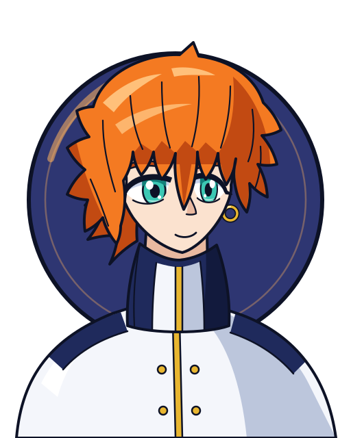

# Brooklyn Masefield (ブルックリン / Burukkurin)

Retrato original do jogo ([retrato.svg](retrato.svg)). Referência: [referencia/foto.png](referencia/foto.png).

| Campo | Valor |
|---|---|
| Nome JP | ブルックリン (Brooklyn). Sobrenome "Masefield" **não confirmado** na Beyblade Wiki (a página se chama só "Brooklyn"); usado aqui por convenção do projeto |
| Equipe(s) por temporada | S1: — / V-Force: — / G-Rev: BEGA League (membro do Justice Five; treinado por Hiro) |
| Nacionalidade | não confirmado |
| Idade (aprox.) | não confirmado (aparenta adolescente mais velho que Tyson) |
| Fera Bit | Zeus (ゼウス) — "Deus das Trevas" (闇の神 na caixa do brinquedo); visualmente uma quimera/demônio alado negro |
| Estilo de batalha | Gênio natural, evasivo e preditivo; não ataca até se entediar, depois finaliza num único golpe devastador (King of Darkness) |
| Dublador(a) JP / EN / PT-BR | Sōichirō Hoshi / Robert Tinkler / não confirmado |

Aniversário: 14 de julho. Aparência: cabelo laranja, olhos verde-água, casaco branco longo com detalhes dourados, luvas sem dedos bordô.

## Visual

Padrão do retrato: visual de **G-Revolution (2003)**, única temporada em que aparece.

- Cabelo **laranja** volumoso e bagunçado, com mechas caídas para baixo e para os lados e **franja longa que cai entre e sobre os olhos**. Olhos **verde-água (aqua)**, grandes e serenos; expressão calma com leve sorriso (no modo "trevas" os olhos se arregalam e o rosto se contorce). **Brinco de argola dourado** visível na foto de referência (lado esquerdo dele).
- Roupa (wiki EN): **casaco branco longo** com **gola alta preta/azul-marinho**, detalhes escuros nos ombros, **friso dourado** descendo pelo centro e na barra, botões dourados dos dois lados, cinto branco, calça branca, sapatos marrons e **luvas sem dedos bordô**.
- Elementos obrigatórios no retrato: franja laranja sobre os olhos, olhos aqua calmos, brinco de argola, gola alta escura com friso dourado.

| Uso | Hex |
|---|---|
| Disco de fundo (Zeus, armadura azul-escura com detalhes vermelho/laranja; proposta até existir `feras-bit/zeus/dados.json`) | `#2e3672` (borda `#0d1226`, brilho `#ffb35c`) |
| Cabelo base / sombra / brilho | `#f47a22` / `#c24a12` / `#ffc07a` |
| Pele base / sombra | `#fbe2cf` / `#e9b9a0` |
| Íris base / sombra | `#3cc8b4` / `#13807a` |
| Casaco branco base / sombra | `#f4f6fb` / `#bcc6dc` |
| Gola/ombros escuros base / sombra | `#1f2a5c` / `#121a3d` |
| Dourado base / sombra | `#e8b630` / `#b07f14` |
| Contorno | `#0d1226` |

## Personalidade e papel na história
- Principal antagonista de G-Revolution. Personalidade dupla "Jekyll & Hyde": calmo, gentil, amante da natureza (cuida de pássaros e animais, odeia treinar em lugares fechados) e, sob pressão, psicótico e destrutivo.
- Talento natural absoluto: vence em tudo sem esforço — por isso foi isolado na infância (as outras crianças não queriam brincar com ele). Para ele beyblade é "só mais uma coisa"; nunca suou numa batalha. Tem "visões" que antecipam o resultado das lutas (previu Max x Mystel e Tyson x Crusher).
- **Ep. 41–42**: destrói bladers da BEGA e esmaga Kai (que sai gravemente ferido) — estreia do King of Darkness.
- **Ep. 47–48 (Justice Five)**: Kai volta e o escolhe; Brooklyn sua pela primeira vez, perde o controle e sofre sua primeira derrota.
- **Ep. 51–52 (desempate final contra Tyson)**: canaliza todas as emoções em Zeus, cria um buraco negro/mundo de trevas e ganha asas negras; Tyson, com a força das feras dos amigos, rompe a escuridão. Brooklyn entende o espírito do beyblade e continua a batalha "de igual para igual"; o resultado é presumido como vitória de Tyson. A BEGA é destruída pela fúria de Brooklyn.

## Estilo de luta (como o jogo deve representá-lo)
- **Lançamento**: suave e preciso, bey vai para o centro e "flutua" girando.
- **Fase 1 (desdém)**: esquiva e defesa passiva; deixa o oponente gastar rotação/energia atacando o vazio; provoca ("Look at you. Utterly defenseless like a little child.").
- **Fase 2 (finalização)**: quando se entedia ou o oponente está desgastado, dispara King of Darkness — rajada de golpes seguida de smash final; afeta também o "espírito" do blader (no jogo: dano + debuff de moral/controle).
- **Fase 3 (descontrole)**: se for pressionado de verdade (perdendo vantagem), entra em modo "berserk": dano altíssimo, mas perde precisão/estabilidade.
- Habilidade de "copiar"/prever: Zeus lê e antecipa o movimento do oponente (no jogo: esquiva automática com alta chance contra ataques telegrafados).
- Frases: "King of Darkness Attack!"; "You're history."; "If you want me to put you out of your misery I will."

## Beyblades utilizadas no anime (ordem cronológica)
| # | Beyblade | Temporada | Episódio de estreia | Pasta | Miniatura | Lançador + ripcord |
|---|---|---|---|---|---|---|
| 1 | Zeus (A-129, Engine Gear System) | G-Revolution | ep. 41 "And Justice Five For All" (King of Darkness estreia no ep. 42) | [zeus](beyblades/zeus/) |  | [EZ Shooter (Easy Shooter, rotação direita)](../../lancadores/ez-shooter/) + [Winder padrão (Beyblade Winder)](../../lancadores/ripcords/winder-padrao/) |

Brooklyn só usa Zeus no anime (a wiki não registra outra bey; não existe versão HMS/"Zeus MS" no anime). Ele aparece pela primeira vez no ep. 33 "Out of Their League", sem batalhar.

## Batalhas marcantes
| Adversário | Episódio | Resultado |
|---|---|---|
| Bladers da BEGA | 41 | Vitória |
| Kai Hiwatari (Dranzer GT) | 41–42 | Vitória esmagadora (Kai fica ferido) |
| Kai Hiwatari (Dranzer GT) — Justice Five | 47–48 | Derrota (primeira da vida) |
| Tyson Granger (Dragoon GT) — final | 51–52 | Derrota/presumida (fim aberto, Tyson vence) |

## Perfil de IA sugerido para o jogo
- **Agressividade**: 3/10 no início → 10/10 na finalização. Gatilho: oponente com < 50% de rotação **ou** após ~20 s de luta.
- **Uso de especial**: paciente e calculado; guarda King of Darkness para o golpe final (quase nunca desperdiça). Modo berserk (agressividade 10, precisão −30%) se a própria rotação ficar abaixo da do oponente.
- **Posicionamento**: domina o centro da arena, gira estável e desvia lateralmente; não persegue.
- **Leitura**: chance alta de esquiva contra ataques em linha reta (simula a "previsão"); dificuldade de chefe final.
- **Fraqueza**: espírito de luta frágil — se levar vários golpes seguidos, sofre penalidade de moral/estabilidade (como contra Kai).

## Fontes
- https://beyblade.fandom.com/wiki/Brooklyn
- https://beyblade.fandom.com/wiki/Zeus
- https://beyblade.fandom.com/wiki/Zeus_(Hasbro)
- https://beyblade.fandom.com/wiki/King_of_Darkness
- https://beyblade.fandom.com/wiki/Justice_Five_Tournament
- Imagem: File:Brooklyn.png (beyblade.fandom.com)
