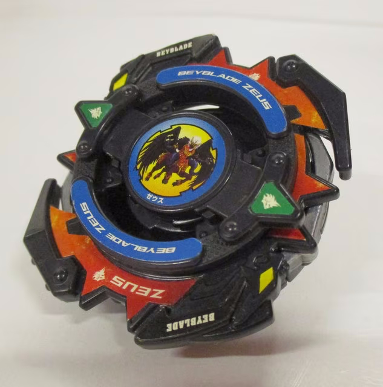
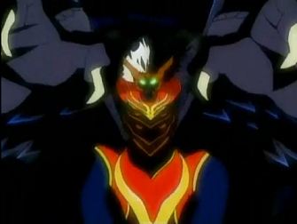
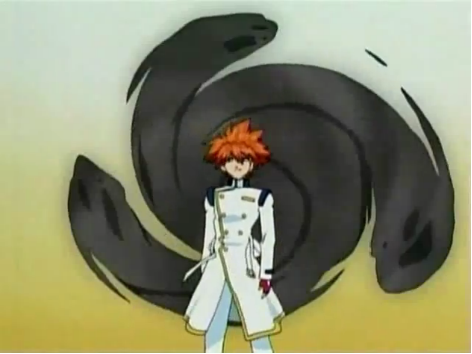
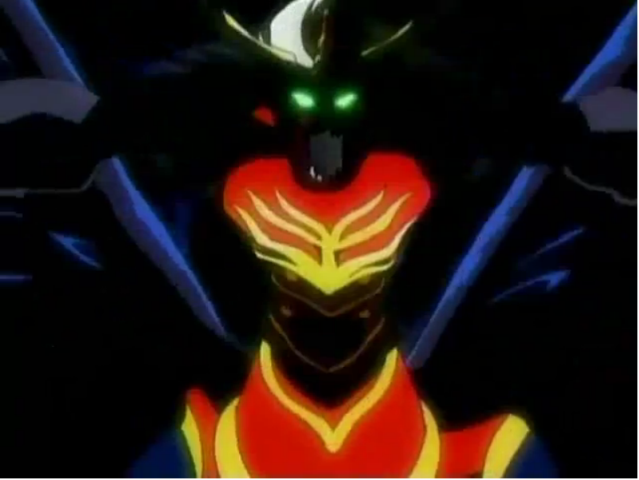

# Zeus (ゼウス / Zeusu)

Infobox da wiki:  — versão Hasbro: 

Fera bit:  — King of Darkness no anime:  

| Campo | Valor |
|---|---|
| Dono | Brooklyn (Masefield) |
| Código do produto | A-129 (Takara, Booster, out/2003, ¥680); Hasbro: A-129 Starter (relançado em 2005) |
| Tipo | Stamina (brinquedo, Takara e Hasbro). Atenção: a página do Brooklyn na wiki chama a bey/fera de "Balance" |
| Sistema | Engine Gear System (a base é EG; a versão Takara vem com uma Customize Gear de eixo livre no lugar do Engine Gear) |
| Rotação | Direita |
| Fera Bit (Bit-Beast) | Zeus — "Deus das Trevas" (闇の神, atributo na caixa); visual de quimera/demônio alado negro |
| Série / temporada | G-Revolution (2003) |
| Primeira aparição (anime) | G-Rev ep. 41 "And Justice Five For All" (King of Darkness: ep. 42 "When You Wish Upon A Star") |
| Antecessora → Sucessora | — → — |

## 1. Peças (de cima para baixo)

A caixa japonesa (`pecas/caixa-verso-pecas.jpg`) descreve um "sistema de 6 camadas":

| Camada | Peça | Descrição física | Função em batalha |
|---|---|---|---|
| Bit Chip | Zeus | chip com a fera Zeus estilizada | identidade / fera bit |
| Attack Ring Supporter | Holy Despell | anel compacto e agressivo com 2 protuberâncias triangulares; segundo a caixa, **fixa o anel livre (Screw Zeus) à bey** e o "suporta" | suporte / contato secundário |
| Attack Ring (AR) | Screw Zeus | anel com as "asas"/garras pretas e adesivo vermelho "ZEUS"; **o AR inteiro gira livre** (caixa: "アタックリング全体がフリー回転") | defesa excelente (o anel livre dissipa o impacto) e bom em **upper attack** (caixa); o Screw Zeus é usado como Sub-AR em combos de ataque (wiki, Dragon Saucer) |
| Weight Disk (WD) | Ten Wide (14 g) | 10 lados, largo, massa na periferia | caixa: reforça ataque e stamina; inércia alta |
| Spin Gear / Customize Gear | Right Customize Gear (Free Shaft Version) | mecanismo de eixo livre com **2 rolamentos (double bearing)** internos | o corpo gira quase sem atrito com o eixo → stamina muito alta (caixa: "suporta o fôlego") |
| Customize Engine Weight (ponta) | Light Sharp | eixo de resina POM com ponta **sharp** de baixo atrito (peça vermelha) | stamina máxima, fica no centro |
| Blade Base (BB) | First Clutch Base (Zeus Version) | base redonda, pesada e com boa distribuição de peso; aceita Engine Gear vendido à parte ("mostra seu verdadeiro poder com um Engine Gear") | estabilidade; clutch "First" libera o EG logo no início se houver um |

Fotos: `pecas/caixa-verso-pecas.jpg` (todas as peças ilustradas, com descrições e estrelas de atributos da Takara), `pecas/montada-inferior.jpg` (vista de baixo, ponta vermelha Light Sharp), `pecas/montada-com-launcher.jpg`. Não há fotos individuais das peças na wiki.

**Divergências de fonte**: a página Hasbro da wiki lista "Right EG (Metal Ball)" no lugar da Customize Gear + Light Sharp (o brinquedo Hasbro trazia um Engine Gear de ponta metal ball). Uma listagem de modelo 3D fala em WD "10 Heavy" e EG "Heavy Right Spin (fused)" — a caixa Takara confirma **Ten Wide**, então o modelo 3D foi descartado.

## 2. Formato e geometria
- Vista de cima: corpo preto quase circular com 2 grandes "garras" curvas do Screw Zeus + 2 triângulos do Holy Despell; simetria de 2 lados; raio grande.
- Peso: Ten Wide periférico + base pesada → muita inércia, rotação longa.
- Perfil médio-alto (6 camadas), mas a base larga e redonda dá estabilidade.

## 3. Comportamento na arena
- **Movimento**: ponta sharp + double bearing → fica **no centro**, quase parado, girando por muito tempo (padrão "centro").
- **Ataque**: baixo no brinquedo (stamina); o anel livre ainda pode aplicar upper attack ao receber golpes por baixo.
- **Defesa**: alta — AR inteiro free-spinning absorve e desvia golpes; base pesada.
- **Stamina**: altíssima (âncora 10 do projeto): bearings + sharp POM + WD largo.
- **Matchups**: vence attackers que se cansam batendo nele e beys de stamina inferiores; perde para upper/smash attackers muito fortes que o tirem do centro antes de cansar (a ponta sharp tem pouca tração para reagir).
- **Gimmick**: AR totalmente livre + eixo livre com rolamento duplo; base compatível com Engine Gear.

## 4. No anime
- Bey preta "Balance" (segundo a página do Brooklyn) que **copia e prevê** o movimento do adversário. Brooklyn normalmente a deixa lutar sozinha: Zeus esquiva de tudo, deixa o oponente se esgotar e então finaliza.
- **Especial**: **King of Darkness** (único especial de Brooklyn) — trevas surgem atrás de Brooklyn, que "desaparece"; Zeus emerge da névoa negra, desfere uma rajada de golpes e termina com um smash intenso. A metáfora visual: o oponente se afoga em água negra enquanto Brooklyn flutua acima. O ataque fere também o blader e o espírito de luta.
- Na final (ep. 51–52) Brooklyn funde suas emoções com Zeus e cria um buraco negro/mundo de trevas; Brooklyn ganha asas negras.
- **Batalhas**: bladers da BEGA (ep. 41, vitória); Kai (ep. 41–42, vitória esmagadora); Kai no Justice Five (ep. 47–48, derrota); Tyson (ep. 51–52, derrota presumida; as duas beys terminam colidindo sem especiais restantes).
- Sem evolução/substituição no anime.

## 5. Tradução para o jogo
| Atributo | Valor | Justificativa |
|---|---|---|
| Ataque | 6 | brinquedo stamina (baixo), mas King of Darkness no anime é devastador — média ponderada |
| Defesa | 8 | AR inteiro livre + base pesada e redonda |
| Stamina | 10 | âncora do projeto; double bearing + Light Sharp + Ten Wide |
| Velocidade | 4 | ponta sharp, fica no centro (esquiva por "previsão", não por deslocamento) |
| Peso | 6 | Ten Wide 14 g + base pesada; sem Engine Gear metálico na versão Takara |
| Equilíbrio | 9 | base larga e redonda, peso periférico, gira estável por muito tempo |
| Burst/Knockout-resist | 8 | anel livre desvia impacto; só invencível no anime |

- **Movimento em IA**: "centro" — segura a posição central, deslocamentos curtos laterais para esquivar (chance de esquiva alta contra investidas em linha reta = "previsão"). Após o gatilho de tédio (≈20 s ou oponente < 50% de rotação), passa a "agressivo" e caça o oponente.
- **Especiais (no jogo)**: *King of Darkness* — escurece a arena por 3 s (o oponente perde controle/visibilidade, −30% precisão), seguido de 4–5 golpes rápidos e um smash final com +120% knockback; custo 120, cooldown 30 s. (Chefe) *Asas negras / buraco negro* — modo berserk temporário: +50% ataque, −30% equilíbrio por 8 s; custo 150, uso único por luta.
- **Física sugerida**: massa 1.05, raio 1.05, atrito da ponta 0.15 (sharp POM + bearing), restituição 0.35 (anel livre absorve).

## 6. Fontes
- https://beyblade.fandom.com/wiki/Zeus
- https://beyblade.fandom.com/wiki/Zeus_(Hasbro)
- https://beyblade.fandom.com/wiki/Attack_Ring_-_Holy_Despell
- https://beyblade.fandom.com/wiki/Weight_Disk_-_Ten_Wide
- https://beyblade.fandom.com/wiki/Spin_Gear_-_Right_Customize_Gear_(Free_Shaft_Version)
- https://beyblade.fandom.com/wiki/Blade_Base_-_First_Clutch_Base_(Zeus_Version)
- https://beyblade.fandom.com/wiki/Bit_Chip_-_Zeus
- https://beyblade.fandom.com/wiki/Attack_Ring_-_Dragon_Saucer (menção ao Screw Zeus)
- https://beyblade.fandom.com/wiki/King_of_Darkness
- https://beyblade.fandom.com/wiki/Brooklyn
- https://beyblade.fandom.com/wiki/File:Zeus_Box_Back.jpg (verso da caixa Takara A-129)
- https://thangs.com/m/1120141 (lista de peças de modelo 3D — usada só para comparação)
