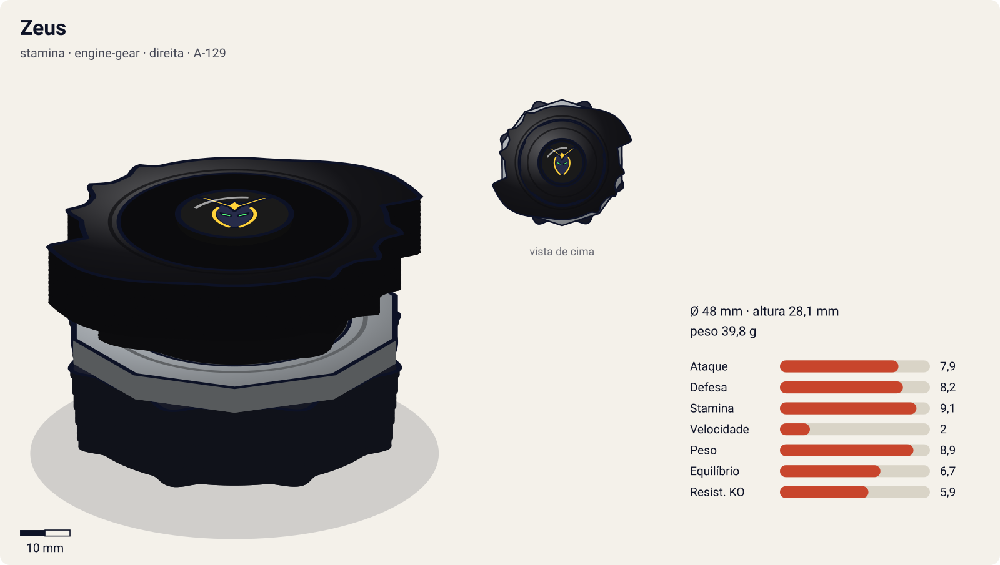
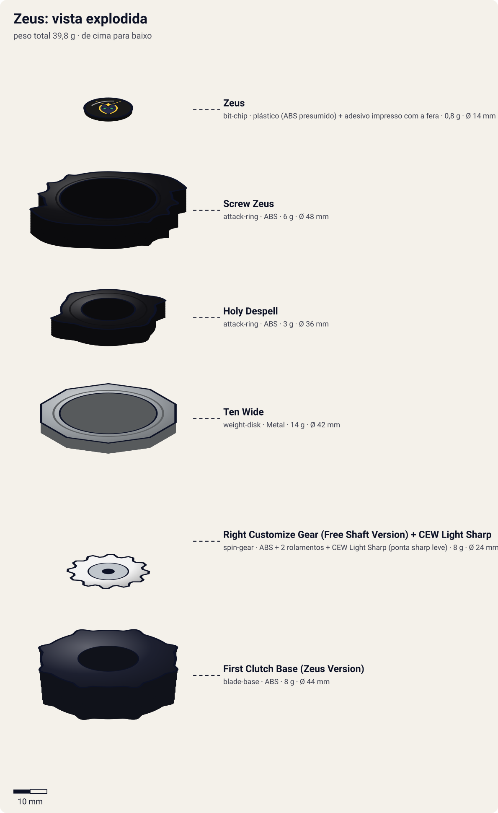
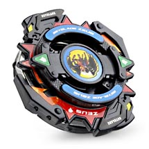
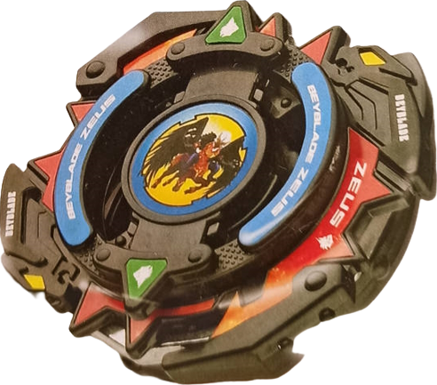

# Zeus (ゼウス / Zeusu)

<!-- auto:inicio (gerado por npm run build:research; não edite este bloco) -->

| Ficha | |
|---|---|
| Dono | [Brooklyn Masefield (ブルックリン / Burukkurin)](../../README.md) |
| Tipo · sistema · rotação | stamina · engine-gear · direita |
| Código do produto | A-129 |
| Montada | Ø 48 mm · altura 28,1 mm · **39,8 g** (soma das peças) |
| Fera bit | [Zeus](../../../../feras-bit/zeus/) |
| Lançador | [EZ Shooter (Easy Shooter, rotação direita)](../../../../lancadores/ez-shooter/) |
| Ripcord | [winder-padrao](../../../../lancadores/ripcords/winder-padrao/) |

### Peças

| Camada | Peça | Material | Ø mm | Altura mm | Peso g | Estrelas Takara (A / D / S) | Desenho |
|---|---|---|---|---|---|---|---|
| Bit Chip | [Zeus](../../../../pecas/bit-chip/zeus/) | plástico (ABS presumido) + adesivo impresso com a fera | 14 estimado | 8 estimado | 0,8 comunidade | — | [ver](pecas/bit-chip.svg) |
| Attack Ring | [Holy Despell](../../../../pecas/attack-ring/holy-despell/) | ABS | 36 estimado | 5 estimado | 3 estimado | 0 / 1 / 0 | [ver](pecas/attack-ring.svg) |
| Attack Ring | [Screw Zeus](../../../../pecas/attack-ring/screw-zeus/) | ABS | 48 estimado | 7 estimado | 6 estimado | 3 / 2 / 1 | [ver](pecas/attack-ring.svg) |
| Weight Disk | [Ten Wide](../../../../pecas/weight-disk/ten-wide/) | Metal | 42 estimado | 3,1 estimado | 14 wiki | 1 / 1,5 / 4 | [ver](pecas/weight-disk.svg) |
| Spin Gear / Core | [Right Customize Gear (Free Shaft Version) + CEW Light Sharp](../../../../pecas/spin-gear/right-customize-gear-free-shaft-version/) | ABS + 2 rolamentos + CEW Light Sharp (ponta sharp leve) | 24 estimado | 18 estimado | 8 estimado | 2 / 1,5 / 3,5 | [ver](pecas/spin-gear.svg) |
| Blade Base | [First Clutch Base (Zeus Version)](../../../../pecas/blade-base/first-clutch-base-zeus/) | ABS | 44 estimado | 13 estimado | 8 estimado | 0 / 3 / 2 | [ver](pecas/blade-base.svg) |

Fonte de cada medida em subscrito (wiki, comunidade, estimado). Detalhes em cada ficha de peça.

### Atributos

| Atributo | Brinquedo (calculado) | Ajuste anime | Jogo |
|---|---|---|---|
| Ataque | 4,9 | +3 | **7,9** |
| Defesa | 7,2 | +1 | **8,2** |
| Stamina | 9,1 | — | **9,1** |
| Velocidade | 2 | — | **2** |
| Peso | 8,9 | — | **8,9** |
| Equilíbrio | 4,7 | +2 | **6,7** |
| Resistência a KO | 5,9 | — | **5,9** |

Calculado por `src/beyblade/stats.js` a partir de: ponta sharp (atrito 0,1), contato smash (recoil 0,4), peso do WD na periferia. Modelo em [docs/BEYBLADES.md](../../../../../docs/BEYBLADES.md).

### Fera bit em cima da bey

 

Sons: [invocacao](../../../../feras-bit/zeus/sons/invocacao.wav) · [rugido](../../../../feras-bit/zeus/sons/rugido.wav) · [ataque](../../../../feras-bit/zeus/sons/ataque.wav). Animações: [invocação](../../../../feras-bit/zeus/invocacao.svg) · [ataque](../../../../feras-bit/zeus/ataque.svg).

Fotos de referência (terceiros, só para estudo)

[anime-king-of-darkness.png](referencia/anime-king-of-darkness.png) · [anime.png](referencia/anime.png) · [fera-bit.png](referencia/fera-bit.png) · [imagem-hasbro.png](referencia/imagem-hasbro.png) · [imagem-infobox.jpg](referencia/imagem-infobox.jpg) · [imagem.jpg](referencia/imagem.jpg) · [pecas-caixa-verso-pecas.jpg](referencia/pecas-caixa-verso-pecas.jpg) · [pecas-montada-com-launcher.jpg](referencia/pecas-montada-com-launcher.jpg) · [pecas-montada-inferior.jpg](referencia/pecas-montada-inferior.jpg)

<!-- auto:fim -->

Infobox da wiki:  — versão Hasbro: 

Fera bit:  — King of Darkness no anime:  

| Campo | Valor |
|---|---|
| Dono | Brooklyn (Masefield) |
| Código do produto | A-129 (Takara, Booster, out/2003, ¥680); Hasbro: A-129 Starter (relançado em 2005) |
| Tipo | Stamina (brinquedo, Takara e Hasbro). Atenção: a página do Brooklyn na wiki chama a bey/fera de "Balance" |
| Sistema | Engine Gear System (a base é EG; a versão Takara vem com uma Customize Gear de eixo livre no lugar do Engine Gear) |
| Fera Bit (Bit-Beast) | Zeus, "Deus das Trevas" (闇の神, atributo na caixa); visual de quimera/demônio alado negro |
| Série / temporada | G-Revolution (2003) |
| Primeira aparição (anime) | G-Rev ep. 41 "And Justice Five For All" (King of Darkness: ep. 42 "When You Wish Upon A Star") |
| Antecessora → Sucessora | — → — |

## Formato e geometria
- Vista de cima: corpo preto quase circular com 2 grandes "garras" curvas do Screw Zeus + 2 triângulos do Holy Despell; simetria de 2 lados; raio grande.
- Peso: Ten Wide periférico + base pesada → muita inércia, rotação longa.
- Perfil médio-alto (6 camadas), mas a base larga e redonda dá estabilidade.

Análise das peças (a caixa japonesa, [verso](referencia/pecas-caixa-verso-pecas.jpg), descreve um "sistema de 6 camadas"):
- [Holy Despell](../../../../pecas/attack-ring/holy-despell/) (Attack Ring Supporter): anel compacto e agressivo com 2 protuberâncias triangulares; segundo a caixa, **fixa o anel livre (Screw Zeus) à bey** e o "suporta". Suporte e contato secundário.
- [Screw Zeus](../../../../pecas/attack-ring/screw-zeus/): anel com as "asas"/garras pretas e adesivo vermelho "ZEUS"; **o AR inteiro gira livre** (caixa: 「アタックリング全体がフリー回転」). Defesa excelente (o anel livre dissipa o impacto) e bom em **upper attack** (caixa); usado como Sub-AR em combos de ataque (wiki, Dragon Saucer).
- [Ten Wide](../../../../pecas/weight-disk/ten-wide/) (14 g): 10 lados, largo, massa na periferia; a caixa diz que reforça ataque e stamina (inércia alta).
- [Right Customize Gear (Free Shaft Version)](../../../../pecas/spin-gear/right-customize-gear-free-shaft-version/): eixo livre com **2 rolamentos (double bearing)** internos; o corpo gira quase sem atrito com o eixo → stamina muito alta (caixa: "suporta o fôlego"). A ponta é o Customize Engine Weight **Light Sharp**: eixo de resina POM com ponta sharp de baixo atrito (peça vermelha), stamina máxima, fica no centro.
- [First Clutch Base (Zeus Version)](../../../../pecas/blade-base/first-clutch-base-zeus/): redonda, pesada e com boa distribuição de peso; aceita Engine Gear vendido à parte ("mostra seu verdadeiro poder com um Engine Gear"). Estabilidade; o clutch "First" libera o EG logo no início se houver um.

**Divergências de fonte**: a página Hasbro da wiki lista "Right EG (Metal Ball)" no lugar da Customize Gear + Light Sharp (o brinquedo Hasbro trazia um Engine Gear de ponta metal ball). Uma listagem de modelo 3D fala em WD "10 Heavy" e EG "Heavy Right Spin (fused)"; a caixa Takara confirma **Ten Wide**, então o modelo 3D foi descartado.

Fotos das peças (terceiros): [verso da caixa](referencia/pecas-caixa-verso-pecas.jpg) (todas as peças ilustradas, com descrições e estrelas da Takara), [vista de baixo](referencia/pecas-montada-inferior.jpg) (ponta vermelha Light Sharp), [com o lançador](referencia/pecas-montada-com-launcher.jpg). Não há fotos individuais das peças na wiki.

## Comportamento na arena
- **Movimento**: ponta sharp + double bearing → fica **no centro**, quase parada, girando por muito tempo.
- **Ataque**: baixo no brinquedo (stamina); o anel livre ainda pode aplicar upper attack ao receber golpes por baixo.
- **Defesa**: alta: o AR inteiro livre absorve e desvia golpes; base pesada.
- **Stamina**: altíssima: bearings + sharp de POM + WD largo.
- **Matchups**: vence atacantes que se cansam batendo nele e beys de stamina inferiores; perde para upper/smash attackers muito fortes que o tirem do centro antes de cansar (a ponta sharp tem pouca tração para reagir).
- **Gimmick**: AR totalmente livre + eixo livre com rolamento duplo; base compatível com Engine Gear.

## No anime
- Bey preta "Balance" (segundo a página do Brooklyn) que **copia e prevê** o movimento do adversário. Brooklyn normalmente a deixa lutar sozinha: Zeus esquiva de tudo, deixa o oponente se esgotar e então finaliza.
- **Especial**: **King of Darkness** (único especial de Brooklyn): trevas surgem atrás de Brooklyn, que "desaparece"; Zeus emerge da névoa negra, desfere uma rajada de golpes e termina com um smash intenso. A metáfora visual: o oponente se afoga em água negra enquanto Brooklyn flutua acima. O ataque fere também o blader e o espírito de luta.
- Na final (ep. 51–52) Brooklyn funde suas emoções com Zeus e cria um buraco negro/mundo de trevas; Brooklyn ganha asas negras.
- **Batalhas**: bladers da BEGA (ep. 41, vitória); Kai (ep. 41–42, vitória esmagadora); Kai no Justice Five (ep. 47–48, derrota); Tyson (ep. 51–52, derrota para a Dragoon MS Ultimate Version; as duas beys terminam colidindo sem especiais restantes).
- Sem evolução/substituição no anime.

## Mecânica no jogo
- **Movimento (IA)**: "centro": segura a posição central com deslocamentos curtos laterais para esquivar. "Previsão": 35% de chance de esquivar de uma investida em linha reta (o atacante passa direto e perde 3% de RPM). Gatilho de tédio: depois de ~20 s, ou com o oponente abaixo de 50% de RPM, passa a "agressivo" e caça o adversário.
- **Gimmick (AR livre + double bearing)**: o Screw Zeus gira livre: −30% de dano e de knockback em golpes frontais; golpes vindos de baixo são devolvidos como upper (+15% de knockback no atacante). A perda de RPM por atrito é a menor do jogo (rolamento duplo + Light Sharp). Sem Engine Gear na versão Takara.
- **Especiais**:
  - *King of Darkness*: escurece a arena por 3 s (o oponente perde visibilidade/controle: −30% de precisão), seguido de 4–5 golpes rápidos e um smash final com +120% de knockback; custo 120 de energia, recarga 30 s. Visual: o poço de escuridão da [invocação de Zeus](../../../../feras-bit/zeus/invocacao.svg) e a rajada de garradas com onda de choque do [ataque](../../../../feras-bit/zeus/ataque.svg).
  - *Asas negras / buraco negro* (modo chefe, final): berserk por 8 s com +50% de ataque e −30% de equilíbrio; custo 150, uso único por luta.
- **Física**: massa relativa 1,05; raio 1,05; atrito da ponta 0,15 (sharp de POM + rolamento); restituição 0,35 (o anel livre absorve).

## Ajuste do anime

| Atributo | Delta | Justificativa (episódio/batalha) |
|---|---|---|
| Ataque | +3 | King of Darkness: vitória esmagadora sobre Kai (ep. 41–42) e rajada de golpes que fere blader e espírito de luta; chefe final de G-Revolution. |
| Equilíbrio | +2 | Copia e prevê os movimentos do rival e esquiva de tudo sem sair do centro (ep. 41–42, 51–52). |
| Defesa | +1 | Kai e Tyson só a vencem depois de esgotar tudo; contra Tyson as duas beys terminam sem especiais restantes (ep. 52). |

Resultado esperado: a bey mais forte de G-Rev em stamina e uma das mais fortes no geral. Deve perder só para a Dragoon MS Ultimate Version (final, ep. 51–52) e, no Justice Five, para a Dranzer MS de Kai (ep. 47–48). Com o ajuste, Zeus fica perto de 8,2 / 7,7 / 9,2 (Atq / Def / Sta) e Equilíbrio 6,7.

Notas para o coordenador:
- Para o resultado canônico se manter, a Dragoon MS UV (6,6 / 4,6 / 6 no brinquedo) e a Dranzer MS (6,2 / 4,8 / 6,6) precisam de ajustes grandes, ou a vitória delas tem de vir do especial/modo final. Conferir com os agentes de Tyson e Kai.
- Estrelas incompletas no catálogo: Holy Despell "? / 1 / ?", Screw Zeus sem estrelas e First Clutch Base (Zeus) "? / 3 / 2"; os pesos de AR, Customize Gear e base são estimados. O peso total calculado (39,8 g) depende dessas estimativas.

## Fontes
- https://beyblade.fandom.com/wiki/Zeus
- https://beyblade.fandom.com/wiki/Zeus_(Hasbro)
- https://beyblade.fandom.com/wiki/Attack_Ring_-_Holy_Despell
- https://beyblade.fandom.com/wiki/Weight_Disk_-_Ten_Wide
- https://beyblade.fandom.com/wiki/Spin_Gear_-_Right_Customize_Gear_(Free_Shaft_Version)
- https://beyblade.fandom.com/wiki/Blade_Base_-_First_Clutch_Base_(Zeus_Version)
- https://beyblade.fandom.com/wiki/Bit_Chip_-_Zeus
- https://beyblade.fandom.com/wiki/Attack_Ring_-_Dragon_Saucer (menção ao Screw Zeus)
- https://beyblade.fandom.com/wiki/King_of_Darkness
- https://beyblade.fandom.com/wiki/Brooklyn
- https://beyblade.fandom.com/wiki/File:Zeus_Box_Back.jpg (verso da caixa Takara A-129)
- https://thangs.com/m/1120141 (lista de peças de modelo 3D, usada só para comparação)
