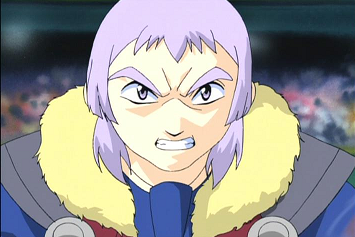

# Bryan Kuznetsov (Boris Kuznetsov / ボリス・クズネツォーフ)

Imagem extra: [foto-grev.png](foto-grev.png) (visual de G-Revolution, cabelo cinza espetado).

| Campo | Valor |
|---|---|
| Nome JP | ボリス・クズネツォーフ (Borisu Kuzunetsōfu) — no Japão chama-se **Boris** (não confundir com o vilão Boris Balkov, que no JP é "Volkov") |
| Equipe(s) por temporada | S1: Demolition Boys (ボーグ) / V-Force: não aparece no anime / G-Rev: Blitzkrieg Boys (ネオボーグ), reserva |
| Nacionalidade | Russo (criado na Abadia Balkov) |
| Idade (aprox.) | 16 (S1) / 18 (G-Rev), segundo a wiki EN; aniversário 18 de dezembro (Sagitário) |
| Fera Bit | Falborg (ファルボーグ) — falcão (隼 / hayabusa) de vento, fera bit **artificial** |
| Estilo de batalha | Attack agressivo e cruel; lâminas de vento (鎌鼬 kamaitachi) que atingem a bey **e o blader** |
| Dublador(a) JP / EN / PT-BR | Wasabi Mizuta (水田わさび) / Craig Lauzon / não confirmado |

## Personalidade e papel na história
- **S1 (2001)**: o "arma secreta" dos Demolition Boys, normalmente calmo, mas sádico e astuto — prefere atacar o blader em vez da bey. Com Spencer, embosca Max e rouba Draciel (ep. 46, 2 contra 1). Na semifinal/final do Mundial contra Ray (ep. 49): na 1ª rodada joga Falborg de propósito contra a parede para arremessar um pedaço do estádio no estômago de Ray e vence; na 2ª usa lâminas de vento "assassinas", se apressa e perde; na 3ª, Driger protege Ray e despedaça Falborg (ep. 49). Ray vai para o hospital. (A Wikipedia JP afirma ainda que o 白虎/Driger foi "absorvido" por Falborg no último golpe — informação não corroborada pela wiki EN; tratar como não confirmada.)
- **G-Revolution (2003)**: reformado, mais leve e até bem-humorado, mas ainda com ódio de Boris/Volkov. Fica como reserva dos Blitzkrieg Boys, treina com Kai e desmaia de exaustão (ep. 28). Volta com Tala e Spencer para derrubar a BEGA: vencem o BEGA Training Squad e depois perde, com Spencer, para Garland (Apollon) — Falborg 2 é severamente danificada pelo *Radiant Thunder* (ep. 35).

## Estilo de luta (como o jogo deve representá-lo)
- Lançamento forte e agressivo; vai direto ao adversário e à parede.
- Usa o estádio como arma: ricochetes na borda, golpes que arrancam pedaços do cenário.
- Especial de vento: **Stroblitz** (S1) / **Stroblitz Attack** (G-Rev) — tornado/lâminas de vento invisíveis que cortam a bey e ferem o adversário.
- Ponto fraco canônico: impaciência — "vencer depressa demais" abre brecha para contra-ataque (2ª rodada contra Ray).
- Frases (dub EN): "Aw, don't like the wind? Well, I have bad news for you! There's a tornado coming!", "Quit blowing hot air! ... And feel this breeze!".

## Beyblades utilizadas no anime (ordem cronológica)
| # | Beyblade | Temporada | Episódio de estreia | Pasta |
|---|---|---|---|---|
| 1 | Falborg (ファルボーグ; às vezes listada como "Falborg S" na wiki) | S1 (2001) | ep. 46 "First Strike" | [beyblades/falborg](beyblades/falborg/README.md) |
| 2 | Falborg 2 (ファルボーグ2) | G-Revolution | G-Rev ep. 35 "Pros and Ex-cons" | [beyblades/falborg-2](beyblades/falborg-2/README.md) |

**Correções em relação à lista inicial**:
- **Falborg 3 não existe** (nem anime, nem mangá, nem brinquedo — a página não existe na Beyblade Wiki).
- **Falborg MS** (HMS) — só no **mangá** (batalha em dupla com Seaborg MS). Não usada no anime.
- **Falborg Heavy Hunter / Falborg (Burst)** — só no mangá *Rising*.
- Falborg (S1) **nunca foi lançada como brinquedo** — é exclusiva do anime; as peças vêm do jogo de GBA "Bakuten Shoot Beyblade 2002".
- Falborg 2 também é exclusiva de anime/mangá (sem brinquedo); no mangá é Spin Gear, no anime a wiki diz Engine Gear.

## Batalhas marcantes
| Episódio | Adversário | Bey | Resultado |
|---|---|---|---|
| S1 ep. 46 | Max (Draciel F), em dupla com Spencer | Falborg | Vitória; Draciel roubada |
| S1 ep. 49 | Ray (Driger F) | Falborg | 1ª rodada vitória; 2ª e 3ª derrota; Falborg despedaçada |
| G-Rev ep. 28 | Kai (treino) | não mostrada claramente (provável Falborg 2) | Derrota |
| G-Rev ep. 35 | BEGA Training Squad (com Tala e Spencer) | Falborg 2 | Vitória |
| G-Rev ep. 35 | Garland (Apollon), em dupla com Spencer | Falborg 2 | Derrota; bey muito danificada |

## Perfil de IA sugerido para o jogo
- **Agressividade**: 9/10 desde o início.
- **Uso de especial**: cedo e repetido; o especial deve causar dano extra de "corte" (redução de rotação contínua) e empurrão lateral.
- **Posicionamento**: órbita larga perto da borda, investidas em ângulo; usa ricochete na parede para ganhar velocidade.
- **Fraqueza na IA**: se o adversário sobreviver às primeiras investidas, Bryan entra em modo "apressado" (aumenta risco de auto-knockout / recoil).
- Pode ter efeito cosmético de "vento" que empurra levemente a bey adversária durante o especial.

## Fontes
- https://beyblade.fandom.com/wiki/Bryan_Kuznetsov
- https://beyblade.fandom.com/wiki/Falborg
- https://beyblade.fandom.com/wiki/Falborg_2
- https://beyblade.fandom.com/wiki/Falborg_MS
- https://beyblade.fandom.com/wiki/Bit_Chip_-_Falborg
- https://beyblade.fandom.com/wiki/Stroblitz_Attack
- Episódios: https://beyblade.fandom.com/wiki/Beyblade_-_Episode_43 , _46, _49; https://beyblade.fandom.com/wiki/Beyblade_G-Revolution_-_Episode_28 , _35
- https://ja.wikipedia.org/wiki/爆転シュート_ベイブレード_(アニメ) (seção ロシアチーム（ボーグ）)
- https://ja.wikipedia.org/wiki/爆転シュート_ベイブレード_(漫画)
